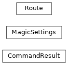
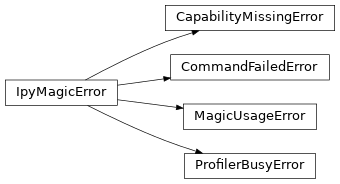

# scikitplot.\_ipymagic[#](#module-scikitplot._ipymagic "Link to this heading")

Notebook frontend of scikit-plots: every `scikitplot` command and a profiler as IPython magics.

Load it in Jupyter, JupyterLab, VS Code, Colab or terminal IPython:

```
%load_ext scikitplot            # or: %load_ext scikitplot._ipymagic

```

| Magic | Does |
| --- | --- |
| `%scikitplot ARGS` | run `scikitplot ARGS`; returns a `CommandResult` |
| `%%scikitplot ARGS` + cell | the same, the cell on standard input |
| `%scikitplot_profile STMT` / | profile code; returns a table |
| `%%scikitplot_profile` + cell | (`ProfileResult`) |
| `%scikitplot_config key=value` | session settings (`MagicSettings`) |

The engine works without IPython, for scripts and agents:

```
>>> import io
>>> from scikitplot._ipymagic import run_command
>>> run_command("info --format json", out=io.StringIO()).data["scikitplot"][
...     "version"
... ] != ""
True

```

Notes

****User notes.**** `%scikitplot` is the command line, in a cell: the same
commands, options, output and exit status as `scikitplot` in a terminal
(`%scikitplot --help`), with `<TAB>` completion, parsed JSON, errors in
two lines instead of a traceback, and nothing left changed in the kernel. A
mistyped command is refused with the closest names; nothing is guessed.

****Developer notes.**** One engine (`_bridge`), one model (the CLI’s
registry), thin magics (`_magics`, the only IPython import). This
package imports nothing until a name is used.

****User guide.**** See the [Notebook magics](../user_guide/_ipymagic/index.html#ipymagic-index) section for further details.

## Notebook magics: extension[#](#notebook-magics-extension "Link to this heading")

|  |  |
| --- | --- |
| `load_ipython_extension` | Register the scikitplot magics (`%load_ext scikitplot._ipymagic`). |
| `unload_ipython_extension` | Remove the magics, stop snakeviz servers, delete temporary profiles. |

## Notebook magics: commands[#](#notebook-magics-commands "Link to this heading")

Class inheritance



|  |  |
| --- | --- |
| `run_command` | Run one `scikitplot` command and return its result. |
| `split_line` | Split a magic's line into arguments the way a POSIX shell would. |
| `route` | Return the command `argv` names, as the CLI would find it. |
| `wants_json` | Return whether `argv` asks for JSON output (`--format json`). |
| `complete` | Return the completions of the last word of a `%scikitplot` line. |
| `Route` | Which command an argument list names, and whether the CLI delegates it. |
| `CommandResult` | The outcome of one `scikitplot` command run from a notebook or Python. |
| `MagicSettings` | Behaviour of the magics for one IPython session. |

## Notebook magics: profiling[#](#notebook-magics-profiling "Link to this heading")

Class inheritance


|  |  |
| --- | --- |
| `profile_code` | Run `code` under `cProfile` and summarise the profile. |
| `profiler_busy_reason` | Return why a profiler cannot be enabled now, or None when it can. |
| `ProfileResult` | A profile of a statement or cell, displayed as a table. |
| `ProfileRow` | One function of a profile. |

## Notebook magics: errors[#](#notebook-magics-errors "Link to this heading")

Class inheritance



|  |  |
| --- | --- |
| `IpyMagicError` | Base class of every error raised by [`scikitplot._ipymagic`](#module-scikitplot._ipymagic "scikitplot._ipymagic"). |
| `MagicUsageError` | The magic was called with arguments it cannot run (nothing was run). |
| `CommandFailedError` | A command exited with a non-zero status (raised only when asked to). |
| `ProfilerBusyError` | Another profiler is active in this process (Rule 133); nothing was run. |
| `CapabilityMissingError` | An optional package the request needs is not installed. |