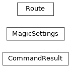
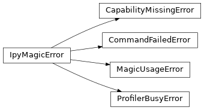

# scikitplot.\_ipymagic[#](#module-scikitplot._ipymagic "Link to this heading")

Notebook frontend of scikit-plots: every `scikitplot` command and a profiler as IPython magics.

Load it in Jupyter, JupyterLab, VS Code, Colab or terminal IPython:

```
%load_ext scikitplot            # or: %load_ext scikitplot._ipymagic

```

| Magic | Does |
| --- | --- |
| `%scikitplot ARGS` | run `scikitplot ARGS`; returns a [`CommandResult`](../modules/generated/scikitplot._ipymagic.CommandResult.html#scikitplot._ipymagic.CommandResult "scikitplot._ipymagic.CommandResult") |
| `%%scikitplot ARGS` + cell | the same, the cell on standard input |
| `%scikitplot_profile STMT` / | profile code; returns a table |
| `%%scikitplot_profile` + cell | ([`ProfileResult`](../modules/generated/scikitplot._ipymagic.ProfileResult.html#scikitplot._ipymagic.ProfileResult "scikitplot._ipymagic.ProfileResult")) |
| `%scikitplot_config key=value` | session settings ([`MagicSettings`](../modules/generated/scikitplot._ipymagic.MagicSettings.html#scikitplot._ipymagic.MagicSettings "scikitplot._ipymagic.MagicSettings")) |

The engine works without IPython, for scripts and agents:

```
>>> import io
>>> from scikitplot._ipymagic import run_command
>>> run_command("info --format json", out=io.StringIO()).data["scikitplot"][
...     "version"
... ] != ""
True

```

Notes

****User notes.**** `%scikitplot` is the command line, in a cell: the same
commands, options, output and exit status as `scikitplot` in a terminal
(`%scikitplot --help`), with `<TAB>` completion, parsed JSON, errors in
two lines instead of a traceback, and nothing left changed in the kernel. A
mistyped command is refused with the closest names; nothing is guessed.

****Developer notes.**** One engine (`_bridge`), one model (the CLI’s
registry), thin magics (`_magics`, the only IPython import). This
package imports nothing until a name is used.

****User guide.**** See the [Notebook magics](../user_guide/_ipymagic/index.html#ipymagic-index) section for further details.

## Notebook magics: extension[#](#notebook-magics-extension "Link to this heading")

|  |  |
| --- | --- |
| [`load_ipython_extension`](../modules/generated/scikitplot._ipymagic.load_ipython_extension.html#scikitplot._ipymagic.load_ipython_extension "scikitplot._ipymagic.load_ipython_extension") | Register the scikitplot magics (`%load_ext scikitplot._ipymagic`). |
| [`unload_ipython_extension`](../modules/generated/scikitplot._ipymagic.unload_ipython_extension.html#scikitplot._ipymagic.unload_ipython_extension "scikitplot._ipymagic.unload_ipython_extension") | Remove the magics, stop snakeviz servers, delete temporary profiles. |

## Notebook magics: commands[#](#notebook-magics-commands "Link to this heading")

Class inheritance




|  |  |
| --- | --- |
| [`run_command`](../modules/generated/scikitplot._ipymagic.run_command.html#scikitplot._ipymagic.run_command "scikitplot._ipymagic.run_command") | Run one `scikitplot` command and return its result. |
| [`split_line`](../modules/generated/scikitplot._ipymagic.split_line.html#scikitplot._ipymagic.split_line "scikitplot._ipymagic.split_line") | Split a magic's line into arguments the way a POSIX shell would. |
| [`route`](../modules/generated/scikitplot._ipymagic.route.html#scikitplot._ipymagic.route "scikitplot._ipymagic.route") | Return the command `argv` names, as the CLI would find it. |
| [`wants_json`](../modules/generated/scikitplot._ipymagic.wants_json.html#scikitplot._ipymagic.wants_json "scikitplot._ipymagic.wants_json") | Return whether `argv` asks for JSON output (`--format json`). |
| [`complete`](../modules/generated/scikitplot._ipymagic.complete.html#scikitplot._ipymagic.complete "scikitplot._ipymagic.complete") | Return the completions of the last word of a `%scikitplot` line. |
| [`Route`](../modules/generated/scikitplot._ipymagic.Route.html#scikitplot._ipymagic.Route "scikitplot._ipymagic.Route") | Which command an argument list names, and whether the CLI delegates it. |
| [`CommandResult`](../modules/generated/scikitplot._ipymagic.CommandResult.html#scikitplot._ipymagic.CommandResult "scikitplot._ipymagic.CommandResult") | The outcome of one `scikitplot` command run from a notebook or Python. |
| [`MagicSettings`](../modules/generated/scikitplot._ipymagic.MagicSettings.html#scikitplot._ipymagic.MagicSettings "scikitplot._ipymagic.MagicSettings") | Behaviour of the magics for one IPython session. |

## Notebook magics: profiling[#](#notebook-magics-profiling "Link to this heading")

Class inheritance


|  |  |
| --- | --- |
| [`profile_code`](../modules/generated/scikitplot._ipymagic.profile_code.html#scikitplot._ipymagic.profile_code "scikitplot._ipymagic.profile_code") | Run `code` under `cProfile` and summarise the profile. |
| [`profiler_busy_reason`](../modules/generated/scikitplot._ipymagic.profiler_busy_reason.html#scikitplot._ipymagic.profiler_busy_reason "scikitplot._ipymagic.profiler_busy_reason") | Return why a profiler cannot be enabled now, or None when it can. |
| [`ProfileResult`](../modules/generated/scikitplot._ipymagic.ProfileResult.html#scikitplot._ipymagic.ProfileResult "scikitplot._ipymagic.ProfileResult") | A profile of a statement or cell, displayed as a table. |
| [`ProfileRow`](../modules/generated/scikitplot._ipymagic.ProfileRow.html#scikitplot._ipymagic.ProfileRow "scikitplot._ipymagic.ProfileRow") | One function of a profile. |

## Notebook magics: errors[#](#notebook-magics-errors "Link to this heading")

Class inheritance




|  |  |
| --- | --- |
| [`IpyMagicError`](../modules/generated/scikitplot._ipymagic.IpyMagicError.html#scikitplot._ipymagic.IpyMagicError "scikitplot._ipymagic.IpyMagicError") | Base class of every error raised by [`scikitplot._ipymagic`](#module-scikitplot._ipymagic "scikitplot._ipymagic"). |
| [`MagicUsageError`](../modules/generated/scikitplot._ipymagic.MagicUsageError.html#scikitplot._ipymagic.MagicUsageError "scikitplot._ipymagic.MagicUsageError") | The magic was called with arguments it cannot run (nothing was run). |
| [`CommandFailedError`](../modules/generated/scikitplot._ipymagic.CommandFailedError.html#scikitplot._ipymagic.CommandFailedError "scikitplot._ipymagic.CommandFailedError") | A command exited with a non-zero status (raised only when asked to). |
| [`ProfilerBusyError`](../modules/generated/scikitplot._ipymagic.ProfilerBusyError.html#scikitplot._ipymagic.ProfilerBusyError "scikitplot._ipymagic.ProfilerBusyError") | Another profiler is active in this process (Rule 133); nothing was run. |
| [`CapabilityMissingError`](../modules/generated/scikitplot._ipymagic.CapabilityMissingError.html#scikitplot._ipymagic.CapabilityMissingError "scikitplot._ipymagic.CapabilityMissingError") | An optional package the request needs is not installed. |