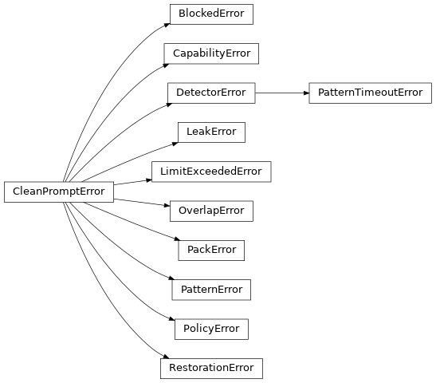

# scikitplot.cleanprompt[#](#module-scikitplot.cleanprompt "Link to this heading")

Redact sensitive values from a prompt, then restore them from the reply.

`scikitplot.cleanprompt` replaces personal data in a text with stable
placeholders before that text is sent to a language model, and puts the values
back afterwards. The base tier is pure standard library.

Notes

****User notes.****

```
from scikitplot.cleanprompt import Redactor, restore

redactor = Redactor()
result = redactor.redact(
    "Mail ada@example.com about the Acme deal", extra_terms=["Acme"]
)
result.text
# 'Mail [EMAIL-1] about the [CUSTOM-1] deal'

# ... send result.text to a model, get a reply ...
restore(reply, result.vault).text

```

`result.text` is safe to transmit. `result.vault` is not: it holds the
values that were removed. Keep it on this machine and call `vault.clear()`
when you are finished.

The optional tiers add named-entity detection, a local web interface, and
authenticated vault encryption. [`capabilities`](../modules/generated/scikitplot.cleanprompt.capabilities.html#scikitplot.cleanprompt.capabilities "scikitplot.cleanprompt.capabilities") reports which are usable:

```
python -m scikitplot.cleanprompt capabilities

```

****Developer notes — the import contract.****

Importing this module imports ****no third-party package****. Not `spacy`, not
`flask`, not `cryptography`, not `numpy`. This submodule can therefore be
added to `scikitplot` without changing the import cost or the failure surface
of any other submodule, and without any other submodule needing to know it
exists. It imports no sibling `scikitplot` package either.

Optional-tier names are resolved lazily through [****PEP 562****](https://peps.python.org/pep-0562/):

* `__all__` lists ****base-tier names only****. `__all__` **is** the
  star-import surface, and `from … import *` resolves every entry; listing an
  optional name there would defeat the lazy tier at exactly the one operation
  that touches all of them. The optional names remain reachable by attribute
  access, which is how a consumer of that tier reaches them anyway.
* `__getattr__` imports the owning module on first access, and raises
  [`CapabilityError`](../modules/generated/scikitplot.cleanprompt.CapabilityError.html#scikitplot.cleanprompt.CapabilityError "scikitplot.cleanprompt.CapabilityError") with an install command when the tier is
  unavailable — raised **before** the missing dependency is imported, so the
  message is actually reachable.
* `__dir__` unions the module globals with the optional names ****as
  strings**** and never resolves them, so tab completion, Sphinx and `hasattr`
  stay base-safe.

`import scikitplot.cleanprompt`, `dir(scikitplot.cleanprompt)` and
`from scikitplot.cleanprompt import *` all succeed on a base installation.
Each is a checked-in regression test, not a claim.

> **See also**
> `scikitplot.cleanprompt._engine`
:   The pipeline.

`scikitplot.cleanprompt._policy`
:   Declarative configuration.

`scikitplot.cleanprompt._patterns`
:   The curated pattern library.
:   !! processed by numpydoc !!

****User guide.**** See the [CleanPrompt User Guide](../user_guide/cleanprompt/index.html#cleanprompt-index) section for further details.

## API Encode Prompt[#](#api-encode-prompt "Link to this heading")

|  |  |
| --- | --- |
| [`EncodedPrompt`](../modules/generated/scikitplot.cleanprompt.EncodedPrompt.html#scikitplot.cleanprompt.EncodedPrompt "scikitplot.cleanprompt.EncodedPrompt") | The result of [`encode`](../modules/generated/scikitplot.cleanprompt.encode.html#scikitplot.cleanprompt.encode "scikitplot.cleanprompt.encode"): a safe text and the handle to undo it. |
| [`Handle`](../modules/generated/scikitplot.cleanprompt.Handle.html#scikitplot.cleanprompt.Handle "scikitplot.cleanprompt.Handle") | Everything needed to decode a reply. |
| [`Session`](../modules/generated/scikitplot.cleanprompt.Session.html#scikitplot.cleanprompt.Session "scikitplot.cleanprompt.Session") | A conversation: consistent placeholders, and a vault with a lifetime. |
| [`decode`](../modules/generated/scikitplot.cleanprompt.decode.html#scikitplot.cleanprompt.decode "scikitplot.cleanprompt.decode") | Put the original values back into a model's reply. |
| [`encode`](../modules/generated/scikitplot.cleanprompt.encode.html#scikitplot.cleanprompt.encode "scikitplot.cleanprompt.encode") | Replace sensitive values in `text` with placeholders. |
| [`session`](../modules/generated/scikitplot.cleanprompt.session-func.html#scikitplot.cleanprompt.session "scikitplot.cleanprompt.session") | Open a [`Session`](../modules/generated/scikitplot.cleanprompt.Session.html#scikitplot.cleanprompt.Session "scikitplot.cleanprompt.Session"). |

## APP Session Store[#](#app-session-store "Link to this heading")

|  |  |
| --- | --- |
| [`SessionStore`](../modules/generated/scikitplot.cleanprompt.SessionStore.html#scikitplot.cleanprompt.SessionStore "scikitplot.cleanprompt.SessionStore") | Bounded, expiring, server-side store of vaults. |
| [`create_app`](../modules/generated/scikitplot.cleanprompt.create_app.html#scikitplot.cleanprompt.create_app "scikitplot.cleanprompt.create_app") | Build the Flask application. |

## Capability[#](#capability "Link to this heading")

|  |  |
| --- | --- |
| [`TIERS`](../modules/generated/scikitplot.cleanprompt.TIERS.html#scikitplot.cleanprompt.TIERS "scikitplot.cleanprompt.TIERS") |  |
| [`CapabilityReport`](../modules/generated/scikitplot.cleanprompt.CapabilityReport.html#scikitplot.cleanprompt.CapabilityReport "scikitplot.cleanprompt.CapabilityReport") | Outcome of probing one tier. |
| [`CapabilityStatus`](../modules/generated/scikitplot.cleanprompt.CapabilityStatus.html#scikitplot.cleanprompt.CapabilityStatus "scikitplot.cleanprompt.CapabilityStatus") | Seven-state usability vocabulary for an optional dependency tier. |
| [`capabilities`](../modules/generated/scikitplot.cleanprompt.capabilities.html#scikitplot.cleanprompt.capabilities "scikitplot.cleanprompt.capabilities") | Probe every optional tier. |
| [`probe`](../modules/generated/scikitplot.cleanprompt.probe.html#scikitplot.cleanprompt.probe "scikitplot.cleanprompt.probe") | Report whether one optional tier is usable. |
| [`require`](../modules/generated/scikitplot.cleanprompt.require.html#scikitplot.cleanprompt.require "scikitplot.cleanprompt.require") | Return the report for `tier`, raising when it is not usable. |

## Custom Domain and Point[#](#custom-domain-and-point "Link to this heading")

|  |  |
| --- | --- |
| [`load_custom`](../modules/generated/scikitplot.cleanprompt.load_custom.html#scikitplot.cleanprompt.load_custom "scikitplot.cleanprompt.load_custom") | Load user definitions from one or more files into a catalog of their own. |
| [`with_custom`](../modules/generated/scikitplot.cleanprompt.with_custom.html#scikitplot.cleanprompt.with_custom "scikitplot.cleanprompt.with_custom") | Return the built-in catalog with custom definitions merged in. |

## Detector Registry[#](#detector-registry "Link to this heading")

|  |  |
| --- | --- |
| [`Detector`](../modules/generated/scikitplot.cleanprompt.Detector.html#scikitplot.cleanprompt.Detector "scikitplot.cleanprompt.Detector") | Base class for detectors. |
| [`DetectorRegistry`](../modules/generated/scikitplot.cleanprompt.DetectorRegistry.html#scikitplot.cleanprompt.DetectorRegistry "scikitplot.cleanprompt.DetectorRegistry") | An ordered, immutable-by-convention collection of detectors. |
| [`LiteralDetector`](../modules/generated/scikitplot.cleanprompt.LiteralDetector.html#scikitplot.cleanprompt.LiteralDetector "scikitplot.cleanprompt.LiteralDetector") | Detector for exact strings the caller names. |
| [`RegexDetector`](../modules/generated/scikitplot.cleanprompt.RegexDetector.html#scikitplot.cleanprompt.RegexDetector "scikitplot.cleanprompt.RegexDetector") | Detector backed by one entry of the pattern library. |
| [`default_registry`](../modules/generated/scikitplot.cleanprompt.default_registry.html#scikitplot.cleanprompt.default_registry "scikitplot.cleanprompt.default_registry") | Build a registry from the pattern library, plus optional literal terms. |

## Diagnosis[#](#diagnosis "Link to this heading")

|  |  |
| --- | --- |
| [`BlindSpot`](../modules/generated/scikitplot.cleanprompt.BlindSpot.html#scikitplot.cleanprompt.BlindSpot "scikitplot.cleanprompt.BlindSpot") | A category of sensitive information nothing currently detects. |
| [`Diagnosis`](../modules/generated/scikitplot.cleanprompt.Diagnosis.html#scikitplot.cleanprompt.Diagnosis "scikitplot.cleanprompt.Diagnosis") | What a given configuration can and cannot detect. |
| [`Suggestion`](../modules/generated/scikitplot.cleanprompt.Suggestion.html#scikitplot.cleanprompt.Suggestion "scikitplot.cleanprompt.Suggestion") | A candidate the active detectors did not claim. |
| [`describe_outcome`](../modules/generated/scikitplot.cleanprompt.describe_outcome.html#scikitplot.cleanprompt.describe_outcome "scikitplot.cleanprompt.describe_outcome") | Explain a redaction outcome, especially an empty one. |
| [`diagnose`](../modules/generated/scikitplot.cleanprompt.diagnose.html#scikitplot.cleanprompt.diagnose "scikitplot.cleanprompt.diagnose") | Report what a configuration can and cannot detect. |
| [`suggest_terms`](../modules/generated/scikitplot.cleanprompt.suggest_terms.html#scikitplot.cleanprompt.suggest_terms "scikitplot.cleanprompt.suggest_terms") | Offer candidate terms the active detectors did not claim. |
| [`CoverageRow`](../modules/generated/scikitplot.cleanprompt.CoverageRow.html#scikitplot.cleanprompt.CoverageRow "scikitplot.cleanprompt.CoverageRow") | What covers one detection kind, and what happens to its values. |
| [`coverage_matrix`](../modules/generated/scikitplot.cleanprompt.coverage_matrix.html#scikitplot.cleanprompt.coverage_matrix "scikitplot.cleanprompt.coverage_matrix") | Return one row per detection kind, derived from the live registries. |

## Redactor[#](#redactor "Link to this heading")

|  |  |
| --- | --- |
| [`Redactor`](../modules/generated/scikitplot.cleanprompt.Redactor.html#scikitplot.cleanprompt.Redactor "scikitplot.cleanprompt.Redactor") | Reusable, stateless redactor. |
| [`reserved_label_spans`](../modules/generated/scikitplot.cleanprompt.reserved_label_spans.html#scikitplot.cleanprompt.reserved_label_spans "scikitplot.cleanprompt.reserved_label_spans") | Find substrings of `text` that already match the placeholder grammar. |
| [`resolve_spans`](../modules/generated/scikitplot.cleanprompt.resolve_spans.html#scikitplot.cleanprompt.resolve_spans "scikitplot.cleanprompt.resolve_spans") | Reduce possibly overlapping spans to a disjoint, ascending sequence. |
| [`restore`](../modules/generated/scikitplot.cleanprompt.restore.html#scikitplot.cleanprompt.restore "scikitplot.cleanprompt.restore") | Replace placeholders in `text` with the values held in `vault`. |

## Engines Named-entity[#](#engines-named-entity "Link to this heading")

|  |  |
| --- | --- |
| [`CANONICAL_LABELS`](../modules/generated/scikitplot.cleanprompt.CANONICAL_LABELS.html#scikitplot.cleanprompt.CANONICAL_LABELS "scikitplot.cleanprompt.CANONICAL_LABELS") | Built-in immutable sequence. |
| [`DEFAULT_ENGINE`](../modules/generated/scikitplot.cleanprompt.DEFAULT_ENGINE.html#scikitplot.cleanprompt.DEFAULT_ENGINE "scikitplot.cleanprompt.DEFAULT_ENGINE") | str(object='') -> str str(bytes\_or\_buffer[, encoding[, errors]]) -> str |
| [`ENGINES`](../modules/generated/scikitplot.cleanprompt.ENGINES.html#scikitplot.cleanprompt.ENGINES "scikitplot.cleanprompt.ENGINES") |  |
| [`ENGINE_MODES`](../modules/generated/scikitplot.cleanprompt.ENGINE_MODES.html#scikitplot.cleanprompt.ENGINE_MODES "scikitplot.cleanprompt.ENGINE_MODES") | Built-in immutable sequence. |
| [`EngineSpec`](../modules/generated/scikitplot.cleanprompt.EngineSpec.html#scikitplot.cleanprompt.EngineSpec "scikitplot.cleanprompt.EngineSpec") | Static description of one named-entity engine. |
| [`build_detectors`](../modules/generated/scikitplot.cleanprompt.build_detectors.html#scikitplot.cleanprompt.build_detectors "scikitplot.cleanprompt.build_detectors") | Construct the detectors for an engine mode. |
| [`canonical_label`](../modules/generated/scikitplot.cleanprompt.canonical_label.html#scikitplot.cleanprompt.canonical_label "scikitplot.cleanprompt.canonical_label") | Map an engine's entity label onto the canonical vocabulary. |
| [`describe_engines`](../modules/generated/scikitplot.cleanprompt.describe_engines.html#scikitplot.cleanprompt.describe_engines "scikitplot.cleanprompt.describe_engines") | Report every engine's readiness, and what `mode` would select. |
| [`resolve_engine`](../modules/generated/scikitplot.cleanprompt.resolve_engine.html#scikitplot.cleanprompt.resolve_engine "scikitplot.cleanprompt.resolve_engine") | Resolve an engine mode into the engines that will actually run. |
| [`trim_entity_span`](../modules/generated/scikitplot.cleanprompt.trim_entity_span.html#scikitplot.cleanprompt.trim_entity_span "scikitplot.cleanprompt.trim_entity_span") | Shrink an entity span until it carries no unmatched bracket. |
| [`EngineReadiness`](../modules/generated/scikitplot.cleanprompt.EngineReadiness.html#scikitplot.cleanprompt.EngineReadiness "scikitplot.cleanprompt.EngineReadiness") | Whether one engine can run here, now, and if not, the one step that fixes it. |
| [`engine_readiness`](../modules/generated/scikitplot.cleanprompt.engine_readiness.html#scikitplot.cleanprompt.engine_readiness "scikitplot.cleanprompt.engine_readiness") | Decide whether one engine can run for a language, and how to fix it if not. |

## Format Spec[#](#format-spec "Link to this heading")

|  |  |
| --- | --- |
| [`FormatSpec`](../modules/generated/scikitplot.cleanprompt.FormatSpec.html#scikitplot.cleanprompt.FormatSpec "scikitplot.cleanprompt.FormatSpec") | One validated file format. |

## Guard Spec[#](#guard-spec "Link to this heading")

|  |  |
| --- | --- |
| [`Guard`](../modules/generated/scikitplot.cleanprompt.Guard.html#scikitplot.cleanprompt.Guard "scikitplot.cleanprompt.Guard") | Encode what goes to a model, check it, and decode what comes back. |
| [`StreamDecoder`](../modules/generated/scikitplot.cleanprompt.StreamDecoder.html#scikitplot.cleanprompt.StreamDecoder "scikitplot.cleanprompt.StreamDecoder") | Decode a model's reply as it streams in, never splitting a label. |

## Language Spec[#](#language-spec "Link to this heading")

|  |  |
| --- | --- |
| [`DEFAULT_LANGUAGE`](../modules/generated/scikitplot.cleanprompt.DEFAULT_LANGUAGE.html#scikitplot.cleanprompt.DEFAULT_LANGUAGE "scikitplot.cleanprompt.DEFAULT_LANGUAGE") | str(object='') -> str str(bytes\_or\_buffer[, encoding[, errors]]) -> str |
| [`LANGUAGES`](../modules/generated/scikitplot.cleanprompt.LANGUAGES.html#scikitplot.cleanprompt.LANGUAGES "scikitplot.cleanprompt.LANGUAGES") |  |
| [`MODEL_SIZES`](../modules/generated/scikitplot.cleanprompt.MODEL_SIZES.html#scikitplot.cleanprompt.MODEL_SIZES "scikitplot.cleanprompt.MODEL_SIZES") | Built-in immutable sequence. |
| [`MULTILINGUAL_MODEL`](../modules/generated/scikitplot.cleanprompt.MULTILINGUAL_MODEL.html#scikitplot.cleanprompt.MULTILINGUAL_MODEL "scikitplot.cleanprompt.MULTILINGUAL_MODEL") | str(object='') -> str str(bytes\_or\_buffer[, encoding[, errors]]) -> str |
| [`LanguageSpec`](../modules/generated/scikitplot.cleanprompt.LanguageSpec.html#scikitplot.cleanprompt.LanguageSpec "scikitplot.cleanprompt.LanguageSpec") | One language spaCy publishes models for. |
| [`installed_models`](../modules/generated/scikitplot.cleanprompt.installed_models.html#scikitplot.cleanprompt.installed_models "scikitplot.cleanprompt.installed_models") | Return the spaCy models installed here, mapped to their versions. |
| [`resolve_model`](../modules/generated/scikitplot.cleanprompt.resolve_model.html#scikitplot.cleanprompt.resolve_model "scikitplot.cleanprompt.resolve_model") | Resolve a language and size into a spaCy model name. |
| [`supported_languages`](../modules/generated/scikitplot.cleanprompt.supported_languages.html#scikitplot.cleanprompt.supported_languages "scikitplot.cleanprompt.supported_languages") | Return every language code with a dedicated model. |

## Mcp Server[#](#mcp-server "Link to this heading")

|  |  |
| --- | --- |
| [`McpServer`](../modules/generated/scikitplot.cleanprompt.McpServer.html#scikitplot.cleanprompt.McpServer "scikitplot.cleanprompt.McpServer") | Answer MCP requests with cleanprompt tools. |

## Ner Detector[#](#ner-detector "Link to this heading")

|  |  |
| --- | --- |
| [`DEFAULT_ENTITY_LABELS`](../modules/generated/scikitplot.cleanprompt.DEFAULT_ENTITY_LABELS.html#scikitplot.cleanprompt.DEFAULT_ENTITY_LABELS "scikitplot.cleanprompt.DEFAULT_ENTITY_LABELS") | frozenset() -> empty frozenset object frozenset(iterable) -> frozenset object |
| [`DEFAULT_MODEL`](../modules/generated/scikitplot.cleanprompt.DEFAULT_MODEL.html#scikitplot.cleanprompt.DEFAULT_MODEL "scikitplot.cleanprompt.DEFAULT_MODEL") | str(object='') -> str str(bytes\_or\_buffer[, encoding[, errors]]) -> str |
| [`NerDetector`](../modules/generated/scikitplot.cleanprompt.NerDetector.html#scikitplot.cleanprompt.NerDetector "scikitplot.cleanprompt.NerDetector") | Detect named entities with a spaCy pipeline. |
| [`spacy_detector`](../modules/generated/scikitplot.cleanprompt.spacy_detector.html#scikitplot.cleanprompt.spacy_detector "scikitplot.cleanprompt.spacy_detector") | Build a [`NerDetector`](../modules/generated/scikitplot.cleanprompt.NerDetector.html#scikitplot.cleanprompt.NerDetector "scikitplot.cleanprompt.NerDetector"). |

## Nltk Detector[#](#nltk-detector "Link to this heading")

|  |  |
| --- | --- |
| [`NltkDetector`](../modules/generated/scikitplot.cleanprompt.NltkDetector.html#scikitplot.cleanprompt.NltkDetector "scikitplot.cleanprompt.NltkDetector") | Detect named entities with NLTK's maximum-entropy chunker. |
| [`nltk_detector`](../modules/generated/scikitplot.cleanprompt.nltk_detector.html#scikitplot.cleanprompt.nltk_detector "scikitplot.cleanprompt.nltk_detector") | Build an [`NltkDetector`](../modules/generated/scikitplot.cleanprompt.NltkDetector.html#scikitplot.cleanprompt.NltkDetector "scikitplot.cleanprompt.NltkDetector"). |
| [`corpora_status`](../modules/generated/scikitplot.cleanprompt.corpora_status.html#scikitplot.cleanprompt.corpora_status "scikitplot.cleanprompt.corpora_status") | Report whether NLTK's data packages are present. |

## Pack Pattern Detector[#](#pack-pattern-detector "Link to this heading")

|  |  |
| --- | --- |
| [`FieldSpec`](../modules/generated/scikitplot.cleanprompt.FieldSpec.html#scikitplot.cleanprompt.FieldSpec "scikitplot.cleanprompt.FieldSpec") | A field whose value is sensitive wherever it appears in a record. |
| [`PackError`](../modules/generated/scikitplot.cleanprompt.PackError.html#scikitplot.cleanprompt.PackError "scikitplot.cleanprompt.PackError") | A pack document is invalid. |
| [`PackSpec`](../modules/generated/scikitplot.cleanprompt.PackSpec.html#scikitplot.cleanprompt.PackSpec "scikitplot.cleanprompt.PackSpec") | One validated pack. |

## Pattern Spec[#](#pattern-spec "Link to this heading")

|  |  |
| --- | --- |
| [`PATTERNS`](../modules/generated/scikitplot.cleanprompt.PATTERNS.html#scikitplot.cleanprompt.PATTERNS "scikitplot.cleanprompt.PATTERNS") |  |
| [`PatternSpec`](../modules/generated/scikitplot.cleanprompt.PatternSpec.html#scikitplot.cleanprompt.PatternSpec "scikitplot.cleanprompt.PatternSpec") | One named structural pattern. |
| [`default_patterns`](../modules/generated/scikitplot.cleanprompt.default_patterns.html#scikitplot.cleanprompt.default_patterns "scikitplot.cleanprompt.default_patterns") | Return the patterns enabled when a policy does not name `kinds`. |
| [`get_pattern`](../modules/generated/scikitplot.cleanprompt.get_pattern.html#scikitplot.cleanprompt.get_pattern "scikitplot.cleanprompt.get_pattern") | Return one pattern specification by kind. |
| [`luhn_ok`](../modules/generated/scikitplot.cleanprompt.luhn_ok.html#scikitplot.cleanprompt.luhn_ok "scikitplot.cleanprompt.luhn_ok") | Return whether `digits` satisfies the Luhn checksum. |
| [`PatternRiskWarning`](../modules/generated/scikitplot.cleanprompt.PatternRiskWarning.html#scikitplot.cleanprompt.PatternRiskWarning "scikitplot.cleanprompt.PatternRiskWarning") | A pack pattern has a shape that can backtrack catastrophically. |
| [`analyse_pattern`](../modules/generated/scikitplot.cleanprompt.analyse_pattern.html#scikitplot.cleanprompt.analyse_pattern "scikitplot.cleanprompt.analyse_pattern") | Report the shapes in `source` that can backtrack catastrophically. |

## Plan Spec[#](#plan-spec "Link to this heading")

|  |  |
| --- | --- |
| [`CleanPlan`](../modules/generated/scikitplot.cleanprompt.CleanPlan.html#scikitplot.cleanprompt.CleanPlan "scikitplot.cleanprompt.CleanPlan") | Everything a cleaner needs to know, and nothing it discovers. |
| [`FluentCleanPrompt`](../modules/generated/scikitplot.cleanprompt.FluentCleanPrompt.html#scikitplot.cleanprompt.FluentCleanPrompt "scikitplot.cleanprompt.FluentCleanPrompt") | Build a [`CleanPlan`](../modules/generated/scikitplot.cleanprompt.CleanPlan.html#scikitplot.cleanprompt.CleanPlan "scikitplot.cleanprompt.CleanPlan") one decision at a time. |

## Policy Spec[#](#policy-spec "Link to this heading")

|  |  |
| --- | --- |
| [`DEFAULT_LIMITS`](../modules/generated/scikitplot.cleanprompt.DEFAULT_LIMITS.html#scikitplot.cleanprompt.DEFAULT_LIMITS "scikitplot.cleanprompt.DEFAULT_LIMITS") | Hard bounds on one redaction pass. |
| [`DEFAULT_POLICY`](../modules/generated/scikitplot.cleanprompt.DEFAULT_POLICY.html#scikitplot.cleanprompt.DEFAULT_POLICY "scikitplot.cleanprompt.DEFAULT_POLICY") | Complete, declarative configuration for a redaction pass. |
| [`DEFAULT_TAG_STYLE`](../modules/generated/scikitplot.cleanprompt.DEFAULT_TAG_STYLE.html#scikitplot.cleanprompt.DEFAULT_TAG_STYLE "scikitplot.cleanprompt.DEFAULT_TAG_STYLE") | The placeholder grammar. |
| [`ACTIONS`](../modules/generated/scikitplot.cleanprompt.ACTIONS.html#scikitplot.cleanprompt.ACTIONS "scikitplot.cleanprompt.ACTIONS") | Built-in immutable sequence. |
| [`Action`](../modules/generated/scikitplot.cleanprompt.Action.html#scikitplot.cleanprompt.Action "scikitplot.cleanprompt.Action") | What happens to a value of one kind once it is detected. |
| [`Limits`](../modules/generated/scikitplot.cleanprompt.Limits.html#scikitplot.cleanprompt.Limits "scikitplot.cleanprompt.Limits") | Hard bounds on one redaction pass. |
| [`OverlapStrategy`](../modules/generated/scikitplot.cleanprompt.OverlapStrategy.html#scikitplot.cleanprompt.OverlapStrategy "scikitplot.cleanprompt.OverlapStrategy") | How to arbitrate two detections that share characters. |
| [`RedactionPolicy`](../modules/generated/scikitplot.cleanprompt.RedactionPolicy.html#scikitplot.cleanprompt.RedactionPolicy "scikitplot.cleanprompt.RedactionPolicy") | Complete, declarative configuration for a redaction pass. |
| [`TagStyle`](../modules/generated/scikitplot.cleanprompt.TagStyle.html#scikitplot.cleanprompt.TagStyle "scikitplot.cleanprompt.TagStyle") | The placeholder grammar. |

## Render Helper[#](#render-helper "Link to this heading")

|  |  |
| --- | --- |
| [`ANSI`](../modules/generated/scikitplot.cleanprompt.ANSI.html#scikitplot.cleanprompt.ANSI "scikitplot.cleanprompt.ANSI") | Terminal escape sequences used by [`highlight_placeholders`](../modules/generated/scikitplot.cleanprompt.highlight_placeholders.html#scikitplot.cleanprompt.highlight_placeholders "scikitplot.cleanprompt.highlight_placeholders"). |
| [`highlight_placeholders`](../modules/generated/scikitplot.cleanprompt.highlight_placeholders.html#scikitplot.cleanprompt.highlight_placeholders "scikitplot.cleanprompt.highlight_placeholders") | Return a copy of `text` with placeholders wrapped in colour. |
| [`restoration_note`](../modules/generated/scikitplot.cleanprompt.restoration_note.html#scikitplot.cleanprompt.restoration_note "scikitplot.cleanprompt.restoration_note") | Return a one-line, secret-free description of a restoration. |
| [`should_colorize`](../modules/generated/scikitplot.cleanprompt.should_colorize.html#scikitplot.cleanprompt.should_colorize "scikitplot.cleanprompt.should_colorize") | Decide whether to emit terminal colour. |
| [`summary_table`](../modules/generated/scikitplot.cleanprompt.summary_table.html#scikitplot.cleanprompt.summary_table "scikitplot.cleanprompt.summary_table") | Render a table of what was redacted. |

## Runtime Helper[#](#runtime-helper "Link to this heading")

|  |  |
| --- | --- |
| [`Cleaner`](../modules/generated/scikitplot.cleanprompt.Cleaner.html#scikitplot.cleanprompt.Cleaner "scikitplot.cleanprompt.Cleaner") | Apply one validated plan to text, files, folders and archives. |
| [`Encoded`](../modules/generated/scikitplot.cleanprompt.Encoded.html#scikitplot.cleanprompt.Encoded "scikitplot.cleanprompt.Encoded") | One encoded input: safe text and a report. |
| [`Item`](../modules/generated/scikitplot.cleanprompt.Item.html#scikitplot.cleanprompt.Item "scikitplot.cleanprompt.Item") | What happened to one file of a folder or archive. |

## Vault[#](#vault "Link to this heading")

|  |  |
| --- | --- |
| [`Vault`](../modules/generated/scikitplot.cleanprompt.Vault.html#scikitplot.cleanprompt.Vault "scikitplot.cleanprompt.Vault") | A closed mapping from placeholder label to original secret. |

## Vault Encryption[#](#vault-encryption "Link to this heading")

|  |  |
| --- | --- |
| [`decrypt_mapping`](../modules/generated/scikitplot.cleanprompt.decrypt_mapping.html#scikitplot.cleanprompt.decrypt_mapping "scikitplot.cleanprompt.decrypt_mapping") | Decrypt a mapping produced by [`encrypt_mapping`](../modules/generated/scikitplot.cleanprompt.encrypt_mapping.html#scikitplot.cleanprompt.encrypt_mapping "scikitplot.cleanprompt.encrypt_mapping"). |
| [`encrypt_mapping`](../modules/generated/scikitplot.cleanprompt.encrypt_mapping.html#scikitplot.cleanprompt.encrypt_mapping "scikitplot.cleanprompt.encrypt_mapping") | Encrypt every value of `mapping`, leaving the labels in the clear. |
| [`new_key`](../modules/generated/scikitplot.cleanprompt.new_key.html#scikitplot.cleanprompt.new_key "scikitplot.cleanprompt.new_key") | Generate a fresh vault key. |

## Results and Types[#](#results-and-types "Link to this heading")

|  |  |
| --- | --- |
| [`Entry`](../modules/generated/scikitplot.cleanprompt.Entry.html#scikitplot.cleanprompt.Entry "scikitplot.cleanprompt.Entry") | One resolved detection and the placeholder label assigned to it. |
| [`RedactionResult`](../modules/generated/scikitplot.cleanprompt.RedactionResult.html#scikitplot.cleanprompt.RedactionResult "scikitplot.cleanprompt.RedactionResult") | Output of a redaction pass. |
| [`RestorationResult`](../modules/generated/scikitplot.cleanprompt.RestorationResult.html#scikitplot.cleanprompt.RestorationResult "scikitplot.cleanprompt.RestorationResult") | Output of a restoration pass. |
| [`Span`](../modules/generated/scikitplot.cleanprompt.Span.html#scikitplot.cleanprompt.Span "scikitplot.cleanprompt.Span") | A half-open `[start, end)` character interval flagged by one detector. |
| [`Stats`](../modules/generated/scikitplot.cleanprompt.Stats.html#scikitplot.cleanprompt.Stats "scikitplot.cleanprompt.Stats") | Counters describing one redaction pass. |
| [`as_dict`](../modules/generated/scikitplot.cleanprompt.as_dict.html#scikitplot.cleanprompt.as_dict "scikitplot.cleanprompt.as_dict") | Return a JSON-safe, secret-free dictionary for a result object. |

## Errors and Warnings[#](#errors-and-warnings "Link to this heading")

Class inheritance




|  |  |
| --- | --- |
| [`CleanPromptError`](../modules/generated/scikitplot.cleanprompt.CleanPromptError.html#scikitplot.cleanprompt.CleanPromptError "scikitplot.cleanprompt.CleanPromptError") | Base class for every error raised by [`scikitplot.cleanprompt`](#module-scikitplot.cleanprompt "scikitplot.cleanprompt"). |
| [`BlockedError`](../modules/generated/scikitplot.cleanprompt.BlockedError.html#scikitplot.cleanprompt.BlockedError "scikitplot.cleanprompt.BlockedError") | The text holds a value of a kind whose action is `block`; nothing was returned. |
| [`CapabilityError`](../modules/generated/scikitplot.cleanprompt.CapabilityError.html#scikitplot.cleanprompt.CapabilityError "scikitplot.cleanprompt.CapabilityError") | An optional tier is not usable in this environment. |
| [`DetectorError`](../modules/generated/scikitplot.cleanprompt.DetectorError.html#scikitplot.cleanprompt.DetectorError "scikitplot.cleanprompt.DetectorError") | A detector raised while scanning. |
| [`LeakError`](../modules/generated/scikitplot.cleanprompt.LeakError.html#scikitplot.cleanprompt.LeakError "scikitplot.cleanprompt.LeakError") | Outgoing text still holds a value the vault removed; it was not sent. |
| [`LimitExceededError`](../modules/generated/scikitplot.cleanprompt.LimitExceededError.html#scikitplot.cleanprompt.LimitExceededError "scikitplot.cleanprompt.LimitExceededError") | A policy limit was exceeded. |
| [`OverlapError`](../modules/generated/scikitplot.cleanprompt.OverlapError.html#scikitplot.cleanprompt.OverlapError "scikitplot.cleanprompt.OverlapError") | Two detections overlap under `STRICT`. |
| [`PatternError`](../modules/generated/scikitplot.cleanprompt.PatternError.html#scikitplot.cleanprompt.PatternError "scikitplot.cleanprompt.PatternError") | A detection pattern is uncompilable or structurally unsafe. |
| [`PatternTimeoutError`](../modules/generated/scikitplot.cleanprompt.PatternTimeoutError.html#scikitplot.cleanprompt.PatternTimeoutError "scikitplot.cleanprompt.PatternTimeoutError") | A custom pack pattern ran past the pattern time limit on one document. |
| [`PolicyError`](../modules/generated/scikitplot.cleanprompt.PolicyError.html#scikitplot.cleanprompt.PolicyError "scikitplot.cleanprompt.PolicyError") | A [`RedactionPolicy`](../modules/generated/scikitplot.cleanprompt.RedactionPolicy.html#scikitplot.cleanprompt.RedactionPolicy "scikitplot.cleanprompt._policy.RedactionPolicy") is invalid. |
| [`RestorationError`](../modules/generated/scikitplot.cleanprompt.RestorationError.html#scikitplot.cleanprompt.RestorationError "scikitplot.cleanprompt.RestorationError") | A placeholder in the text cannot be restored from the supplied vault. |

## Logging and Audit[#](#logging-and-audit "Link to this heading")

|  |  |
| --- | --- |
| [`AUDIT_LOGGER_NAME`](../modules/generated/scikitplot.cleanprompt.AUDIT_LOGGER_NAME.html#scikitplot.cleanprompt.AUDIT_LOGGER_NAME "scikitplot.cleanprompt.AUDIT_LOGGER_NAME") | str(object='') -> str str(bytes\_or\_buffer[, encoding[, errors]]) -> str |
| [`LOGGER_NAME`](../modules/generated/scikitplot.cleanprompt.LOGGER_NAME.html#scikitplot.cleanprompt.LOGGER_NAME "scikitplot.cleanprompt.LOGGER_NAME") | str(object='') -> str str(bytes\_or\_buffer[, encoding[, errors]]) -> str |
| [`JsonFormatter`](../modules/generated/scikitplot.cleanprompt.JsonFormatter.html#scikitplot.cleanprompt.JsonFormatter "scikitplot.cleanprompt.JsonFormatter") | Format a record as one JSON object per line. |
| [`SecretFilter`](../modules/generated/scikitplot.cleanprompt.SecretFilter.html#scikitplot.cleanprompt.SecretFilter "scikitplot.cleanprompt.SecretFilter") | Replace known secret surfaces in a record with `REDACTION_MARK`. |
| [`VaultScrubber`](../modules/generated/scikitplot.cleanprompt.VaultScrubber.html#scikitplot.cleanprompt.VaultScrubber "scikitplot.cleanprompt.VaultScrubber") | Keep a vault's values out of every log record for as long as it holds them. |
| [`audit`](../modules/generated/scikitplot.cleanprompt.audit.html#scikitplot.cleanprompt.audit "scikitplot.cleanprompt.audit") | Emit one structured audit event on [`AUDIT_LOGGER_NAME`](../modules/generated/scikitplot.cleanprompt.AUDIT_LOGGER_NAME.html#scikitplot.cleanprompt.AUDIT_LOGGER_NAME "scikitplot.cleanprompt.AUDIT_LOGGER_NAME"). |
| [`configure_logging`](../modules/generated/scikitplot.cleanprompt.configure_logging.html#scikitplot.cleanprompt.configure_logging "scikitplot.cleanprompt.configure_logging") | Attach a handler to this submodule's logger. |
| [`get_logger`](../modules/generated/scikitplot.cleanprompt.get_logger.html#scikitplot.cleanprompt.get_logger "scikitplot.cleanprompt.get_logger") | Return a logger under this submodule's namespace. |
| [`log_level_from_env`](../modules/generated/scikitplot.cleanprompt.log_level_from_env.html#scikitplot.cleanprompt.log_level_from_env "scikitplot.cleanprompt.log_level_from_env") | Return the log level named by the environment, or `default`. |
| [`redacting`](../modules/generated/scikitplot.cleanprompt.redacting.html#scikitplot.cleanprompt.redacting "scikitplot.cleanprompt.redacting") | Scrub known secrets from log records for the duration of a block. |

## Pattern Catalog and Surrogate Sets[#](#pattern-catalog-and-surrogate-sets "Link to this heading")

|  |  |
| --- | --- |
| [`Catalog`](../modules/generated/scikitplot.cleanprompt.Catalog.html#scikitplot.cleanprompt.Catalog "scikitplot.cleanprompt.Catalog") | An immutable set of packs and formats. |
| [`builtin_catalog`](../modules/generated/scikitplot.cleanprompt.builtin_catalog.html#scikitplot.cleanprompt.builtin_catalog "scikitplot.cleanprompt.builtin_catalog") | Return the built-in catalog, read from the compiled JSON. |
| [`SurrogateSet`](../modules/generated/scikitplot.cleanprompt.SurrogateSet.html#scikitplot.cleanprompt.SurrogateSet "scikitplot.cleanprompt.SurrogateSet") | A validated set of invented names. |
| [`load_surrogate_set`](../modules/generated/scikitplot.cleanprompt.load_surrogate_set.html#scikitplot.cleanprompt.load_surrogate_set "scikitplot.cleanprompt.load_surrogate_set") | Read and validate a surrogate set from a `.yaml`, `.yml` or `.json` file. |

## Corpus Integration[#](#corpus-integration "Link to this heading")

|  |  |
| --- | --- |
| [`redact_documents`](../modules/generated/scikitplot.cleanprompt.redact_documents.html#scikitplot.cleanprompt.redact_documents "scikitplot.cleanprompt.redact_documents") | Return corpus documents with every text field redacted by one cleaner. |
| [`register_corpus_readers`](../modules/generated/scikitplot.cleanprompt.register_corpus_readers.html#scikitplot.cleanprompt.register_corpus_readers "scikitplot.cleanprompt.register_corpus_readers") | Let corpus read `.docx`, `.xlsx` and `.pptx` with cleanprompt's reader. |