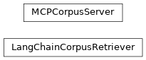
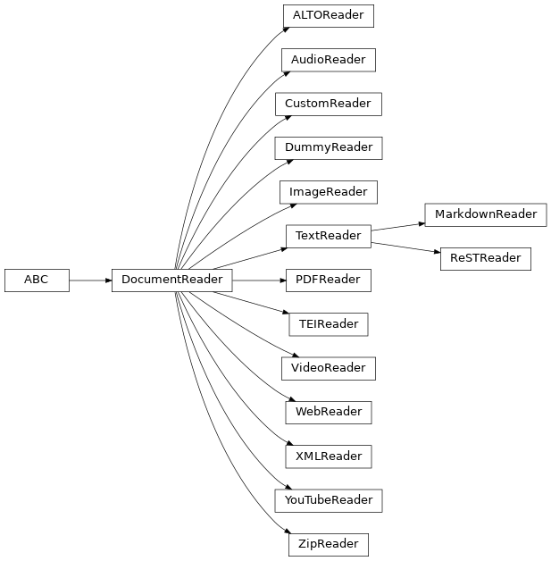
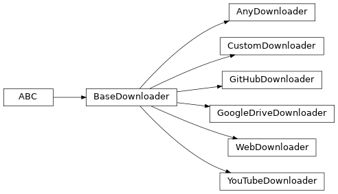
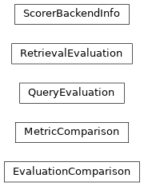
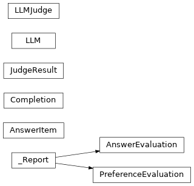
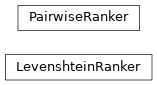

# scikitplot.corpus[#](#module-scikitplot.corpus "Link to this heading")

## scikitplot.corpus[#](#id1 "Link to this heading")

Tools for turning files, URLs, media, and text sources into canonical
[`CorpusDocument`](../modules/generated/scikitplot.corpus.CorpusDocument.html#scikitplot.corpus.CorpusDocument "scikitplot.corpus.CorpusDocument") evidence that can be transformed, embedded, stored,
searched, adapted, and exported.

> **See also**
> * [modelcontextprotocol/python-sdk](https://github.com/modelcontextprotocol/python-sdk)
* [semantica-agi/semantica](https://github.com/semantica-agi/semantica)
* <https://docs.getsemantica.ai/guides/distance-intelligence/#common-pitfalls>

### Choose the API that matches the job[#](#choose-the-api-that-matches-the-job "Link to this heading")

`CorpusPipeline`
:   Direct stage control for one source or an explicit batch.

`CorpusBuilder`
:   High-level build/search/adapt convenience for end-to-end corpus workflows.

`FluentCorpus`
:   Immutable, reusable configuration. Chained setter order describes **what**
    is configured; it does not define execution order.

`RuntimeCorpus`
:   The operational form of a validated Fluent plan. Materialization constructs
    runtime components; source processing starts only with `run()` or
    `add()`.

`RetrievalIndex` / `VectorIndexBackend`
:   Lower-level retrieval and vector-backend extension APIs.

The common processing picture is:

```
Source
  -> Read
  -> Chunk / Normalize / Enrich
  -> Embed
  -> Store
  -> Index
  -> Retrieve
  -> Adapt / Export

```

Examples

Try it in your browser!

Direct pipeline control:

```
>>> from pathlib import Path
>>> from scikitplot.corpus import CorpusPipeline, ParagraphChunker
>>> pipeline = CorpusPipeline(chunker=ParagraphChunker())
>>> result = pipeline.run(Path("article.txt"))
>>> print(f"{result.n_documents} chunks from {result.source}")

```

The dependency-free default sentence backend is `REGEX`. Passing a spaCy
model name explicitly selects the spaCy shorthand instead:

```
>>> from scikitplot.corpus import SentenceChunker
>>> portable = SentenceChunker()
>>> spacy_chunker = SentenceChunker("en_core_web_sm")

```

High-level builder:

```
>>> from scikitplot.corpus import CorpusBuilder, BuilderConfig
>>> builder = CorpusBuilder(
...     BuilderConfig(
...         chunker="paragraph",
...         normalize=True,
...         enrich=True,
...         build_index=True,
...     )
... )
>>> result = builder.build("./data/")
>>> results = builder.search("quantum computing")

```

Reusable declarative configuration:

```
>>> from scikitplot.corpus import FluentCorpus
>>> fluent = FluentCorpus().chunker("paragraph").storage("memory")
>>> fluent.validate()
[]

```

Materialization is explicit and performs no source read by itself:

```
>>> from scikitplot.corpus import RuntimePolicy
>>> with fluent.materialize(policy=RuntimePolicy(allow_network=False)) as runtime:
...     len(runtime.documents)
0

```

A configured source becomes operational only when `run()` is called:

```
>>> runtime_fluent = (
...     FluentCorpus().source("article.txt").chunker("paragraph").storage("memory")
... )
>>> with runtime_fluent.materialize() as runtime:
...     result = runtime.run()

```

Network and optional-capability examples:

Live URLs, OCR, ASR, spaCy, NLTK resource-backed NLP, model embeddings, and
native vector backends depend on the corresponding environment capability.
User-facing examples should not fabricate results when a capability is absent.
Documentation/gallery examples should either use a portable executed path or
report a clear skip while keeping the optional configuration visible.

URL ingestion:

```
>>> result = pipeline.run_url("https://en.wikipedia.org/wiki/Python")

```

YouTube transcript:

```
>>> result = pipeline.run(
...     "https://www.youtube.com/watch?v=rwPISgZcYIk"
... )

```

Image OCR:

```
>>> from scikitplot.corpus import DocumentReader
>>> reader = DocumentReader.create(Path("scan.png"))
>>> docs = list(reader.get_documents())

```

With model embeddings:

```
>>> from scikitplot.corpus import EmbeddingEngine
>>> engine = EmbeddingEngine(backend="sentence_transformers")

```

Dependency-free local helpers:

```
>>> from scikitplot.corpus import HAMLET_TEXT, HashEmbedder, SimpleEnricherSpec
>>> HashEmbedder(dimension=32)([HAMLET_TEXT[:120]]).shape
(1, 32)
>>> FluentCorpus().enricher(SimpleEnricherSpec()).validate()
[]

```

`HashEmbedder` is a deterministic lexical hashing baseline, not a learned
semantic model. `HAMLET_TEXT` is bundled convenience sample data rather than
an authoritative scholarly edition.

See `scikitplot/corpus/README.md` for the user-oriented API map, runtime
policy boundary, retrieval modes, and optional-capability guidance.

Go BackOpen In Tab

****User guide.**** See the [Corpus User Guide](../user_guide/corpus/index.html#corpus-index) section for further details.

## Adapter layer[#](#adapter-layer "Link to this heading")

Class inheritance




|  |  |
| --- | --- |
| [`to_langchain_documents`](../modules/generated/scikitplot.corpus.to_langchain_documents.html#scikitplot.corpus.to_langchain_documents "scikitplot.corpus.to_langchain_documents") | Convert `CorpusDocument` instances to LangChain `Document`. |
| [`to_langgraph_state`](../modules/generated/scikitplot.corpus.to_langgraph_state.html#scikitplot.corpus.to_langgraph_state "scikitplot.corpus.to_langgraph_state") | Convert documents to a LangGraph-compatible state dict. |
| [`to_mcp_resources`](../modules/generated/scikitplot.corpus.to_mcp_resources.html#scikitplot.corpus.to_mcp_resources "scikitplot.corpus.to_mcp_resources") | Convert documents to MCP `resources/read` response format. |
| [`to_mcp_tool_result`](../modules/generated/scikitplot.corpus.to_mcp_tool_result.html#scikitplot.corpus.to_mcp_tool_result "scikitplot.corpus.to_mcp_tool_result") | Format documents as an MCP `tools/call` response. |
| [`to_huggingface_dataset`](../modules/generated/scikitplot.corpus.to_huggingface_dataset.html#scikitplot.corpus.to_huggingface_dataset "scikitplot.corpus.to_huggingface_dataset") | Convert documents to a HuggingFace `Dataset`. |
| [`to_rag_tuples`](../modules/generated/scikitplot.corpus.to_rag_tuples.html#scikitplot.corpus.to_rag_tuples "scikitplot.corpus.to_rag_tuples") | Convert documents to `(text, metadata, embedding)` tuples. |
| [`to_jsonl`](../modules/generated/scikitplot.corpus.to_jsonl.html#scikitplot.corpus.to_jsonl "scikitplot.corpus.to_jsonl") | Yield documents as newline-delimited JSON strings. |
| [`to_numpy_arrays`](../modules/generated/scikitplot.corpus.to_numpy_arrays.html#scikitplot.corpus.to_numpy_arrays "scikitplot.corpus.to_numpy_arrays") | Convert documents to a dict of NumPy arrays suitable for batch ML. |
| [`to_tensorflow_dataset`](../modules/generated/scikitplot.corpus.to_tensorflow_dataset.html#scikitplot.corpus.to_tensorflow_dataset "scikitplot.corpus.to_tensorflow_dataset") | Convert documents to a `tf.data.Dataset`. |
| [`to_torch_dataloader`](../modules/generated/scikitplot.corpus.to_torch_dataloader.html#scikitplot.corpus.to_torch_dataloader "scikitplot.corpus.to_torch_dataloader") | Convert documents to a `torch.utils.data.DataLoader`. |
| [`LangChainCorpusRetriever`](../modules/generated/scikitplot.corpus.LangChainCorpusRetriever.html#scikitplot.corpus.LangChainCorpusRetriever "scikitplot.corpus.LangChainCorpusRetriever") | LangChain-compatible retriever backed by `RetrievalIndex`. |
| [`MCPCorpusServer`](../modules/generated/scikitplot.corpus.MCPCorpusServer.html#scikitplot.corpus.MCPCorpusServer "scikitplot.corpus.MCPCorpusServer") | MCP server adapter for corpus search. |

## Agentic Retrieval Session[#](#agentic-retrieval-session "Link to this heading")

|  |  |
| --- | --- |
| [`AgenticRetrievalSession`](../modules/generated/scikitplot.corpus.AgenticRetrievalSession.html#scikitplot.corpus.AgenticRetrievalSession "scikitplot.corpus.AgenticRetrievalSession") | Ephemeral state for one investigation. |
| [`BudgetPolicy`](../modules/generated/scikitplot.corpus.BudgetPolicy.html#scikitplot.corpus.BudgetPolicy "scikitplot.corpus.BudgetPolicy") | Deterministic, decrementing limits on an investigation. |
| [`InvestigationOutcome`](../modules/generated/scikitplot.corpus.InvestigationOutcome.html#scikitplot.corpus.InvestigationOutcome "scikitplot.corpus.InvestigationOutcome") | The result of a bounded investigation. |
| [`InvestigationStatus`](../modules/generated/scikitplot.corpus.InvestigationStatus.html#scikitplot.corpus.InvestigationStatus "scikitplot.corpus.InvestigationStatus") | How an investigation finished. |
| [`RoutePlan`](../modules/generated/scikitplot.corpus.RoutePlan.html#scikitplot.corpus.RoutePlan "scikitplot.corpus.RoutePlan") | A deterministic decision about which evidence paths to use. |
| [`StopReason`](../modules/generated/scikitplot.corpus.StopReason.html#scikitplot.corpus.StopReason "scikitplot.corpus.StopReason") | Why the loop stopped. |
| [`SufficiencySignals`](../modules/generated/scikitplot.corpus.SufficiencySignals.html#scikitplot.corpus.SufficiencySignals "scikitplot.corpus.SufficiencySignals") | The seven deterministic signals, computed before any model judgement. |
| [`route`](../modules/generated/scikitplot.corpus.route.html#scikitplot.corpus.route "scikitplot.corpus.route") | Choose evidence paths by deterministic rule (autonomy level A1). |
| [`run_investigation`](../modules/generated/scikitplot.corpus.run_investigation.html#scikitplot.corpus.run_investigation "scikitplot.corpus.run_investigation") | Run the bounded retrieve/evaluate/refine loop (autonomy level A2). |

## Archive within Archive Handler[#](#archive-within-archive-handler "Link to this heading")

|  |  |
| --- | --- |
| [`extract_archive`](../modules/generated/scikitplot.corpus.extract_archive.html#scikitplot.corpus.extract_archive "scikitplot.corpus.extract_archive") | Extract an archive to a destination directory. |
| [`is_archive`](../modules/generated/scikitplot.corpus.is_archive.html#scikitplot.corpus.is_archive "scikitplot.corpus.is_archive") | Check if a file path has a supported archive extension. |

## Artifact Handler[#](#artifact-handler "Link to this heading")

|  |  |
| --- | --- |
| [`ANNIndexArtifact`](../modules/generated/scikitplot.corpus.ANNIndexArtifact.html#scikitplot.corpus.ANNIndexArtifact "scikitplot.corpus.ANNIndexArtifact") | A persisted vector index together with its provenance. |
| [`ArtifactError`](../modules/generated/scikitplot.corpus.ArtifactError.html#scikitplot.corpus.ArtifactError "scikitplot.corpus.ArtifactError") | Raised when an artifact is missing, malformed or incompatible. |

## Base Classes[#](#base-classes "Link to this heading")

Class inheritance




|  |  |
| --- | --- |
| [`ChunkerBase`](../modules/generated/scikitplot.corpus.ChunkerBase.html#scikitplot.corpus.ChunkerBase "scikitplot.corpus.ChunkerBase") | Abstract base class for all text chunkers. |
| [`DefaultFilter`](../modules/generated/scikitplot.corpus.DefaultFilter.html#scikitplot.corpus.DefaultFilter "scikitplot.corpus.DefaultFilter") | Standard noise filter ported and improved from remarx's `include_sentence`. |
| [`DocumentReader`](../modules/generated/scikitplot.corpus.DocumentReader.html#scikitplot.corpus.DocumentReader "scikitplot.corpus.DocumentReader") | Abstract base class for all format-specific document readers. |
| [`DummyReader`](../modules/generated/scikitplot.corpus.DummyReader.html#scikitplot.corpus.DummyReader "scikitplot.corpus.DummyReader") | A no-op reader that validates source existence and accessibility. |
| [`FilterBase`](../modules/generated/scikitplot.corpus.FilterBase.html#scikitplot.corpus.FilterBase "scikitplot.corpus.FilterBase") | Abstract base class for corpus document filters. |
| [`PipelineGuard`](../modules/generated/scikitplot.corpus.PipelineGuard.html#scikitplot.corpus.PipelineGuard "scikitplot.corpus.PipelineGuard") | Wrap any document stream with resilience, deduplication, and checkpointing. |

## Capability Status[#](#capability-status "Link to this heading")

|  |  |
| --- | --- |
| [`CapabilityStatus`](../modules/generated/scikitplot.corpus.CapabilityStatus.html#scikitplot.corpus.CapabilityStatus "scikitplot.corpus.CapabilityStatus") | Why a capability is or is not usable. |
| [`capability_snapshot`](../modules/generated/scikitplot.corpus.capability_snapshot.html#scikitplot.corpus.capability_snapshot "scikitplot.corpus.capability_snapshot") | Return a read-only snapshot of the runtime corpus capabilities. |
| [`distribution_version`](../modules/generated/scikitplot.corpus.distribution_version.html#scikitplot.corpus.distribution_version "scikitplot.corpus.distribution_version") | Return the installed version of a distribution, or `None` if absent. |
| [`probe_backend`](../modules/generated/scikitplot.corpus.probe_backend.html#scikitplot.corpus.probe_backend "scikitplot.corpus.probe_backend") | Classify one backend's availability. |

## Component Spec[#](#component-spec "Link to this heading")

|  |  |
| --- | --- |
| [`ComponentCatalog`](../modules/generated/scikitplot.corpus.ComponentCatalog.html#scikitplot.corpus.ComponentCatalog "scikitplot.corpus.ComponentCatalog") | An immutable snapshot of every registered component. |
| [`ComponentSpec`](../modules/generated/scikitplot.corpus.ComponentSpec.html#scikitplot.corpus.ComponentSpec "scikitplot.corpus.ComponentSpec") | Everything the catalog knows about one component. |
| [`DiscoveryOutcome`](../modules/generated/scikitplot.corpus.DiscoveryOutcome.html#scikitplot.corpus.DiscoveryOutcome "scikitplot.corpus.DiscoveryOutcome") | What happened when one source was asked for its components. |
| [`DiscoveryStatus`](../modules/generated/scikitplot.corpus.DiscoveryStatus.html#scikitplot.corpus.DiscoveryStatus "scikitplot.corpus.DiscoveryStatus") | Terminal outcome of asking one source what components it has. |
| [`component_catalog`](../modules/generated/scikitplot.corpus.component_catalog.html#scikitplot.corpus.component_catalog "scikitplot.corpus.component_catalog") | Build a snapshot of every registered component. |

## Chunkers[#](#chunkers "Link to this heading")

|  |  |
| --- | --- |
| [`ChunkedTextList`](../modules/generated/scikitplot.corpus.ChunkedTextList.html#scikitplot.corpus.ChunkedTextList "scikitplot.corpus.ChunkedTextList") | A `list` subclass that carries per-chunk metadata alongside `(int, str)` pairs. |
| [`ChunkerBridge`](../modules/generated/scikitplot.corpus.ChunkerBridge.html#scikitplot.corpus.ChunkerBridge "scikitplot.corpus.ChunkerBridge") | Adapter that wraps a new-style chunker as a `ChunkerBase`- compatible object. |
| [`FixedWindowChunkerBridge`](../modules/generated/scikitplot.corpus.FixedWindowChunkerBridge.html#scikitplot.corpus.FixedWindowChunkerBridge "scikitplot.corpus.FixedWindowChunkerBridge") | Bridge for `FixedWindowChunker` → `ChunkerBase` contract. |
| [`ParagraphChunkerBridge`](../modules/generated/scikitplot.corpus.ParagraphChunkerBridge.html#scikitplot.corpus.ParagraphChunkerBridge "scikitplot.corpus.ParagraphChunkerBridge") | Bridge for `ParagraphChunker` → `ChunkerBase` contract. |
| [`ProtocolChunkerBridge`](../modules/generated/scikitplot.corpus.ProtocolChunkerBridge.html#scikitplot.corpus.ProtocolChunkerBridge "scikitplot.corpus.ProtocolChunkerBridge") | Bridge for any chunker satisfying `ChunkerProtocol` (R3-1). |
| [`SemanticChunkerBridge`](../modules/generated/scikitplot.corpus.SemanticChunkerBridge.html#scikitplot.corpus.SemanticChunkerBridge "scikitplot.corpus.SemanticChunkerBridge") | Bridge for `SemanticChunker` → `ChunkerBase` contract. |
| [`SentenceChunkerBridge`](../modules/generated/scikitplot.corpus.SentenceChunkerBridge.html#scikitplot.corpus.SentenceChunkerBridge "scikitplot.corpus.SentenceChunkerBridge") | Bridge for `SentenceChunker` → `ChunkerBase` contract. |
| [`WordChunkerBridge`](../modules/generated/scikitplot.corpus.WordChunkerBridge.html#scikitplot.corpus.WordChunkerBridge "scikitplot.corpus.WordChunkerBridge") | Bridge for `WordChunker` → `ChunkerBase` contract. |
| [`bridge_chunker`](../modules/generated/scikitplot.corpus.bridge_chunker.html#scikitplot.corpus.bridge_chunker "scikitplot.corpus.bridge_chunker") | Wrap **chunker** in a bridge if it is a new-style chunker. |
| [`register_bridge`](../modules/generated/scikitplot.corpus.register_bridge.html#scikitplot.corpus.register_bridge "scikitplot.corpus.register_bridge") | Register a custom bridge for a user-defined chunker class. |
| [`unregister_bridge`](../modules/generated/scikitplot.corpus.unregister_bridge.html#scikitplot.corpus.unregister_bridge "scikitplot.corpus.unregister_bridge") | Remove a previously registered bridge for **chunker\_class**. |
| [`TokenizerProtocol`](../modules/generated/scikitplot.corpus.TokenizerProtocol.html#scikitplot.corpus.TokenizerProtocol "scikitplot.corpus.TokenizerProtocol") | Structural protocol for word tokenizers. |
| [`SentenceSplitterProtocol`](../modules/generated/scikitplot.corpus.SentenceSplitterProtocol.html#scikitplot.corpus.SentenceSplitterProtocol "scikitplot.corpus.SentenceSplitterProtocol") | Structural protocol for sentence segmenters. |
| [`StemmerProtocol`](../modules/generated/scikitplot.corpus.StemmerProtocol.html#scikitplot.corpus.StemmerProtocol "scikitplot.corpus.StemmerProtocol") | Structural protocol for word stemmers. |
| [`LemmatizerProtocol`](../modules/generated/scikitplot.corpus.LemmatizerProtocol.html#scikitplot.corpus.LemmatizerProtocol "scikitplot.corpus.LemmatizerProtocol") | Structural protocol for word lemmatizers. |
| [`FunctionTokenizer`](../modules/generated/scikitplot.corpus.FunctionTokenizer.html#scikitplot.corpus.FunctionTokenizer "scikitplot.corpus.FunctionTokenizer") | Wrap any `Callable[[str], list[str]]` as a [`TokenizerProtocol`](../modules/generated/scikitplot.corpus.TokenizerProtocol.html#scikitplot.corpus.TokenizerProtocol "scikitplot.corpus.TokenizerProtocol"). |
| [`FunctionSentenceSplitter`](../modules/generated/scikitplot.corpus.FunctionSentenceSplitter.html#scikitplot.corpus.FunctionSentenceSplitter "scikitplot.corpus.FunctionSentenceSplitter") | Wrap any `Callable[[str], list[str]]` as a [`SentenceSplitterProtocol`](../modules/generated/scikitplot.corpus.SentenceSplitterProtocol.html#scikitplot.corpus.SentenceSplitterProtocol "scikitplot.corpus.SentenceSplitterProtocol"). |
| [`FunctionStemmer`](../modules/generated/scikitplot.corpus.FunctionStemmer.html#scikitplot.corpus.FunctionStemmer "scikitplot.corpus.FunctionStemmer") | Wrap any `Callable[[str], str]` as a [`StemmerProtocol`](../modules/generated/scikitplot.corpus.StemmerProtocol.html#scikitplot.corpus.StemmerProtocol "scikitplot.corpus.StemmerProtocol"). |
| [`FunctionLemmatizer`](../modules/generated/scikitplot.corpus.FunctionLemmatizer.html#scikitplot.corpus.FunctionLemmatizer "scikitplot.corpus.FunctionLemmatizer") | Wrap any `Callable[[str, Optional[str]], str]` as a [`LemmatizerProtocol`](../modules/generated/scikitplot.corpus.LemmatizerProtocol.html#scikitplot.corpus.LemmatizerProtocol "scikitplot.corpus.LemmatizerProtocol"). |
| [`CustomTokenizerRegistry`](../modules/generated/scikitplot.corpus.CustomTokenizerRegistry.html#scikitplot.corpus.CustomTokenizerRegistry "scikitplot.corpus.CustomTokenizerRegistry") | Thread-safe module-level registry for named custom components. |
| [`register_tokenizer`](../modules/generated/scikitplot.corpus.register_tokenizer.html#scikitplot.corpus.register_tokenizer "scikitplot.corpus.register_tokenizer") | Register a named [`TokenizerProtocol`](../modules/generated/scikitplot.corpus.TokenizerProtocol.html#scikitplot.corpus.TokenizerProtocol "scikitplot.corpus.TokenizerProtocol") implementation. |
| [`get_tokenizer`](../modules/generated/scikitplot.corpus.get_tokenizer.html#scikitplot.corpus.get_tokenizer "scikitplot.corpus.get_tokenizer") | Retrieve a registered tokenizer by name. |
| [`register_sentence_splitter`](../modules/generated/scikitplot.corpus.register_sentence_splitter.html#scikitplot.corpus.register_sentence_splitter "scikitplot.corpus.register_sentence_splitter") | Register a named [`SentenceSplitterProtocol`](../modules/generated/scikitplot.corpus.SentenceSplitterProtocol.html#scikitplot.corpus.SentenceSplitterProtocol "scikitplot.corpus.SentenceSplitterProtocol") implementation. |
| [`get_sentence_splitter`](../modules/generated/scikitplot.corpus.get_sentence_splitter.html#scikitplot.corpus.get_sentence_splitter "scikitplot.corpus.get_sentence_splitter") | Retrieve a registered sentence splitter by name. |
| [`register_stemmer`](../modules/generated/scikitplot.corpus.register_stemmer.html#scikitplot.corpus.register_stemmer "scikitplot.corpus.register_stemmer") | Register a named [`StemmerProtocol`](../modules/generated/scikitplot.corpus.StemmerProtocol.html#scikitplot.corpus.StemmerProtocol "scikitplot.corpus.StemmerProtocol") implementation. |
| [`get_stemmer`](../modules/generated/scikitplot.corpus.get_stemmer.html#scikitplot.corpus.get_stemmer "scikitplot.corpus.get_stemmer") | Retrieve a registered stemmer by name. |
| [`register_lemmatizer`](../modules/generated/scikitplot.corpus.register_lemmatizer.html#scikitplot.corpus.register_lemmatizer "scikitplot.corpus.register_lemmatizer") | Register a named [`LemmatizerProtocol`](../modules/generated/scikitplot.corpus.LemmatizerProtocol.html#scikitplot.corpus.LemmatizerProtocol "scikitplot.corpus.LemmatizerProtocol") implementation. |
| [`get_lemmatizer`](../modules/generated/scikitplot.corpus.get_lemmatizer.html#scikitplot.corpus.get_lemmatizer "scikitplot.corpus.get_lemmatizer") | Retrieve a registered lemmatizer by name. |
| [`ScriptType`](../modules/generated/scikitplot.corpus.ScriptType.html#scikitplot.corpus.ScriptType "scikitplot.corpus.ScriptType") | Dominant Unicode script detected in a text sample. |
| [`detect_script`](../modules/generated/scikitplot.corpus.detect_script.html#scikitplot.corpus.detect_script "scikitplot.corpus.detect_script") | Detect the dominant Unicode script in **text**. |
| [`is_cjk_char`](../modules/generated/scikitplot.corpus.is_cjk_char.html#scikitplot.corpus.is_cjk_char "scikitplot.corpus.is_cjk_char") | Return `True` if **ch** is a CJK / Japanese / Korean character. |
| [`is_rtl_char`](../modules/generated/scikitplot.corpus.is_rtl_char.html#scikitplot.corpus.is_rtl_char "scikitplot.corpus.is_rtl_char") | Return `True` if **ch** belongs to a right-to-left script. |
| [`split_cjk_chars`](../modules/generated/scikitplot.corpus.split_cjk_chars.html#scikitplot.corpus.split_cjk_chars "scikitplot.corpus.split_cjk_chars") | Split **text** into individual CJK character tokens. |
| [`_split_cjk_chars_legacy`](../modules/generated/scikitplot.corpus._split_cjk_chars_legacy.html#scikitplot.corpus._split_cjk_chars_legacy "scikitplot.corpus._split_cjk_chars_legacy") | Legacy codepoint-level CJK splitting (pre-Layer-0 implementation). |
| [`MULTI_SCRIPT_SENTENCE_RE_PATTERN`](../modules/generated/scikitplot.corpus.MULTI_SCRIPT_SENTENCE_RE_PATTERN.html#scikitplot.corpus.MULTI_SCRIPT_SENTENCE_RE_PATTERN "scikitplot.corpus.MULTI_SCRIPT_SENTENCE_RE_PATTERN") | str(object='') -> str str(bytes\_or\_buffer[, encoding[, errors]]) -> str |
| [`ScriptSpan`](../modules/generated/scikitplot.corpus.ScriptSpan.html#scikitplot.corpus.ScriptSpan "scikitplot.corpus.ScriptSpan") | A contiguous span of text in a single Unicode script. |
| [`ScriptSegmenter`](../modules/generated/scikitplot.corpus.ScriptSegmenter.html#scikitplot.corpus.ScriptSegmenter "scikitplot.corpus.ScriptSegmenter") | Segment NFC-normalised text into contiguous Unicode script spans. |
| [`FixedWindowChunker`](../modules/generated/scikitplot.corpus.FixedWindowChunker.html#scikitplot.corpus.FixedWindowChunker "scikitplot.corpus.FixedWindowChunker") | Produce fixed-size sliding-window chunks over a document. |
| [`FixedWindowChunkerConfig`](../modules/generated/scikitplot.corpus.FixedWindowChunkerConfig.html#scikitplot.corpus.FixedWindowChunkerConfig "scikitplot.corpus.FixedWindowChunkerConfig") | Configuration for [`FixedWindowChunker`](../modules/generated/scikitplot.corpus.FixedWindowChunker.html#scikitplot.corpus.FixedWindowChunker "scikitplot.corpus.FixedWindowChunker"). |
| [`WindowUnit`](../modules/generated/scikitplot.corpus.WindowUnit.html#scikitplot.corpus.WindowUnit "scikitplot.corpus.WindowUnit") | Unit of measurement for window size and step. |
| [`ISO_TO_NLTK`](../modules/generated/scikitplot.corpus.ISO_TO_NLTK.html#scikitplot.corpus.ISO_TO_NLTK "scikitplot.corpus.ISO_TO_NLTK") |  |
| [`ISO_TO_NAME`](../modules/generated/scikitplot.corpus.ISO_TO_NAME.html#scikitplot.corpus.ISO_TO_NAME "scikitplot.corpus.ISO_TO_NAME") |  |
| [`NLTK_TO_ISO`](../modules/generated/scikitplot.corpus.NLTK_TO_ISO.html#scikitplot.corpus.NLTK_TO_ISO "scikitplot.corpus.NLTK_TO_ISO") |  |
| [`NLTK_STOPWORD_LANGUAGES`](../modules/generated/scikitplot.corpus.NLTK_STOPWORD_LANGUAGES.html#scikitplot.corpus.NLTK_STOPWORD_LANGUAGES "scikitplot.corpus.NLTK_STOPWORD_LANGUAGES") | frozenset() -> empty frozenset object frozenset(iterable) -> frozenset object |
| [`BUILTIN_LANG_STOPWORDS`](../modules/generated/scikitplot.corpus.BUILTIN_LANG_STOPWORDS.html#scikitplot.corpus.BUILTIN_LANG_STOPWORDS "scikitplot.corpus.BUILTIN_LANG_STOPWORDS") |  |
| [`coerce_language`](../modules/generated/scikitplot.corpus.coerce_language.html#scikitplot.corpus.coerce_language "scikitplot.corpus.coerce_language") | Normalise any language specifier into a list of canonical NLTK names. |
| [`resolve_stopwords`](../modules/generated/scikitplot.corpus.resolve_stopwords.html#scikitplot.corpus.resolve_stopwords "scikitplot.corpus.resolve_stopwords") | Return a frozenset of stopwords for one or more languages. |
| [`iso_to_nltk`](../modules/generated/scikitplot.corpus.iso_to_nltk-func.html#scikitplot.corpus.iso_to_nltk "scikitplot.corpus.iso_to_nltk") | Resolve an ISO 639-1/639-3 code to a canonical NLTK language name. |
| [`nltk_to_iso`](../modules/generated/scikitplot.corpus.nltk_to_iso-func.html#scikitplot.corpus.nltk_to_iso "scikitplot.corpus.nltk_to_iso") | Resolve a canonical NLTK language name to its primary ISO 639-1 code. |
| [`MultilangConfig`](../modules/generated/scikitplot.corpus.MultilangConfig.html#scikitplot.corpus.MultilangConfig "scikitplot.corpus.MultilangConfig") | Multilang feature flags for any chunker. |
| [`MultilangMixin`](../modules/generated/scikitplot.corpus.MultilangMixin.html#scikitplot.corpus.MultilangMixin "scikitplot.corpus.MultilangMixin") | Shared multilang analysis mixin for all five chunkers. |
| [`ParagraphChunker`](../modules/generated/scikitplot.corpus.ParagraphChunker.html#scikitplot.corpus.ParagraphChunker "scikitplot.corpus.ParagraphChunker") | Split a document into paragraph-level `Chunk` objects. |
| [`ParagraphChunkerConfig`](../modules/generated/scikitplot.corpus.ParagraphChunkerConfig.html#scikitplot.corpus.ParagraphChunkerConfig "scikitplot.corpus.ParagraphChunkerConfig") | Configuration for [`ParagraphChunker`](../modules/generated/scikitplot.corpus.ParagraphChunker.html#scikitplot.corpus.ParagraphChunker "scikitplot.corpus.ParagraphChunker"). |
| [`ParentChildChunker`](../modules/generated/scikitplot.corpus.ParentChildChunker.html#scikitplot.corpus.ParentChildChunker "scikitplot.corpus.ParentChildChunker") | Large parents for context, small children for retrieval, linked. |
| [`ParentChildChunkerConfig`](../modules/generated/scikitplot.corpus.ParentChildChunkerConfig.html#scikitplot.corpus.ParentChildChunkerConfig "scikitplot.corpus.ParentChildChunkerConfig") | Configuration for [`ParentChildChunker`](../modules/generated/scikitplot.corpus.ParentChildChunker.html#scikitplot.corpus.ParentChildChunker "scikitplot.corpus.ParentChildChunker"). |
| [`RecursiveChunker`](../modules/generated/scikitplot.corpus.RecursiveChunker.html#scikitplot.corpus.RecursiveChunker "scikitplot.corpus.RecursiveChunker") | Split text by a separator hierarchy until each piece fits a budget. |
| [`RecursiveChunkerConfig`](../modules/generated/scikitplot.corpus.RecursiveChunkerConfig.html#scikitplot.corpus.RecursiveChunkerConfig "scikitplot.corpus.RecursiveChunkerConfig") | Configuration for [`RecursiveChunker`](../modules/generated/scikitplot.corpus.RecursiveChunker.html#scikitplot.corpus.RecursiveChunker "scikitplot.corpus.RecursiveChunker"). |
| [`SemanticBackend`](../modules/generated/scikitplot.corpus.SemanticBackend.html#scikitplot.corpus.SemanticBackend "scikitplot.corpus.SemanticBackend") | Semantic chunking backend selector. |
| [`SemanticChunker`](../modules/generated/scikitplot.corpus.SemanticChunker.html#scikitplot.corpus.SemanticChunker "scikitplot.corpus.SemanticChunker") | Embedding-aware, writing-system-aware semantic chunker (Layer 3). |
| [`SemanticChunkerConfig`](../modules/generated/scikitplot.corpus.SemanticChunkerConfig.html#scikitplot.corpus.SemanticChunkerConfig "scikitplot.corpus.SemanticChunkerConfig") | Configuration for [`SemanticChunker`](../modules/generated/scikitplot.corpus.SemanticChunker.html#scikitplot.corpus.SemanticChunker "scikitplot.corpus.SemanticChunker"). |
| [`SentenceBackend`](../modules/generated/scikitplot.corpus.SentenceBackend.html#scikitplot.corpus.SentenceBackend "scikitplot.corpus.SentenceBackend") | Supported sentence-splitting backends. |
| [`SentenceChunker`](../modules/generated/scikitplot.corpus.SentenceChunker.html#scikitplot.corpus.SentenceChunker "scikitplot.corpus.SentenceChunker") | Split a document into sentence-level `Chunk` objects. |
| [`SentenceChunkerConfig`](../modules/generated/scikitplot.corpus.SentenceChunkerConfig.html#scikitplot.corpus.SentenceChunkerConfig "scikitplot.corpus.SentenceChunkerConfig") | Configuration for [`SentenceChunker`](../modules/generated/scikitplot.corpus.SentenceChunker.html#scikitplot.corpus.SentenceChunker "scikitplot.corpus.SentenceChunker"). |
| [`_validate_text_input`](../modules/generated/scikitplot.corpus._validate_text_input.html#scikitplot.corpus._validate_text_input "scikitplot.corpus._validate_text_input") | Validate chunker text input for NUL bytes and lone surrogates. |
| [`StructureChunker`](../modules/generated/scikitplot.corpus.StructureChunker.html#scikitplot.corpus.StructureChunker "scikitplot.corpus.StructureChunker") | Chunk Markdown or reStructuredText by its headings and code blocks. |
| [`StructureChunkerConfig`](../modules/generated/scikitplot.corpus.StructureChunkerConfig.html#scikitplot.corpus.StructureChunkerConfig "scikitplot.corpus.StructureChunkerConfig") | Configuration for [`StructureChunker`](../modules/generated/scikitplot.corpus.StructureChunker.html#scikitplot.corpus.StructureChunker "scikitplot.corpus.StructureChunker"). |
| [`LemmatizationBackend`](../modules/generated/scikitplot.corpus.LemmatizationBackend.html#scikitplot.corpus.LemmatizationBackend "scikitplot.corpus.LemmatizationBackend") | Lemmatization backend. |
| [`StemmingBackend`](../modules/generated/scikitplot.corpus.StemmingBackend.html#scikitplot.corpus.StemmingBackend "scikitplot.corpus.StemmingBackend") | Stemming algorithm. |
| [`StopwordSource`](../modules/generated/scikitplot.corpus.StopwordSource.html#scikitplot.corpus.StopwordSource "scikitplot.corpus.StopwordSource") | Stopword list source. |
| [`TokenizerBackend`](../modules/generated/scikitplot.corpus.TokenizerBackend.html#scikitplot.corpus.TokenizerBackend "scikitplot.corpus.TokenizerBackend") | Word tokenisation backend. |
| [`WordChunker`](../modules/generated/scikitplot.corpus.WordChunker.html#scikitplot.corpus.WordChunker "scikitplot.corpus.WordChunker") | Process a document at word level, producing normalised token chunks. |
| [`WordChunkerConfig`](../modules/generated/scikitplot.corpus.WordChunkerConfig.html#scikitplot.corpus.WordChunkerConfig "scikitplot.corpus.WordChunkerConfig") | Configuration for [`WordChunker`](../modules/generated/scikitplot.corpus.WordChunker.html#scikitplot.corpus.WordChunker "scikitplot.corpus.WordChunker"). |
| [`ArabicMorphologicalStrategy`](../modules/generated/scikitplot.corpus.ArabicMorphologicalStrategy.html#scikitplot.corpus.ArabicMorphologicalStrategy "scikitplot.corpus.ArabicMorphologicalStrategy") | Arabic and Hebrew morphological segmentation strategy. |
| [`CJKCharacterStrategy`](../modules/generated/scikitplot.corpus.CJKCharacterStrategy.html#scikitplot.corpus.CJKCharacterStrategy "scikitplot.corpus.CJKCharacterStrategy") | Character-level segmentation for Han (Chinese logograph) script. |
| [`DeterminativeGroupStrategy`](../modules/generated/scikitplot.corpus.DeterminativeGroupStrategy.html#scikitplot.corpus.DeterminativeGroupStrategy "scikitplot.corpus.DeterminativeGroupStrategy") | Egyptian Hieroglyph segmentation into determinative groups. |
| [`DictionaryBoundaryStrategy`](../modules/generated/scikitplot.corpus.DictionaryBoundaryStrategy.html#scikitplot.corpus.DictionaryBoundaryStrategy "scikitplot.corpus.DictionaryBoundaryStrategy") | Dictionary-based word boundary detection for no-space scripts. |
| [`EthiopicStrategy`](../modules/generated/scikitplot.corpus.EthiopicStrategy.html#scikitplot.corpus.EthiopicStrategy "scikitplot.corpus.EthiopicStrategy") | Ethiopic (Amharic, Tigrinya) segmentation strategy. |
| [`GraphemeClusterStrategy`](../modules/generated/scikitplot.corpus.GraphemeClusterStrategy.html#scikitplot.corpus.GraphemeClusterStrategy "scikitplot.corpus.GraphemeClusterStrategy") | Grapheme-cluster-level fallback strategy for any script. |
| [`IndicAksharaStrategy`](../modules/generated/scikitplot.corpus.IndicAksharaStrategy.html#scikitplot.corpus.IndicAksharaStrategy "scikitplot.corpus.IndicAksharaStrategy") | Grapheme-cluster segmentation for Indic scripts. |
| [`JapaneseStrategy`](../modules/generated/scikitplot.corpus.JapaneseStrategy.html#scikitplot.corpus.JapaneseStrategy "scikitplot.corpus.JapaneseStrategy") | Multi-tier Japanese segmentation strategy. |
| [`KoreanSyllableStrategy`](../modules/generated/scikitplot.corpus.KoreanSyllableStrategy.html#scikitplot.corpus.KoreanSyllableStrategy "scikitplot.corpus.KoreanSyllableStrategy") | Space-delimited word segmentation for Korean Hangul. |
| [`MongolianStrategy`](../modules/generated/scikitplot.corpus.MongolianStrategy.html#scikitplot.corpus.MongolianStrategy "scikitplot.corpus.MongolianStrategy") | Traditional Mongolian segmentation strategy. |
| [`SegmentationStrategy`](../modules/generated/scikitplot.corpus.SegmentationStrategy.html#scikitplot.corpus.SegmentationStrategy "scikitplot.corpus.SegmentationStrategy") | Protocol for per-script text segmentation strategies. |
| [`SpacePunctuationStrategy`](../modules/generated/scikitplot.corpus.SpacePunctuationStrategy.html#scikitplot.corpus.SpacePunctuationStrategy "scikitplot.corpus.SpacePunctuationStrategy") | Whitespace-and-punctuation segmentation for space-delimited scripts. |
| [`TibetanStrategy`](../modules/generated/scikitplot.corpus.TibetanStrategy.html#scikitplot.corpus.TibetanStrategy "scikitplot.corpus.TibetanStrategy") | Tibetan segmentation strategy. |
| [`WritingSystemAdapter`](../modules/generated/scikitplot.corpus.WritingSystemAdapter.html#scikitplot.corpus.WritingSystemAdapter "scikitplot.corpus.WritingSystemAdapter") | Dispatch per-script segmentation to the correct strategy. |
| [`WritingSystemAdapterConfig`](../modules/generated/scikitplot.corpus.WritingSystemAdapterConfig.html#scikitplot.corpus.WritingSystemAdapterConfig "scikitplot.corpus.WritingSystemAdapterConfig") | Configuration for [`WritingSystemAdapter`](../modules/generated/scikitplot.corpus.WritingSystemAdapter.html#scikitplot.corpus.WritingSystemAdapter "scikitplot.corpus.WritingSystemAdapter"). |

## Corpus Builder[#](#corpus-builder "Link to this heading")

Class inheritance


|  |  |
| --- | --- |
| [`BuildResult`](../modules/generated/scikitplot.corpus.BuildResult.html#scikitplot.corpus.BuildResult "scikitplot.corpus.BuildResult") | Result of a corpus build operation. |
| [`BuilderConfig`](../modules/generated/scikitplot.corpus.BuilderConfig.html#scikitplot.corpus.BuilderConfig "scikitplot.corpus.BuilderConfig") | Configuration for [`CorpusBuilder`](../modules/generated/scikitplot.corpus.CorpusBuilder.html#scikitplot.corpus.CorpusBuilder "scikitplot.corpus.CorpusBuilder"). |
| [`CorpusBuilder`](../modules/generated/scikitplot.corpus.CorpusBuilder.html#scikitplot.corpus.CorpusBuilder "scikitplot.corpus.CorpusBuilder") | Unified corpus builder — end-to-end pipeline orchestrator. |

## Custom Hooks[#](#custom-hooks "Link to this heading")

|  |  |
| --- | --- |
| [`BuilderFactories`](../modules/generated/scikitplot.corpus.BuilderFactories.html#scikitplot.corpus.BuilderFactories "scikitplot.corpus.BuilderFactories") | Component factory callables for [`FactoryCorpusBuilder`](../modules/generated/scikitplot.corpus.FactoryCorpusBuilder.html#scikitplot.corpus.FactoryCorpusBuilder "scikitplot.corpus.FactoryCorpusBuilder"). |
| [`CustomChunker`](../modules/generated/scikitplot.corpus.CustomChunker.html#scikitplot.corpus.CustomChunker "scikitplot.corpus.CustomChunker") | Wrap any callable as a [`ChunkerBase`](../modules/generated/scikitplot.corpus.ChunkerBase.html#scikitplot.corpus.ChunkerBase "scikitplot.corpus._base.ChunkerBase"). |
| [`CustomEnricherConfig`](../modules/generated/scikitplot.corpus.CustomEnricherConfig.html#scikitplot.corpus.CustomEnricherConfig "scikitplot.corpus.CustomEnricherConfig") | Custom backend callables for [`CustomNLPEnricher`](../modules/generated/scikitplot.corpus.CustomNLPEnricher.html#scikitplot.corpus.CustomNLPEnricher "scikitplot.corpus.CustomNLPEnricher"). |
| [`CustomFilter`](../modules/generated/scikitplot.corpus.CustomFilter.html#scikitplot.corpus.CustomFilter "scikitplot.corpus.CustomFilter") | Wrap any callable as a [`FilterBase`](../modules/generated/scikitplot.corpus.FilterBase.html#scikitplot.corpus.FilterBase "scikitplot.corpus._base.FilterBase"). |
| [`CustomNLPEnricher`](../modules/generated/scikitplot.corpus.CustomNLPEnricher.html#scikitplot.corpus.CustomNLPEnricher "scikitplot.corpus.CustomNLPEnricher") | `NLPEnricher` extended with fully-replaceable NLP backends. |
| [`CustomNormalizer`](../modules/generated/scikitplot.corpus.CustomNormalizer.html#scikitplot.corpus.CustomNormalizer "scikitplot.corpus.CustomNormalizer") | Wrap any callable as a `NormalizerBase`. |
| [`CustomRetrievalIndex`](../modules/generated/scikitplot.corpus.CustomRetrievalIndex.html#scikitplot.corpus.CustomRetrievalIndex "scikitplot.corpus.CustomRetrievalIndex") | `RetrievalIndex` extended with a fully-replaceable custom scorer callable. |
| [`FactoryCorpusBuilder`](../modules/generated/scikitplot.corpus.FactoryCorpusBuilder.html#scikitplot.corpus.FactoryCorpusBuilder "scikitplot.corpus.FactoryCorpusBuilder") | [`CorpusBuilder`](../modules/generated/scikitplot.corpus.CorpusBuilder.html#scikitplot.corpus.CorpusBuilder "scikitplot.corpus._corpus_builder.CorpusBuilder") extended with pluggable component factories. |
| [`HookableCorpusPipeline`](../modules/generated/scikitplot.corpus.HookableCorpusPipeline.html#scikitplot.corpus.HookableCorpusPipeline "scikitplot.corpus.HookableCorpusPipeline") | [`CorpusPipeline`](../modules/generated/scikitplot.corpus.CorpusPipeline.html#scikitplot.corpus.CorpusPipeline "scikitplot.corpus._pipeline.CorpusPipeline") extended with per-stage lifecycle hooks. |
| [`PipelineHooks`](../modules/generated/scikitplot.corpus.PipelineHooks.html#scikitplot.corpus.PipelineHooks "scikitplot.corpus.PipelineHooks") | Lifecycle callbacks for [`HookableCorpusPipeline`](../modules/generated/scikitplot.corpus.HookableCorpusPipeline.html#scikitplot.corpus.HookableCorpusPipeline "scikitplot.corpus.HookableCorpusPipeline"). |

## Diagnostic Error Record[#](#diagnostic-error-record "Link to this heading")

|  |  |
| --- | --- |
| [`ErrorCategory`](../modules/generated/scikitplot.corpus.ErrorCategory.html#scikitplot.corpus.ErrorCategory "scikitplot.corpus.ErrorCategory") | Coarse classification of a diagnostic, for counting and filtering. |
| [`ErrorRecord`](../modules/generated/scikitplot.corpus.ErrorRecord.html#scikitplot.corpus.ErrorRecord "scikitplot.corpus.ErrorRecord") | One structured, serialisable diagnostic. |

## Downloader[#](#downloader "Link to this heading")

Class inheritance




|  |  |
| --- | --- |
| [`AnyDownloader`](../modules/generated/scikitplot.corpus.AnyDownloader.html#scikitplot.corpus.AnyDownloader "scikitplot.corpus.AnyDownloader") | Auto-dispatching downloader with multi-URL and per-parameter list support. |
| [`BaseDownloader`](../modules/generated/scikitplot.corpus.BaseDownloader.html#scikitplot.corpus.BaseDownloader "scikitplot.corpus.BaseDownloader") | Abstract base class for all format-specific URL downloaders. |
| [`CustomDownloader`](../modules/generated/scikitplot.corpus.CustomDownloader.html#scikitplot.corpus.CustomDownloader "scikitplot.corpus.CustomDownloader") | Wraps a user-supplied callable as a [`BaseDownloader`](../modules/generated/scikitplot.corpus.BaseDownloader.html#scikitplot.corpus.BaseDownloader "scikitplot.corpus.BaseDownloader"). |
| [`DownloadResult`](../modules/generated/scikitplot.corpus.DownloadResult.html#scikitplot.corpus.DownloadResult "scikitplot.corpus.DownloadResult") | Immutable result object returned by every [`BaseDownloader`](../modules/generated/scikitplot.corpus.BaseDownloader.html#scikitplot.corpus.BaseDownloader "scikitplot.corpus.BaseDownloader"). |
| [`GitHubDownloader`](../modules/generated/scikitplot.corpus.GitHubDownloader.html#scikitplot.corpus.GitHubDownloader "scikitplot.corpus.GitHubDownloader") | GitHub URL downloader with automatic blob → raw normalisation. |
| [`GoogleDriveDownloader`](../modules/generated/scikitplot.corpus.GoogleDriveDownloader.html#scikitplot.corpus.GoogleDriveDownloader "scikitplot.corpus.GoogleDriveDownloader") | Google Drive share-link downloader. |
| [`WebDownloader`](../modules/generated/scikitplot.corpus.WebDownloader.html#scikitplot.corpus.WebDownloader "scikitplot.corpus.WebDownloader") | Generic HTTP/HTTPS file downloader. |
| [`YouTubeDownloader`](../modules/generated/scikitplot.corpus.YouTubeDownloader.html#scikitplot.corpus.YouTubeDownloader "scikitplot.corpus.YouTubeDownloader") | YouTube content downloader. |

## Embeddings[#](#embeddings "Link to this heading")

|  |  |
| --- | --- |
| [`CachePolicy`](../modules/generated/scikitplot.corpus.CachePolicy.html#scikitplot.corpus.CachePolicy "scikitplot.corpus.CachePolicy") | How [`EmbeddingEngine`](../modules/generated/scikitplot.corpus.EmbeddingEngine.html#scikitplot.corpus.EmbeddingEngine "scikitplot.corpus.EmbeddingEngine") uses its disk cache. |
| [`CacheStatus`](../modules/generated/scikitplot.corpus.CacheStatus.html#scikitplot.corpus.CacheStatus "scikitplot.corpus.CacheStatus") | What one cached embedding call did. |
| [`CachedEmbeddings`](../modules/generated/scikitplot.corpus.CachedEmbeddings.html#scikitplot.corpus.CachedEmbeddings "scikitplot.corpus.CachedEmbeddings") | The result of [`EmbeddingEngine.embed_cached`](../modules/generated/scikitplot.corpus.EmbeddingEngine.html#scikitplot.corpus.EmbeddingEngine.embed_cached "scikitplot.corpus.EmbeddingEngine.embed_cached"). |
| [`resolve_hub_revision`](../modules/generated/scikitplot.corpus.resolve_hub_revision.html#scikitplot.corpus.resolve_hub_revision "scikitplot.corpus.resolve_hub_revision") | Return the Hugging Face Hub commit a model id currently points to. |
| [`DEFAULT_CACHE_DIR`](../modules/generated/scikitplot.corpus.DEFAULT_CACHE_DIR.html#scikitplot.corpus.DEFAULT_CACHE_DIR "scikitplot.corpus.DEFAULT_CACHE_DIR") | Path subclass for non-Windows systems. |
| [`DEFAULT_MODEL`](../modules/generated/scikitplot.corpus.DEFAULT_MODEL.html#scikitplot.corpus.DEFAULT_MODEL "scikitplot.corpus.DEFAULT_MODEL") | str(object='') -> str str(bytes\_or\_buffer[, encoding[, errors]]) -> str |
| [`EmbeddingEngine`](../modules/generated/scikitplot.corpus.EmbeddingEngine.html#scikitplot.corpus.EmbeddingEngine "scikitplot.corpus.EmbeddingEngine") | Multi-backend sentence embedding engine with SHA-256 file caching. |
| [`HashEmbedder`](../modules/generated/scikitplot.corpus.HashEmbedder.html#scikitplot.corpus.HashEmbedder "scikitplot.corpus.HashEmbedder") | Embed text with deterministic signed feature hashing. |
| [`DEFAULT_AUDIO_MODEL`](../modules/generated/scikitplot.corpus.DEFAULT_AUDIO_MODEL.html#scikitplot.corpus.DEFAULT_AUDIO_MODEL "scikitplot.corpus.DEFAULT_AUDIO_MODEL") | str(object='') -> str str(bytes\_or\_buffer[, encoding[, errors]]) -> str |
| [`DEFAULT_IMAGE_MODEL`](../modules/generated/scikitplot.corpus.DEFAULT_IMAGE_MODEL.html#scikitplot.corpus.DEFAULT_IMAGE_MODEL "scikitplot.corpus.DEFAULT_IMAGE_MODEL") | str(object='') -> str str(bytes\_or\_buffer[, encoding[, errors]]) -> str |
| [`DEFAULT_TEXT_MODEL`](../modules/generated/scikitplot.corpus.DEFAULT_TEXT_MODEL.html#scikitplot.corpus.DEFAULT_TEXT_MODEL "scikitplot.corpus.DEFAULT_TEXT_MODEL") | str(object='') -> str str(bytes\_or\_buffer[, encoding[, errors]]) -> str |
| [`LLMTrainingExporter`](../modules/generated/scikitplot.corpus.LLMTrainingExporter.html#scikitplot.corpus.LLMTrainingExporter "scikitplot.corpus.LLMTrainingExporter") | Export a corpus with embeddings to LLM training formats. |
| [`MultimodalEmbeddingEngine`](../modules/generated/scikitplot.corpus.MultimodalEmbeddingEngine.html#scikitplot.corpus.MultimodalEmbeddingEngine "scikitplot.corpus.MultimodalEmbeddingEngine") | Unified embedding engine for any [`CorpusDocument`](../modules/generated/scikitplot.corpus.CorpusDocument.html#scikitplot.corpus.CorpusDocument "scikitplot.corpus.CorpusDocument") modality — text, image, audio, video, or multimodal. |

## Embedding Manifest[#](#embedding-manifest "Link to this heading")

|  |  |
| --- | --- |
| [`EmbeddingManifest`](../modules/generated/scikitplot.corpus.EmbeddingManifest.html#scikitplot.corpus.EmbeddingManifest "scikitplot.corpus.EmbeddingManifest") | Identity of one embedding generation. |
| [`IncompatibleEmbeddingsError`](../modules/generated/scikitplot.corpus.IncompatibleEmbeddingsError.html#scikitplot.corpus.IncompatibleEmbeddingsError "scikitplot.corpus.IncompatibleEmbeddingsError") | Raised when vectors from incompatible generations would be combined. |

## Enricher[#](#enricher "Link to this heading")

|  |  |
| --- | --- |
| [`BUILTIN_STOPWORDS`](../modules/generated/scikitplot.corpus.BUILTIN_STOPWORDS.html#scikitplot.corpus.BUILTIN_STOPWORDS "scikitplot.corpus.BUILTIN_STOPWORDS") | frozenset() -> empty frozenset object frozenset(iterable) -> frozenset object |
| [`EnricherConfig`](../modules/generated/scikitplot.corpus.EnricherConfig.html#scikitplot.corpus.EnricherConfig "scikitplot.corpus.EnricherConfig") | Configuration for [`NLPEnricher`](../modules/generated/scikitplot.corpus.NLPEnricher.html#scikitplot.corpus.NLPEnricher "scikitplot.corpus.NLPEnricher"). |
| [`NLPEnricher`](../modules/generated/scikitplot.corpus.NLPEnricher.html#scikitplot.corpus.NLPEnricher "scikitplot.corpus.NLPEnricher") | Pipeline component that populates NLP enrichment fields on [`CorpusDocument`](../modules/generated/scikitplot.corpus.CorpusDocument.html#scikitplot.corpus.CorpusDocument "scikitplot.corpus._schema.CorpusDocument"). |
| [`SimpleEnricherSpec`](../modules/generated/scikitplot.corpus.SimpleEnricherSpec.html#scikitplot.corpus.SimpleEnricherSpec "scikitplot.corpus.SimpleEnricherSpec") | Declarative configuration for [`SimpleFrequencyEnricher`](../modules/generated/scikitplot.corpus.SimpleFrequencyEnricher.html#scikitplot.corpus.SimpleFrequencyEnricher "scikitplot.corpus.SimpleFrequencyEnricher"). |
| [`SimpleFrequencyEnricher`](../modules/generated/scikitplot.corpus.SimpleFrequencyEnricher.html#scikitplot.corpus.SimpleFrequencyEnricher "scikitplot.corpus.SimpleFrequencyEnricher") | Populate tokens and deterministic frequency-ranked keywords. |

## Evaluation: Retrieval and Answer Metrics, Scorers[#](#evaluation-retrieval-and-answer-metrics-scorers "Link to this heading")

Class inheritance




|  |  |
| --- | --- |
| [`hit_rate_at_k`](../modules/generated/scikitplot.corpus.hit_rate_at_k.html#scikitplot.corpus.hit_rate_at_k "scikitplot.corpus.hit_rate_at_k") | Fraction of queries with at least one relevant identifier in the first `k`. |
| [`mean_average_precision`](../modules/generated/scikitplot.corpus.mean_average_precision.html#scikitplot.corpus.mean_average_precision "scikitplot.corpus.mean_average_precision") | Mean average precision (MAP), normalised by all relevant identifiers. |
| [`mean_reciprocal_rank`](../modules/generated/scikitplot.corpus.mean_reciprocal_rank.html#scikitplot.corpus.mean_reciprocal_rank "scikitplot.corpus.mean_reciprocal_rank") | Mean of `1 / rank` of the first relevant identifier (MRR). |
| [`ndcg_at_k`](../modules/generated/scikitplot.corpus.ndcg_at_k.html#scikitplot.corpus.ndcg_at_k "scikitplot.corpus.ndcg_at_k") | Normalised discounted cumulative gain (nDCG@k) over graded judgments. |
| [`precision_at_k`](../modules/generated/scikitplot.corpus.precision_at_k.html#scikitplot.corpus.precision_at_k "scikitplot.corpus.precision_at_k") | Fraction of the first `k` ranked identifiers that are relevant. |
| [`r_precision`](../modules/generated/scikitplot.corpus.r_precision.html#scikitplot.corpus.r_precision "scikitplot.corpus.r_precision") | Precision at `|R|`, the number of relevant identifiers of each query. |
| [`ranking_metrics`](../modules/generated/scikitplot.corpus.ranking_metrics.html#scikitplot.corpus.ranking_metrics "scikitplot.corpus.ranking_metrics") | Compute several ranking metrics in one validated pass. |
| [`recall_at_k`](../modules/generated/scikitplot.corpus.recall_at_k.html#scikitplot.corpus.recall_at_k "scikitplot.corpus.recall_at_k") | Fraction of the relevant identifiers found in the first `k`. |
| [`anls_score`](../modules/generated/scikitplot.corpus.anls_score.html#scikitplot.corpus.anls_score "scikitplot.corpus.anls_score") | Average normalised Levenshtein similarity (ANLS). |
| [`edit_similarity`](../modules/generated/scikitplot.corpus.edit_similarity.html#scikitplot.corpus.edit_similarity "scikitplot.corpus.edit_similarity") | Return `1 - levenshtein(a, b) / max(len(a), len(b))`. |
| [`edit_similarity_score`](../modules/generated/scikitplot.corpus.edit_similarity_score.html#scikitplot.corpus.edit_similarity_score "scikitplot.corpus.edit_similarity_score") | Mean normalised edit similarity between predictions and references. |
| [`exact_match_score`](../modules/generated/scikitplot.corpus.exact_match_score.html#scikitplot.corpus.exact_match_score "scikitplot.corpus.exact_match_score") | Fraction of predicted answers equal to a reference after normalisation. |
| [`normalize_answer`](../modules/generated/scikitplot.corpus.normalize_answer.html#scikitplot.corpus.normalize_answer "scikitplot.corpus.normalize_answer") | Normalise an answer string for comparison. |
| [`token_f1_score`](../modules/generated/scikitplot.corpus.token_f1_score.html#scikitplot.corpus.token_f1_score "scikitplot.corpus.token_f1_score") | Token-overlap F1 between predicted and reference answers (SQuAD style). |
| [`ScorerBackendInfo`](../modules/generated/scikitplot.corpus.ScorerBackendInfo.html#scikitplot.corpus.ScorerBackendInfo "scikitplot.corpus.ScorerBackendInfo") | Which base class the corpus scorers use in this process. |
| [`get_corpus_scorer`](../modules/generated/scikitplot.corpus.get_corpus_scorer.html#scikitplot.corpus.get_corpus_scorer "scikitplot.corpus.get_corpus_scorer") | Return a new scorer for a metric name. |
| [`get_corpus_scorer_names`](../modules/generated/scikitplot.corpus.get_corpus_scorer_names.html#scikitplot.corpus.get_corpus_scorer_names "scikitplot.corpus.get_corpus_scorer_names") | Return the names [`get_corpus_scorer`](../modules/generated/scikitplot.corpus.get_corpus_scorer.html#scikitplot.corpus.get_corpus_scorer "scikitplot.corpus.get_corpus_scorer") accepts. |
| [`make_corpus_scorer`](../modules/generated/scikitplot.corpus.make_corpus_scorer.html#scikitplot.corpus.make_corpus_scorer "scikitplot.corpus.make_corpus_scorer") | Make a scikit-learn compatible scorer from a corpus metric. |
| [`scorer_backend_info`](../modules/generated/scikitplot.corpus.scorer_backend_info.html#scikitplot.corpus.scorer_backend_info "scikitplot.corpus.scorer_backend_info") | Report which base class corpus scorers use in this process. |
| [`EvaluationComparison`](../modules/generated/scikitplot.corpus.EvaluationComparison.html#scikitplot.corpus.EvaluationComparison "scikitplot.corpus.EvaluationComparison") | Paired comparison of two evaluations of the same queries. |
| [`MetricComparison`](../modules/generated/scikitplot.corpus.MetricComparison.html#scikitplot.corpus.MetricComparison "scikitplot.corpus.MetricComparison") | One metric of an [`EvaluationComparison`](../modules/generated/scikitplot.corpus.EvaluationComparison.html#scikitplot.corpus.EvaluationComparison "scikitplot.corpus.EvaluationComparison"). |
| [`QueryEvaluation`](../modules/generated/scikitplot.corpus.QueryEvaluation.html#scikitplot.corpus.QueryEvaluation "scikitplot.corpus.QueryEvaluation") | One query of a [`RetrievalEvaluation`](../modules/generated/scikitplot.corpus.RetrievalEvaluation.html#scikitplot.corpus.RetrievalEvaluation "scikitplot.corpus.RetrievalEvaluation"). |
| [`RetrievalEvaluation`](../modules/generated/scikitplot.corpus.RetrievalEvaluation.html#scikitplot.corpus.RetrievalEvaluation "scikitplot.corpus.RetrievalEvaluation") | Result of [`evaluate_retrieval`](../modules/generated/scikitplot.corpus.evaluate_retrieval.html#scikitplot.corpus.evaluate_retrieval "scikitplot.corpus.evaluate_retrieval"). |
| [`evaluate_retrieval`](../modules/generated/scikitplot.corpus.evaluate_retrieval.html#scikitplot.corpus.evaluate_retrieval "scikitplot.corpus.evaluate_retrieval") | Run `retriever` on every query and score the rankings. |
| [`UndefinedMetricWarning`](../modules/generated/scikitplot.corpus.UndefinedMetricWarning.html#scikitplot.corpus.UndefinedMetricWarning "scikitplot.corpus.UndefinedMetricWarning") | A metric is undefined for some queries and was scored by `zero_division`. |
| [`ranked_ids`](../modules/generated/scikitplot.corpus.ranked_ids.html#scikitplot.corpus.ranked_ids "scikitplot.corpus.ranked_ids") | Return the identifiers of retrieval results, in rank order. |

## Evaluation: LLM Judges, Answer Harness, Agreement[#](#evaluation-llm-judges-answer-harness-agreement "Link to this heading")

Class inheritance




|  |  |
| --- | --- |
| [`CacheError`](../modules/generated/scikitplot.corpus.CacheError.html#scikitplot.corpus.CacheError "scikitplot.corpus.CacheError") | The response cache failed (a configuration problem, not a model failure). |
| [`Completion`](../modules/generated/scikitplot.corpus.Completion.html#scikitplot.corpus.Completion "scikitplot.corpus.Completion") | One model response. |
| [`IncompleteCompletionError`](../modules/generated/scikitplot.corpus.IncompleteCompletionError.html#scikitplot.corpus.IncompleteCompletionError "scikitplot.corpus.IncompleteCompletionError") | A completion that did not end normally (cut off, filtered, refused). |
| [`LLM`](../modules/generated/scikitplot.corpus.LLM.html#scikitplot.corpus.LLM "scikitplot.corpus.LLM") | A language model behind one call shape; made by [`make_llm`](../modules/generated/scikitplot.corpus.make_llm.html#scikitplot.corpus.make_llm "scikitplot.corpus.make_llm"). |
| [`make_llm`](../modules/generated/scikitplot.corpus.make_llm.html#scikitplot.corpus.make_llm "scikitplot.corpus.make_llm") | Make an [`LLM`](../modules/generated/scikitplot.corpus.LLM.html#scikitplot.corpus.LLM "scikitplot.corpus.LLM") for OpenAI, Anthropic, Gemini or a callable. |
| [`JudgeParseError`](../modules/generated/scikitplot.corpus.JudgeParseError.html#scikitplot.corpus.JudgeParseError "scikitplot.corpus.JudgeParseError") | A judge's response that is not a valid verdict. |
| [`JudgeResult`](../modules/generated/scikitplot.corpus.JudgeResult.html#scikitplot.corpus.JudgeResult "scikitplot.corpus.JudgeResult") | One judged score. |
| [`LLMJudge`](../modules/generated/scikitplot.corpus.LLMJudge.html#scikitplot.corpus.LLMJudge "scikitplot.corpus.LLMJudge") | Judge answers and contexts with a language model. |
| [`context_texts`](../modules/generated/scikitplot.corpus.context_texts.html#scikitplot.corpus.context_texts "scikitplot.corpus.context_texts") | Return the texts of retrieved contexts, in order. |
| [`parse_verdict`](../modules/generated/scikitplot.corpus.parse_verdict.html#scikitplot.corpus.parse_verdict "scikitplot.corpus.parse_verdict") | Parse a judge response strictly. |
| [`AnswerEvaluation`](../modules/generated/scikitplot.corpus.AnswerEvaluation.html#scikitplot.corpus.AnswerEvaluation "scikitplot.corpus.AnswerEvaluation") | Result of [`evaluate_answers`](../modules/generated/scikitplot.corpus.evaluate_answers.html#scikitplot.corpus.evaluate_answers "scikitplot.corpus.evaluate_answers"). |
| [`AnswerItem`](../modules/generated/scikitplot.corpus.AnswerItem.html#scikitplot.corpus.AnswerItem "scikitplot.corpus.AnswerItem") | One item of an [`AnswerEvaluation`](../modules/generated/scikitplot.corpus.AnswerEvaluation.html#scikitplot.corpus.AnswerEvaluation "scikitplot.corpus.AnswerEvaluation"). |
| [`PreferenceEvaluation`](../modules/generated/scikitplot.corpus.PreferenceEvaluation.html#scikitplot.corpus.PreferenceEvaluation "scikitplot.corpus.PreferenceEvaluation") | Result of [`evaluate_preference`](../modules/generated/scikitplot.corpus.evaluate_preference.html#scikitplot.corpus.evaluate_preference "scikitplot.corpus.evaluate_preference"). |
| [`evaluate_answers`](../modules/generated/scikitplot.corpus.evaluate_answers.html#scikitplot.corpus.evaluate_answers "scikitplot.corpus.evaluate_answers") | Evaluate a system's answers with text metrics and LLM judges. |
| [`evaluate_preference`](../modules/generated/scikitplot.corpus.evaluate_preference.html#scikitplot.corpus.evaluate_preference "scikitplot.corpus.evaluate_preference") | Judge two systems' answers head to head, in both orders. |
| [`cohen_kappa`](../modules/generated/scikitplot.corpus.cohen_kappa.html#scikitplot.corpus.cohen_kappa "scikitplot.corpus.cohen_kappa") | Cohen's kappa between two raters of the same items. |
| [`fleiss_kappa`](../modules/generated/scikitplot.corpus.fleiss_kappa.html#scikitplot.corpus.fleiss_kappa "scikitplot.corpus.fleiss_kappa") | Fleiss' kappa for any number of raters with nominal labels. |
| [`krippendorff_alpha`](../modules/generated/scikitplot.corpus.krippendorff_alpha.html#scikitplot.corpus.krippendorff_alpha "scikitplot.corpus.krippendorff_alpha") | Krippendorff's alpha for any number of raters, with missing ratings. |

## Export[#](#export "Link to this heading")

|  |  |
| --- | --- |
| [`export_documents`](../modules/generated/scikitplot.corpus.export_documents.html#scikitplot.corpus.export_documents "scikitplot.corpus.export_documents") | Export a list of documents to `output_path` in the given format. |
| [`load_documents`](../modules/generated/scikitplot.corpus.load_documents.html#scikitplot.corpus.load_documents "scikitplot.corpus.load_documents") | Load [`CorpusDocument`](../modules/generated/scikitplot.corpus.CorpusDocument.html#scikitplot.corpus.CorpusDocument "scikitplot.corpus._schema.CorpusDocument") instances from a previously exported file. |

## Filter (backend-neutral) Expressions[#](#filter-backend-neutral-expressions "Link to this heading")

|  |  |
| --- | --- |
| [`And`](../modules/generated/scikitplot.corpus.And.html#scikitplot.corpus.And "scikitplot.corpus.And") | All sub-expressions must match. |
| [`Eq`](../modules/generated/scikitplot.corpus.Eq.html#scikitplot.corpus.Eq "scikitplot.corpus.Eq") | `field == value`. |
| [`Exists`](../modules/generated/scikitplot.corpus.Exists.html#scikitplot.corpus.Exists "scikitplot.corpus.Exists") | The field is present and not `None`. |
| [`Filter`](../modules/generated/scikitplot.corpus.Filter.html#scikitplot.corpus.Filter "scikitplot.corpus.Filter") | Base class for filter expressions. |
| [`FilterCapability`](../modules/generated/scikitplot.corpus.FilterCapability.html#scikitplot.corpus.FilterCapability "scikitplot.corpus.FilterCapability") | A backend's declared answer for the operators in one expression. |
| [`In`](../modules/generated/scikitplot.corpus.In.html#scikitplot.corpus.In "scikitplot.corpus.In") | `field in values`. |
| [`Not`](../modules/generated/scikitplot.corpus.Not.html#scikitplot.corpus.Not "scikitplot.corpus.Not") | Negates a sub-expression. |
| [`NotEq`](../modules/generated/scikitplot.corpus.NotEq.html#scikitplot.corpus.NotEq "scikitplot.corpus.NotEq") | `field != value`. |
| [`NotIn`](../modules/generated/scikitplot.corpus.NotIn.html#scikitplot.corpus.NotIn "scikitplot.corpus.NotIn") | `field not in values`; a missing field does not match. |
| [`Or`](../modules/generated/scikitplot.corpus.Or.html#scikitplot.corpus.Or "scikitplot.corpus.Or") | At least one sub-expression must match. |
| [`Range`](../modules/generated/scikitplot.corpus.Range.html#scikitplot.corpus.Range "scikitplot.corpus.Range") | `lo <= field <= hi`, with either bound optional. |
| [`SecurityFilter`](../modules/generated/scikitplot.corpus.SecurityFilter.html#scikitplot.corpus.SecurityFilter "scikitplot.corpus.SecurityFilter") | A scope bound to an index and AND-ed with every query's own filter. |
| [`UnsupportedOperatorError`](../modules/generated/scikitplot.corpus.UnsupportedOperatorError.html#scikitplot.corpus.UnsupportedOperatorError "scikitplot.corpus.UnsupportedOperatorError") | Raised when a backend is asked to evaluate an operator it rejects. |
| [`filter_from_dict`](../modules/generated/scikitplot.corpus.filter_from_dict.html#scikitplot.corpus.filter_from_dict "scikitplot.corpus.filter_from_dict") | Rebuild a filter expression from its JSON form, refusing anything off contract. |
| [`filter_to_dict`](../modules/generated/scikitplot.corpus.filter_to_dict.html#scikitplot.corpus.filter_to_dict "scikitplot.corpus.filter_to_dict") | Return the JSON form of a filter expression. |
| [`filterable_fields`](../modules/generated/scikitplot.corpus.filterable_fields.html#scikitplot.corpus.filterable_fields "scikitplot.corpus.filterable_fields") | Return the document fields a filter may name. |
| [`validate_filter`](../modules/generated/scikitplot.corpus.validate_filter.html#scikitplot.corpus.validate_filter "scikitplot.corpus.validate_filter") | Return `expression` checked and frozen to the JSON-able form. |

## Generator Index[#](#generator-index "Link to this heading")

|  |  |
| --- | --- |
| [`IndexGeneration`](../modules/generated/scikitplot.corpus.IndexGeneration.html#scikitplot.corpus.IndexGeneration "scikitplot.corpus.IndexGeneration") | Identity of one built index. |
| [`derive_generation`](../modules/generated/scikitplot.corpus.derive_generation.html#scikitplot.corpus.derive_generation "scikitplot.corpus.derive_generation") | Derive the generation identity for a set of documents. |

## Document Identity[#](#document-identity "Link to this heading")

|  |  |
| --- | --- |
| [`DocIdScheme`](../modules/generated/scikitplot.corpus.DocIdScheme.html#scikitplot.corpus.DocIdScheme "scikitplot.corpus.DocIdScheme") | How a corpus build names its documents. |
| [`IncompatibleSchemaError`](../modules/generated/scikitplot.corpus.IncompatibleSchemaError.html#scikitplot.corpus.IncompatibleSchemaError "scikitplot.corpus.IncompatibleSchemaError") | Raised for data written by another generation of the document schema. |
| [`UUID7Generator`](../modules/generated/scikitplot.corpus.UUID7Generator.html#scikitplot.corpus.UUID7Generator "scikitplot.corpus.UUID7Generator") | Monotonic generator of RFC 9562 UUID version 7 identifiers. |
| [`assign_doc_ids`](../modules/generated/scikitplot.corpus.assign_doc_ids.html#scikitplot.corpus.assign_doc_ids "scikitplot.corpus.assign_doc_ids") | Return `documents` named by `scheme`, with parent links kept intact. |
| [`doc_id_scheme_of`](../modules/generated/scikitplot.corpus.doc_id_scheme_of.html#scikitplot.corpus.doc_id_scheme_of "scikitplot.corpus.doc_id_scheme_of") | Return the scheme that produced `doc_id`, judged by its exact form. |
| [`uuid7`](../modules/generated/scikitplot.corpus.uuid7.html#scikitplot.corpus.uuid7 "scikitplot.corpus.uuid7") | Return a new RFC 9562 UUID version 7 from this process's generator. |
| [`uuid7_unix_ms`](../modules/generated/scikitplot.corpus.uuid7_unix_ms.html#scikitplot.corpus.uuid7_unix_ms "scikitplot.corpus.uuid7_unix_ms") | Return the Unix time in milliseconds that a UUID version 7 carries. |

## Graph Node[#](#graph-node "Link to this heading")

|  |  |
| --- | --- |
| [`EdgeTrust`](../modules/generated/scikitplot.corpus.EdgeTrust.html#scikitplot.corpus.EdgeTrust "scikitplot.corpus.EdgeTrust") | How an edge came to exist. |
| [`GraphEdge`](../modules/generated/scikitplot.corpus.GraphEdge.html#scikitplot.corpus.GraphEdge "scikitplot.corpus.GraphEdge") | One relationship, with the provenance every edge must carry. |
| [`GraphNode`](../modules/generated/scikitplot.corpus.GraphNode.html#scikitplot.corpus.GraphNode "scikitplot.corpus.GraphNode") | One node in the derived graph. |
| [`GraphQuery`](../modules/generated/scikitplot.corpus.GraphQuery.html#scikitplot.corpus.GraphQuery "scikitplot.corpus.GraphQuery") | A bounded traversal request. |
| [`GraphResponse`](../modules/generated/scikitplot.corpus.GraphResponse.html#scikitplot.corpus.GraphResponse "scikitplot.corpus.GraphResponse") | The outcome of a traversal, including why it stopped. |
| [`NodeKind`](../modules/generated/scikitplot.corpus.NodeKind.html#scikitplot.corpus.NodeKind "scikitplot.corpus.NodeKind") | What a graph node represents. |
| [`RelationType`](../modules/generated/scikitplot.corpus.RelationType.html#scikitplot.corpus.RelationType "scikitplot.corpus.RelationType") | The kind of relationship an edge asserts. |
| [`derive_graph`](../modules/generated/scikitplot.corpus.derive_graph.html#scikitplot.corpus.derive_graph "scikitplot.corpus.derive_graph") | Build the G0 view from document fields. |

## Hierarchy Report[#](#hierarchy-report "Link to this heading")

|  |  |
| --- | --- |
| [`HierarchyReport`](../modules/generated/scikitplot.corpus.HierarchyReport.html#scikitplot.corpus.HierarchyReport "scikitplot.corpus.HierarchyReport") | Outcome of validating a document hierarchy. |
| [`ancestors`](../modules/generated/scikitplot.corpus.ancestors.html#scikitplot.corpus.ancestors "scikitplot.corpus.ancestors") | Return the chain from `doc_id`'s parent up to the root. |
| [`children`](../modules/generated/scikitplot.corpus.children.html#scikitplot.corpus.children "scikitplot.corpus.children") | Return the direct children of `doc_id`. |
| [`descendants`](../modules/generated/scikitplot.corpus.descendants.html#scikitplot.corpus.descendants "scikitplot.corpus.descendants") | Yield all descendants of `doc_id`, breadth-first. |
| [`validate_hierarchy`](../modules/generated/scikitplot.corpus.validate_hierarchy.html#scikitplot.corpus.validate_hierarchy "scikitplot.corpus.validate_hierarchy") | Check referential integrity, cycles and depth of the hierarchy. |

## Metadata[#](#metadata "Link to this heading")

|  |  |
| --- | --- |
| [`CollectionManifest`](../modules/generated/scikitplot.corpus.CollectionManifest.html#scikitplot.corpus.CollectionManifest "scikitplot.corpus.CollectionManifest") | Descriptor for a named corpus collection. |
| [`CorpusStats`](../modules/generated/scikitplot.corpus.CorpusStats.html#scikitplot.corpus.CorpusStats "scikitplot.corpus.CorpusStats") | Aggregate statistics over a [`CorpusDocument`](../modules/generated/scikitplot.corpus.CorpusDocument.html#scikitplot.corpus.CorpusDocument "scikitplot.corpus._schema.CorpusDocument") collection. |
| [`compute_stats`](../modules/generated/scikitplot.corpus.compute_stats.html#scikitplot.corpus.compute_stats "scikitplot.corpus.compute_stats") | Compute aggregate statistics over a document collection. |
| [`provenance_from_filename`](../modules/generated/scikitplot.corpus.provenance_from_filename.html#scikitplot.corpus.provenance_from_filename "scikitplot.corpus.provenance_from_filename") | Extract provenance metadata from a source filename using heuristics. |

## Normalizers[#](#normalizers "Link to this heading")

|  |  |
| --- | --- |
| [`DedupLinesNormalizer`](../modules/generated/scikitplot.corpus.DedupLinesNormalizer.html#scikitplot.corpus.DedupLinesNormalizer "scikitplot.corpus.DedupLinesNormalizer") | Remove exact duplicate lines while preserving first-occurrence order. |
| [`GraphemeClusterNormalizer`](../modules/generated/scikitplot.corpus.GraphemeClusterNormalizer.html#scikitplot.corpus.GraphemeClusterNormalizer "scikitplot.corpus.GraphemeClusterNormalizer") | Normalize text to NFC and compute grapheme cluster boundaries. |
| [`HTMLStripNormalizer`](../modules/generated/scikitplot.corpus.HTMLStripNormalizer.html#scikitplot.corpus.HTMLStripNormalizer "scikitplot.corpus.HTMLStripNormalizer") | Remove HTML and XML tags from the document text. |
| [`LanguageDetectionNormalizer`](../modules/generated/scikitplot.corpus.LanguageDetectionNormalizer.html#scikitplot.corpus.LanguageDetectionNormalizer "scikitplot.corpus.LanguageDetectionNormalizer") | Detect document language and set `CorpusDocument.language`. |
| [`LowercaseNormalizer`](../modules/generated/scikitplot.corpus.LowercaseNormalizer.html#scikitplot.corpus.LowercaseNormalizer "scikitplot.corpus.LowercaseNormalizer") | Convert the document text to lowercase. |
| [`NormalizationPipeline`](../modules/generated/scikitplot.corpus.NormalizationPipeline.html#scikitplot.corpus.NormalizationPipeline "scikitplot.corpus.NormalizationPipeline") | Apply a sequence of normalisers in order. |
| [`NormalizerBase`](../modules/generated/scikitplot.corpus.NormalizerBase.html#scikitplot.corpus.NormalizerBase "scikitplot.corpus.NormalizerBase") | Abstract base class for all text normalisers. |
| [`UnicodeNormalizer`](../modules/generated/scikitplot.corpus.UnicodeNormalizer.html#scikitplot.corpus.UnicodeNormalizer "scikitplot.corpus.UnicodeNormalizer") | Apply Unicode normalisation (NFC, NFD, NFKC, or NFKD). |
| [`WhitespaceNormalizer`](../modules/generated/scikitplot.corpus.WhitespaceNormalizer.html#scikitplot.corpus.WhitespaceNormalizer "scikitplot.corpus.WhitespaceNormalizer") | Collapse runs of whitespace and optionally strip leading/trailing space. |
| [`TextNormalizer`](../modules/generated/scikitplot.corpus.TextNormalizer.html#scikitplot.corpus.TextNormalizer "scikitplot.corpus.TextNormalizer") | Pipeline component that populates `normalized_text` on [`CorpusDocument`](../modules/generated/scikitplot.corpus.CorpusDocument.html#scikitplot.corpus.CorpusDocument "scikitplot.corpus._schema.CorpusDocument") instances. |
| [`TextNormalizerConfig`](../modules/generated/scikitplot.corpus.TextNormalizerConfig.html#scikitplot.corpus.TextNormalizerConfig "scikitplot.corpus.TextNormalizerConfig") | Configuration for [`TextNormalizer`](../modules/generated/scikitplot.corpus.TextNormalizer.html#scikitplot.corpus.TextNormalizer "scikitplot.corpus.TextNormalizer"). |
| [`normalize_text`](../modules/generated/scikitplot.corpus.normalize_text.html#scikitplot.corpus.normalize_text "scikitplot.corpus.normalize_text") | Normalise **text** according to **config**. |

## Pipeline[#](#pipeline "Link to this heading")

Class inheritance


|  |  |
| --- | --- |
| [`CorpusPipeline`](../modules/generated/scikitplot.corpus.CorpusPipeline.html#scikitplot.corpus.CorpusPipeline "scikitplot.corpus.CorpusPipeline") | Orchestrates the full corpus ingestion pipeline. |
| [`PipelineResult`](../modules/generated/scikitplot.corpus.PipelineResult.html#scikitplot.corpus.PipelineResult "scikitplot.corpus.PipelineResult") | Immutable summary of a single pipeline run. |
| [`create_corpus`](../modules/generated/scikitplot.corpus.create_corpus.html#scikitplot.corpus.create_corpus "scikitplot.corpus.create_corpus") | Create and export a corpus from a single source file. |

## Plan Fluent Facade[#](#plan-fluent-facade "Link to this heading")

Class inheritance


|  |  |
| --- | --- |
| [`CONFIG_DOMAINS`](../modules/generated/scikitplot.corpus.CONFIG_DOMAINS.html#scikitplot.corpus.CONFIG_DOMAINS "scikitplot.corpus.CONFIG_DOMAINS") | Built-in immutable sequence. |
| [`ConfigConflictError`](../modules/generated/scikitplot.corpus.ConfigConflictError.html#scikitplot.corpus.ConfigConflictError "scikitplot.corpus.ConfigConflictError") | Raised when one domain is configured twice without an explicit intent. |
| [`CorpusPlan`](../modules/generated/scikitplot.corpus.CorpusPlan.html#scikitplot.corpus.CorpusPlan "scikitplot.corpus.CorpusPlan") | An immutable, canonical description of a corpus configuration. |
| [`FluentCorpus`](../modules/generated/scikitplot.corpus.FluentCorpus.html#scikitplot.corpus.FluentCorpus "scikitplot.corpus.FluentCorpus") | Immutable fluent builder over a [`CorpusPlan`](../modules/generated/scikitplot.corpus.CorpusPlan.html#scikitplot.corpus.CorpusPlan "scikitplot.corpus.CorpusPlan"). |

## Readers[#](#readers "Link to this heading")

Class inheritance


|  |  |
| --- | --- |
| [`ALTOReader`](../modules/generated/scikitplot.corpus.ALTOReader.html#scikitplot.corpus.ALTOReader "scikitplot.corpus.ALTOReader") | ALTO XML reader for scanned document archives. |
| [`AudioReader`](../modules/generated/scikitplot.corpus.AudioReader.html#scikitplot.corpus.AudioReader "scikitplot.corpus.AudioReader") | Text extraction from audio files via companion transcript/lyrics parsing, Whisper ASR, and optional audio classification. |
| [`CustomReader`](../modules/generated/scikitplot.corpus.CustomReader.html#scikitplot.corpus.CustomReader "scikitplot.corpus.CustomReader") | Fully user-customizable reader for any file extension and resource type. |
| [`normalize_extractor_output`](../modules/generated/scikitplot.corpus.normalize_extractor_output.html#scikitplot.corpus.normalize_extractor_output "scikitplot.corpus.normalize_extractor_output") | Coerce an extractor return value to a list of raw chunk dicts. |
| [`ImageReader`](../modules/generated/scikitplot.corpus.ImageReader.html#scikitplot.corpus.ImageReader "scikitplot.corpus.ImageReader") | OCR-based text extraction from raster image files. |
| [`PDFReader`](../modules/generated/scikitplot.corpus.PDFReader.html#scikitplot.corpus.PDFReader "scikitplot.corpus.PDFReader") | PDF document reader with pdfminer.six → pypdf cascade. |
| [`MarkdownReader`](../modules/generated/scikitplot.corpus.MarkdownReader.html#scikitplot.corpus.MarkdownReader "scikitplot.corpus.MarkdownReader") | Markdown document reader. |
| [`ReSTReader`](../modules/generated/scikitplot.corpus.ReSTReader.html#scikitplot.corpus.ReSTReader "scikitplot.corpus.ReSTReader") | reStructuredText document reader. |
| [`TextReader`](../modules/generated/scikitplot.corpus.TextReader.html#scikitplot.corpus.TextReader "scikitplot.corpus.TextReader") | Plain-text document reader. |
| [`VideoReader`](../modules/generated/scikitplot.corpus.VideoReader.html#scikitplot.corpus.VideoReader "scikitplot.corpus.VideoReader") | Text extraction from video files via subtitle parsing and/or automatic speech recognition. |
| [`WebReader`](../modules/generated/scikitplot.corpus.WebReader.html#scikitplot.corpus.WebReader "scikitplot.corpus.WebReader") | Fetch a web page and extract structured text via BeautifulSoup. |
| [`YouTubeReader`](../modules/generated/scikitplot.corpus.YouTubeReader.html#scikitplot.corpus.YouTubeReader "scikitplot.corpus.YouTubeReader") | Extract the transcript of a YouTube video using `youtube-transcript-api`. |
| [`TEIReader`](../modules/generated/scikitplot.corpus.TEIReader.html#scikitplot.corpus.TEIReader "scikitplot.corpus.TEIReader") | TEI/XML document reader with dramatic structure extraction. |
| [`XMLReader`](../modules/generated/scikitplot.corpus.XMLReader.html#scikitplot.corpus.XMLReader "scikitplot.corpus.XMLReader") | Generic XML document reader with configurable XPath. |
| [`ArchiveNestingError`](../modules/generated/scikitplot.corpus.ArchiveNestingError.html#scikitplot.corpus.ArchiveNestingError "scikitplot.corpus.ArchiveNestingError") | Raised when archive nesting exceeds `max_depth` (nested-archive bomb). |
| [`ZipReader`](../modules/generated/scikitplot.corpus.ZipReader.html#scikitplot.corpus.ZipReader "scikitplot.corpus.ZipReader") | Generic ZIP archive reader — dispatches each member to its natural reader. |

## Registry[#](#registry "Link to this heading")

|  |  |
| --- | --- |
| [`ComponentRegistry`](../modules/generated/scikitplot.corpus.ComponentRegistry.html#scikitplot.corpus.ComponentRegistry "scikitplot.corpus.ComponentRegistry") | Central look-up table for corpus pipeline components. |
| [`registry`](../modules/generated/scikitplot.corpus.registry.html#scikitplot.corpus.registry "scikitplot.corpus.registry") | Central look-up table for corpus pipeline components. |

## Retrieval Response[#](#retrieval-response "Link to this heading")

|  |  |
| --- | --- |
| [`LegKind`](../modules/generated/scikitplot.corpus.LegKind.html#scikitplot.corpus.LegKind "scikitplot.corpus.LegKind") | Which evidence path a leg represents. |
| [`LegOutcome`](../modules/generated/scikitplot.corpus.LegOutcome.html#scikitplot.corpus.LegOutcome "scikitplot.corpus.LegOutcome") | How one evidence path fared. |
| [`LegStatus`](../modules/generated/scikitplot.corpus.LegStatus.html#scikitplot.corpus.LegStatus "scikitplot.corpus.LegStatus") | Outcome of one evidence path. |
| [`RetrievalResponse`](../modules/generated/scikitplot.corpus.RetrievalResponse.html#scikitplot.corpus.RetrievalResponse "scikitplot.corpus.RetrievalResponse") | Hits plus the story of how they were obtained. |
| [`RetrievalStatus`](../modules/generated/scikitplot.corpus.RetrievalStatus.html#scikitplot.corpus.RetrievalStatus "scikitplot.corpus.RetrievalStatus") | Outcome of a retrieval **operation** as a whole. |

## Retriever[#](#retriever "Link to this heading")

|  |  |
| --- | --- |
| [`DenseRetriever`](../modules/generated/scikitplot.corpus.DenseRetriever.html#scikitplot.corpus.DenseRetriever "scikitplot.corpus.DenseRetriever") | Vector-similarity evidence path. |
| [`FusedItem`](../modules/generated/scikitplot.corpus.FusedItem.html#scikitplot.corpus.FusedItem "scikitplot.corpus.FusedItem") | One item of a fused ranking. |
| [`FusionContribution`](../modules/generated/scikitplot.corpus.FusionContribution.html#scikitplot.corpus.FusionContribution "scikitplot.corpus.FusionContribution") | One leg's share of a fused item's score. |
| [`FusionPolicy`](../modules/generated/scikitplot.corpus.FusionPolicy.html#scikitplot.corpus.FusionPolicy "scikitplot.corpus.FusionPolicy") | Weighted reciprocal rank fusion with one tie-break and returned contributions. |
| [`GraphRetriever`](../modules/generated/scikitplot.corpus.GraphRetriever.html#scikitplot.corpus.GraphRetriever "scikitplot.corpus.GraphRetriever") | Relationship-traversal evidence path. |
| [`LegContribution`](../modules/generated/scikitplot.corpus.LegContribution.html#scikitplot.corpus.LegContribution "scikitplot.corpus.LegContribution") | One leg's contribution to a fused hit. |
| [`LegResult`](../modules/generated/scikitplot.corpus.LegResult.html#scikitplot.corpus.LegResult "scikitplot.corpus.LegResult") | What one leg produced, and how it went. |
| [`LexicalRetriever`](../modules/generated/scikitplot.corpus.LexicalRetriever.html#scikitplot.corpus.LexicalRetriever "scikitplot.corpus.LexicalRetriever") | Keyword / BM25 evidence path. |
| [`Retriever`](../modules/generated/scikitplot.corpus.Retriever.html#scikitplot.corpus.Retriever "scikitplot.corpus.Retriever") | Base class for an independent evidence path. |
| [`fuse_by_rank`](../modules/generated/scikitplot.corpus.fuse_by_rank.html#scikitplot.corpus.fuse_by_rank "scikitplot.corpus.fuse_by_rank") | Combine leg results by weighted reciprocal rank fusion. |

## Retrieval Execution Plan[#](#retrieval-execution-plan "Link to this heading")

|  |  |
| --- | --- |
| [`CharBudgetCompressor`](../modules/generated/scikitplot.corpus.CharBudgetCompressor.html#scikitplot.corpus.CharBudgetCompressor "scikitplot.corpus.CharBudgetCompressor") | Keep each hit's text, best first, until a character budget is spent. |
| [`ContextPassage`](../modules/generated/scikitplot.corpus.ContextPassage.html#scikitplot.corpus.ContextPassage "scikitplot.corpus.ContextPassage") | The context a compressor kept from one hit. |
| [`ExecutionResult`](../modules/generated/scikitplot.corpus.ExecutionResult.html#scikitplot.corpus.ExecutionResult "scikitplot.corpus.ExecutionResult") | Ranked hits plus the account of every stage. |
| [`PlannedHit`](../modules/generated/scikitplot.corpus.PlannedHit.html#scikitplot.corpus.PlannedHit "scikitplot.corpus.PlannedHit") | One ranked hit of a plan, with the score of each stage that ranked it. |
| [`RetrievalExecutionPlan`](../modules/generated/scikitplot.corpus.RetrievalExecutionPlan.html#scikitplot.corpus.RetrievalExecutionPlan "scikitplot.corpus.RetrievalExecutionPlan") | Run retrieval through typed, bounded stages. |
| [`StageBudget`](../modules/generated/scikitplot.corpus.StageBudget.html#scikitplot.corpus.StageBudget "scikitplot.corpus.StageBudget") | Deterministic limits on the `retrieve` stage. |
| [`StageKind`](../modules/generated/scikitplot.corpus.StageKind.html#scikitplot.corpus.StageKind "scikitplot.corpus.StageKind") | One stage of a plan, in execution order. |
| [`StageOutcome`](../modules/generated/scikitplot.corpus.StageOutcome.html#scikitplot.corpus.StageOutcome "scikitplot.corpus.StageOutcome") | How one stage fared. |
| [`StageStatus`](../modules/generated/scikitplot.corpus.StageStatus.html#scikitplot.corpus.StageStatus "scikitplot.corpus.StageStatus") | Outcome of one stage. |

## Corrective Retrieval[#](#corrective-retrieval "Link to this heading")

|  |  |
| --- | --- |
| [`CorrectionResult`](../modules/generated/scikitplot.corpus.CorrectionResult.html#scikitplot.corpus.CorrectionResult "scikitplot.corpus.CorrectionResult") | The returned hits, the verdict, and every round. |
| [`CorrectionRound`](../modules/generated/scikitplot.corpus.CorrectionRound.html#scikitplot.corpus.CorrectionRound "scikitplot.corpus.CorrectionRound") | One round: the query run, how it was graded, what came back. |
| [`CorrectionVerdict`](../modules/generated/scikitplot.corpus.CorrectionVerdict.html#scikitplot.corpus.CorrectionVerdict "scikitplot.corpus.CorrectionVerdict") | What the corrective retrieval came to. |
| [`CorrectiveRetrieval`](../modules/generated/scikitplot.corpus.CorrectiveRetrieval.html#scikitplot.corpus.CorrectiveRetrieval "scikitplot.corpus.CorrectiveRetrieval") | Grade, then accept, retry with a rewritten query, or abstain (CRAG). |
| [`EvidenceGrade`](../modules/generated/scikitplot.corpus.EvidenceGrade.html#scikitplot.corpus.EvidenceGrade "scikitplot.corpus.EvidenceGrade") | How a grader judged one round's hits. |
| [`GradeResult`](../modules/generated/scikitplot.corpus.GradeResult.html#scikitplot.corpus.GradeResult "scikitplot.corpus.GradeResult") | One grader's judgement of one round. |
| [`TermCoverageGrader`](../modules/generated/scikitplot.corpus.TermCoverageGrader.html#scikitplot.corpus.TermCoverageGrader "scikitplot.corpus.TermCoverageGrader") | Grade hits by the share of the query's words their text contains. |

## Runtime Policy[#](#runtime-policy "Link to this heading")

|  |  |
| --- | --- |
| [`RuntimeCorpus`](../modules/generated/scikitplot.corpus.RuntimeCorpus.html#scikitplot.corpus.RuntimeCorpus "scikitplot.corpus.RuntimeCorpus") | Materialized operational view of a validated [`CorpusPlan`](../modules/generated/scikitplot.corpus.CorpusPlan.html#scikitplot.corpus.CorpusPlan "scikitplot.corpus.CorpusPlan"). |
| [`RuntimePolicy`](../modules/generated/scikitplot.corpus.RuntimePolicy.html#scikitplot.corpus.RuntimePolicy "scikitplot.corpus.RuntimePolicy") | Execution-boundary policy applied by [`RuntimeCorpus`](../modules/generated/scikitplot.corpus.RuntimeCorpus.html#scikitplot.corpus.RuntimeCorpus "scikitplot.corpus.RuntimeCorpus"). |
| [`materialize_plan`](../modules/generated/scikitplot.corpus.materialize_plan.html#scikitplot.corpus.materialize_plan "scikitplot.corpus.materialize_plan") | Resolve a validated [`CorpusPlan`](../modules/generated/scikitplot.corpus.CorpusPlan.html#scikitplot.corpus.CorpusPlan "scikitplot.corpus.CorpusPlan") into runtime components. |

## Samples for Corpus Usage[#](#samples-for-corpus-usage "Link to this heading")

|  |  |
| --- | --- |
| [`HAMLET_TEXT`](../modules/generated/scikitplot.corpus.HAMLET_TEXT.html#scikitplot.corpus.HAMLET_TEXT "scikitplot.corpus.HAMLET_TEXT") | str(object='') -> str str(bytes\_or\_buffer[, encoding[, errors]]) -> str |

## Schema[#](#schema "Link to this heading")

|  |  |
| --- | --- |
| [`SectionType`](../modules/generated/scikitplot.corpus.SectionType.html#scikitplot.corpus.SectionType "scikitplot.corpus.SectionType") | Semantic label for the role of a text chunk within its source document. |
| [`ChunkingStrategy`](../modules/generated/scikitplot.corpus.ChunkingStrategy.html#scikitplot.corpus.ChunkingStrategy "scikitplot.corpus.ChunkingStrategy") | Describes how a [`CorpusDocument`](../modules/generated/scikitplot.corpus.CorpusDocument.html#scikitplot.corpus.CorpusDocument "scikitplot.corpus.CorpusDocument") was segmented from raw text. |
| [`ExportFormat`](../modules/generated/scikitplot.corpus.ExportFormat.html#scikitplot.corpus.ExportFormat "scikitplot.corpus.ExportFormat") | Supported serialisation targets for a completed corpus. |
| [`SourceType`](../modules/generated/scikitplot.corpus.SourceType.html#scikitplot.corpus.SourceType "scikitplot.corpus.SourceType") | Semantic label for the kind of source from which a document was read. |
| [`MatchMode`](../modules/generated/scikitplot.corpus.MatchMode.html#scikitplot.corpus.MatchMode "scikitplot.corpus.MatchMode") | Search mode for intertextual matching queries against a corpus index. |
| [`Modality`](../modules/generated/scikitplot.corpus.Modality.html#scikitplot.corpus.Modality "scikitplot.corpus.Modality") | Primary content modality of a [`CorpusDocument`](../modules/generated/scikitplot.corpus.CorpusDocument.html#scikitplot.corpus.CorpusDocument "scikitplot.corpus.CorpusDocument"). |
| [`ErrorPolicy`](../modules/generated/scikitplot.corpus.ErrorPolicy.html#scikitplot.corpus.ErrorPolicy "scikitplot.corpus.ErrorPolicy") | Per-document error handling **behaviour** for [`PipelineGuard`](../modules/generated/scikitplot.corpus.PipelineGuard.html#scikitplot.corpus.PipelineGuard "scikitplot.corpus.PipelineGuard"). |
| [`CorpusDocument`](../modules/generated/scikitplot.corpus.CorpusDocument.html#scikitplot.corpus.CorpusDocument "scikitplot.corpus.CorpusDocument") | Canonical representation of a single text chunk in a processed corpus. |
| [`documents_to_pandas`](../modules/generated/scikitplot.corpus.documents_to_pandas.html#scikitplot.corpus.documents_to_pandas "scikitplot.corpus.documents_to_pandas") | Convert a list of [`CorpusDocument`](../modules/generated/scikitplot.corpus.CorpusDocument.html#scikitplot.corpus.CorpusDocument "scikitplot.corpus.CorpusDocument") instances to a `pandas.DataFrame`. |
| [`documents_to_polars`](../modules/generated/scikitplot.corpus.documents_to_polars.html#scikitplot.corpus.documents_to_polars "scikitplot.corpus.documents_to_polars") | Convert a list of [`CorpusDocument`](../modules/generated/scikitplot.corpus.CorpusDocument.html#scikitplot.corpus.CorpusDocument "scikitplot.corpus.CorpusDocument") instances to a `polars.DataFrame`. |

## Similarity Backend[#](#similarity-backend "Link to this heading")

Class inheritance




|  |  |
| --- | --- |
| [`DEFAULT_BACKEND_ORDER`](../modules/generated/scikitplot.corpus.DEFAULT_BACKEND_ORDER.html#scikitplot.corpus.DEFAULT_BACKEND_ORDER "scikitplot.corpus.DEFAULT_BACKEND_ORDER") | Built-in immutable sequence. |
| [`AnnoyBackend`](../modules/generated/scikitplot.corpus.AnnoyBackend.html#scikitplot.corpus.AnnoyBackend "scikitplot.corpus.AnnoyBackend") | ANN backend over a scikit-plots Annoy `Index` (default backend). |
| [`BruteForceBackend`](../modules/generated/scikitplot.corpus.BruteForceBackend.html#scikitplot.corpus.BruteForceBackend "scikitplot.corpus.BruteForceBackend") | Exact cosine similarity via a normalised dot product. |
| [`FaissBackend`](../modules/generated/scikitplot.corpus.FaissBackend.html#scikitplot.corpus.FaissBackend "scikitplot.corpus.FaissBackend") | ANN backend over a FAISS `IndexFlatIP` on normalised vectors. |
| [`FallbackRefusedError`](../modules/generated/scikitplot.corpus.FallbackRefusedError.html#scikitplot.corpus.FallbackRefusedError "scikitplot.corpus.FallbackRefusedError") | A fallback was needed and `allow_fallback=False` refused it (R2-5). |
| [`VectorIndexBackend`](../modules/generated/scikitplot.corpus.VectorIndexBackend.html#scikitplot.corpus.VectorIndexBackend "scikitplot.corpus.VectorIndexBackend") | Uniform contract for a dense vector index. |
| [`VoyagerBackend`](../modules/generated/scikitplot.corpus.VoyagerBackend.html#scikitplot.corpus.VoyagerBackend "scikitplot.corpus.VoyagerBackend") | ANN backend over a Voyager cosine-space index. |
| [`list_available_backends`](../modules/generated/scikitplot.corpus.list_available_backends.html#scikitplot.corpus.list_available_backends "scikitplot.corpus.list_available_backends") | Return the canonical names of currently importable backends. |
| [`select_backend`](../modules/generated/scikitplot.corpus.select_backend.html#scikitplot.corpus.select_backend "scikitplot.corpus.select_backend") | Construct an ANN backend by name. |
| [`RetrievalConfig`](../modules/generated/scikitplot.corpus.RetrievalConfig.html#scikitplot.corpus.RetrievalConfig "scikitplot.corpus.RetrievalConfig") | Configuration for similarity search. |
| [`RetrievalHit`](../modules/generated/scikitplot.corpus.RetrievalHit.html#scikitplot.corpus.RetrievalHit "scikitplot.corpus.RetrievalHit") | A single search result. |
| [`RetrievalIndex`](../modules/generated/scikitplot.corpus.RetrievalIndex.html#scikitplot.corpus.RetrievalIndex "scikitplot.corpus.RetrievalIndex") | Multi-mode similarity index over `CorpusDocument` collections. |
| [`LevenshteinRanker`](../modules/generated/scikitplot.corpus.LevenshteinRanker.html#scikitplot.corpus.LevenshteinRanker "scikitplot.corpus.LevenshteinRanker") | Ranker by normalised Levenshtein similarity, with backend provenance. |
| [`PairwiseRanker`](../modules/generated/scikitplot.corpus.PairwiseRanker.html#scikitplot.corpus.PairwiseRanker "scikitplot.corpus.PairwiseRanker") | Ranker built from a pairwise relevance function. |
| [`make_levenshtein_ranker`](../modules/generated/scikitplot.corpus.make_levenshtein_ranker.html#scikitplot.corpus.make_levenshtein_ranker "scikitplot.corpus.make_levenshtein_ranker") | Make a [`CustomRetrievalIndex`](../modules/generated/scikitplot.corpus.CustomRetrievalIndex.html#scikitplot.corpus.CustomRetrievalIndex "scikitplot.corpus.CustomRetrievalIndex") ranker by Levenshtein similarity. |
| [`make_pairwise_ranker`](../modules/generated/scikitplot.corpus.make_pairwise_ranker.html#scikitplot.corpus.make_pairwise_ranker "scikitplot.corpus.make_pairwise_ranker") | Make a [`CustomRetrievalIndex`](../modules/generated/scikitplot.corpus.CustomRetrievalIndex.html#scikitplot.corpus.CustomRetrievalIndex "scikitplot.corpus.CustomRetrievalIndex") ranker from a pairwise function. |

## Source[#](#source "Link to this heading")

|  |  |
| --- | --- |
| [`CorpusSource`](../modules/generated/scikitplot.corpus.CorpusSource.html#scikitplot.corpus.CorpusSource "scikitplot.corpus.CorpusSource") | Declarative descriptor for one or more document sources. |
| [`SourceEntry`](../modules/generated/scikitplot.corpus.SourceEntry.html#scikitplot.corpus.SourceEntry "scikitplot.corpus.SourceEntry") | A single resolved source entry yielded by [`CorpusSource.iter_entries`](../modules/generated/scikitplot.corpus.CorpusSource.html#scikitplot.corpus.CorpusSource.iter_entries "scikitplot.corpus.CorpusSource.iter_entries"). |
| [`SourceKind`](../modules/generated/scikitplot.corpus.SourceKind.html#scikitplot.corpus.SourceKind "scikitplot.corpus.SourceKind") | Discriminant for the kind of source an entry represents. |

## Storage[#](#storage "Link to this heading")

Class inheritance


|  |  |
| --- | --- |
| [`FilterSupport`](../modules/generated/scikitplot.corpus.FilterSupport.html#scikitplot.corpus.FilterSupport "scikitplot.corpus.FilterSupport") | How a backend handled one requested filter. |
| [`InMemoryStorage`](../modules/generated/scikitplot.corpus.InMemoryStorage.html#scikitplot.corpus.InMemoryStorage "scikitplot.corpus.InMemoryStorage") | Thread-safe in-memory dict store. |
| [`JSONLStorage`](../modules/generated/scikitplot.corpus.JSONLStorage.html#scikitplot.corpus.JSONLStorage "scikitplot.corpus.JSONLStorage") | Append-friendly JSONL (newline-delimited JSON) flat-file store. |
| [`QueryResult`](../modules/generated/scikitplot.corpus.QueryResult.html#scikitplot.corpus.QueryResult "scikitplot.corpus.QueryResult") | Result container returned by [`StorageBase.query`](../modules/generated/scikitplot.corpus.StorageBase.html#scikitplot.corpus.StorageBase.query "scikitplot.corpus.StorageBase.query"). |
| [`SQLiteStorage`](../modules/generated/scikitplot.corpus.SQLiteStorage.html#scikitplot.corpus.SQLiteStorage "scikitplot.corpus.SQLiteStorage") | SQLite-backed corpus store with FTS5 full-text search. |
| [`StorageBase`](../modules/generated/scikitplot.corpus.StorageBase.html#scikitplot.corpus.StorageBase "scikitplot.corpus.StorageBase") | Abstract base class for all corpus storage backends. |
| [`StorageQuery`](../modules/generated/scikitplot.corpus.StorageQuery.html#scikitplot.corpus.StorageQuery "scikitplot.corpus.StorageQuery") | Query parameters for [`StorageBase.query`](../modules/generated/scikitplot.corpus.StorageBase.html#scikitplot.corpus.StorageBase.query "scikitplot.corpus.StorageBase.query"). |

## Type Contracts[#](#type-contracts "Link to this heading")

|  |  |
| --- | --- |
| `MetadataDict` |  |
| [`CharOffset`](../modules/generated/scikitplot.corpus.CharOffset.html#scikitplot.corpus.CharOffset "scikitplot.corpus.CharOffset") |  |
| [`TokenId`](../modules/generated/scikitplot.corpus.TokenId.html#scikitplot.corpus.TokenId "scikitplot.corpus.TokenId") |  |
| `BowVector` |  |
| `EmbeddingVector` |  |
| [`DocumentStatus`](../modules/generated/scikitplot.corpus.DocumentStatus.html#scikitplot.corpus.DocumentStatus "scikitplot.corpus.DocumentStatus") | Lifecycle state of a [`CorpusDocument`](../modules/generated/scikitplot.corpus.CorpusDocument.html#scikitplot.corpus.CorpusDocument "scikitplot.corpus.CorpusDocument") in the corpus pipeline. |
| [`ContentType`](../modules/generated/scikitplot.corpus.ContentType.html#scikitplot.corpus.ContentType "scikitplot.corpus.ContentType") | MIME-style content type for raw document payloads. |
| [`StorageBackend`](../modules/generated/scikitplot.corpus.StorageBackend.html#scikitplot.corpus.StorageBackend "scikitplot.corpus.StorageBackend") | Storage backend identifiers for the corpus store. |
| [`NormalizerType`](../modules/generated/scikitplot.corpus.NormalizerType.html#scikitplot.corpus.NormalizerType "scikitplot.corpus.NormalizerType") | Normalisation step identifiers for pipeline ordering. |
| [`Chunk`](../modules/generated/scikitplot.corpus.Chunk.html#scikitplot.corpus.Chunk "scikitplot.corpus.Chunk") | A single unit of text produced by a chunker. |
| [`ChunkResult`](../modules/generated/scikitplot.corpus.ChunkResult.html#scikitplot.corpus.ChunkResult "scikitplot.corpus.ChunkResult") | Container returned by every [`ChunkerProtocol`](../modules/generated/scikitplot.corpus.ChunkerProtocol.html#scikitplot.corpus.ChunkerProtocol "scikitplot.corpus.ChunkerProtocol") implementation. |
| [`ChunkerConfig`](../modules/generated/scikitplot.corpus.ChunkerConfig.html#scikitplot.corpus.ChunkerConfig "scikitplot.corpus.ChunkerConfig") | Abstract base configuration for all chunker implementations. |
| [`SourceConfig`](../modules/generated/scikitplot.corpus.SourceConfig.html#scikitplot.corpus.SourceConfig "scikitplot.corpus.SourceConfig") | Abstract base configuration for document source implementations. |
| [`NormalizerConfigBase`](../modules/generated/scikitplot.corpus.NormalizerConfigBase.html#scikitplot.corpus.NormalizerConfigBase "scikitplot.corpus.NormalizerConfigBase") | Abstract base configuration for text normaliser implementations. |
| [`StorageConfig`](../modules/generated/scikitplot.corpus.StorageConfig.html#scikitplot.corpus.StorageConfig "scikitplot.corpus.StorageConfig") | Abstract base configuration for storage backend implementations. |
| [`PipelineStep`](../modules/generated/scikitplot.corpus.PipelineStep.html#scikitplot.corpus.PipelineStep "scikitplot.corpus.PipelineStep") | Descriptor for a single step in a [`PipelineConfig`](../modules/generated/scikitplot.corpus.PipelineConfig.html#scikitplot.corpus.PipelineConfig "scikitplot.corpus.PipelineConfig"). |
| [`PipelineConfig`](../modules/generated/scikitplot.corpus.PipelineConfig.html#scikitplot.corpus.PipelineConfig "scikitplot.corpus.PipelineConfig") | Full pipeline configuration composed of ordered steps. |
| [`EmbeddedChunk`](../modules/generated/scikitplot.corpus.EmbeddedChunk.html#scikitplot.corpus.EmbeddedChunk "scikitplot.corpus.EmbeddedChunk") | A [`Chunk`](../modules/generated/scikitplot.corpus.Chunk.html#scikitplot.corpus.Chunk "scikitplot.corpus.Chunk") decorated with a dense embedding vector. |
| [`RetrievalQuery`](../modules/generated/scikitplot.corpus.RetrievalQuery.html#scikitplot.corpus.RetrievalQuery "scikitplot.corpus.RetrievalQuery") | A query submitted to the corpus retrieval layer. |
| [`ChunkHit`](../modules/generated/scikitplot.corpus.ChunkHit.html#scikitplot.corpus.ChunkHit "scikitplot.corpus.ChunkHit") | A single result returned from the corpus retrieval layer. |
| [`CorpusRecord`](../modules/generated/scikitplot.corpus.CorpusRecord.html#scikitplot.corpus.CorpusRecord "scikitplot.corpus.CorpusRecord") | A persisted record combining a [`Chunk`](../modules/generated/scikitplot.corpus.Chunk.html#scikitplot.corpus.Chunk "scikitplot.corpus.Chunk") with storage metadata. |
| [`ChunkerProtocol`](../modules/generated/scikitplot.corpus.ChunkerProtocol.html#scikitplot.corpus.ChunkerProtocol "scikitplot.corpus.ChunkerProtocol") | Structural interface every chunker must satisfy. |
| [`NormalizerProtocol`](../modules/generated/scikitplot.corpus.NormalizerProtocol.html#scikitplot.corpus.NormalizerProtocol "scikitplot.corpus.NormalizerProtocol") | Structural interface every text normaliser must satisfy. |
| [`SourceProtocol`](../modules/generated/scikitplot.corpus.SourceProtocol.html#scikitplot.corpus.SourceProtocol "scikitplot.corpus.SourceProtocol") | Structural interface every document source must satisfy. |
| [`StorageProtocol`](../modules/generated/scikitplot.corpus.StorageProtocol.html#scikitplot.corpus.StorageProtocol "scikitplot.corpus.StorageProtocol") | Structural interface every storage backend must satisfy. |
| [`ChunkerRegistration`](../modules/generated/scikitplot.corpus.ChunkerRegistration.html#scikitplot.corpus.ChunkerRegistration "scikitplot.corpus.ChunkerRegistration") | An entry in the `ChunkerRegistry`. |
| [`ValidationError`](../modules/generated/scikitplot.corpus.ValidationError.html#scikitplot.corpus.ValidationError "scikitplot.corpus.ValidationError") | A single validation failure raised during corpus processing. |
| [`ValidationResult`](../modules/generated/scikitplot.corpus.ValidationResult.html#scikitplot.corpus.ValidationResult "scikitplot.corpus.ValidationResult") | Aggregate result of a validation pass. |
| [`TrainingExample`](../modules/generated/scikitplot.corpus.TrainingExample.html#scikitplot.corpus.TrainingExample "scikitplot.corpus.TrainingExample") | A single example in an LLM fine-tuning dataset. |
| [`TrainingDataset`](../modules/generated/scikitplot.corpus.TrainingDataset.html#scikitplot.corpus.TrainingDataset "scikitplot.corpus.TrainingDataset") | A named collection of [`TrainingExample`](../modules/generated/scikitplot.corpus.TrainingExample.html#scikitplot.corpus.TrainingExample "scikitplot.corpus.TrainingExample") objects. |
| [`ToolCallInput`](../modules/generated/scikitplot.corpus.ToolCallInput.html#scikitplot.corpus.ToolCallInput "scikitplot.corpus.ToolCallInput") | Input payload for a Model Context Protocol tool call. |
| [`ToolCallResult`](../modules/generated/scikitplot.corpus.ToolCallResult.html#scikitplot.corpus.ToolCallResult "scikitplot.corpus.ToolCallResult") | Result returned from a Model Context Protocol tool call. |
| [`SemantemeInfo`](../modules/generated/scikitplot.corpus.SemantemeInfo.html#scikitplot.corpus.SemantemeInfo "scikitplot.corpus.SemantemeInfo") | Rich semantic unit descriptor attached to each multilang chunk. |
| [`PreprocessingStep`](../modules/generated/scikitplot.corpus.PreprocessingStep.html#scikitplot.corpus.PreprocessingStep "scikitplot.corpus.PreprocessingStep") | Record of a single preprocessing transformation applied to raw text. |
| [`PreprocessingTrace`](../modules/generated/scikitplot.corpus.PreprocessingTrace.html#scikitplot.corpus.PreprocessingTrace "scikitplot.corpus.PreprocessingTrace") | Ordered audit trail of all preprocessing transformations. |
| [`MultilangChunkMeta`](../modules/generated/scikitplot.corpus.MultilangChunkMeta.html#scikitplot.corpus.MultilangChunkMeta "scikitplot.corpus.MultilangChunkMeta") | Per-chunk multilang analysis bundle — stored in `chunk.metadata`. |

## URL Handler[#](#url-handler "Link to this heading")

|  |  |
| --- | --- |
| [`URLKind`](../modules/generated/scikitplot.corpus.URLKind.html#scikitplot.corpus.URLKind "scikitplot.corpus.URLKind") | Classification of a URL for routing to the correct handler. |
| [`classify_url`](../modules/generated/scikitplot.corpus.classify_url.html#scikitplot.corpus.classify_url "scikitplot.corpus.classify_url") | Classify a URL into one of the known [`URLKind`](../modules/generated/scikitplot.corpus.URLKind.html#scikitplot.corpus.URLKind "scikitplot.corpus.URLKind") categories. |
| [`download_url`](../modules/generated/scikitplot.corpus.download_url.html#scikitplot.corpus.download_url "scikitplot.corpus.download_url") | Download a URL to a local file. |
| [`infer_extension`](../modules/generated/scikitplot.corpus.infer_extension.html#scikitplot.corpus.infer_extension "scikitplot.corpus.infer_extension") | Infer a file extension from HTTP response headers and URL path. |
| [`probe_url_kind`](../modules/generated/scikitplot.corpus.probe_url_kind.html#scikitplot.corpus.probe_url_kind "scikitplot.corpus.probe_url_kind") | Probe a URL with a HEAD request to classify by Content-Type. |
| [`resolve_url`](../modules/generated/scikitplot.corpus.resolve_url.html#scikitplot.corpus.resolve_url "scikitplot.corpus.resolve_url") | Resolve a provider-specific URL to a direct-download URL. |