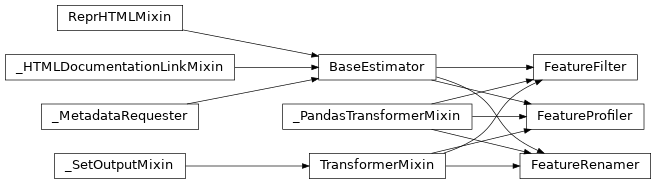

# scikitplot.feature\_selection[#](#module-scikitplot.feature_selection "Link to this heading")

## scikitplot.feature\_selection[#](#id1 "Link to this heading")

Understand, group, track and monitor the features of wide pandas tables.

Three questions, three tools:

**What is each feature?**
:   [`profile_features`](../modules/generated/scikitplot.feature_selection.profile_features.html#scikitplot.feature_selection.profile_features "scikitplot.feature_selection.profile_features") (or [`FeatureProfiler`](../modules/generated/scikitplot.feature_selection.FeatureProfiler.html#scikitplot.feature_selection.FeatureProfiler "scikitplot.feature_selection.FeatureProfiler") in a pipeline) fits a
    [`FeatureSchema`](../modules/generated/scikitplot.feature_selection.FeatureSchema.html#scikitplot.feature_selection.FeatureSchema "scikitplot.feature_selection.FeatureSchema") on training data. Each [`FeatureSpec`](../modules/generated/scikitplot.feature_selection.FeatureSpec.html#scikitplot.feature_selection.FeatureSpec "scikitplot.feature_selection.FeatureSpec") knows
    its role, dtype family, semantic kind, user tags, a bin recommendation,
    and policy-backed assessments with evidence (“am I skewed / discrete /
    constant / binary / identifier-like / high-cardinality …?”). Thresholds
    live in a [`FeaturePolicy`](../modules/generated/scikitplot.feature_selection.FeaturePolicy.html#scikitplot.feature_selection.FeaturePolicy "scikitplot.feature_selection.FeaturePolicy") (TOML, YAML or JSON), and custom
    questions are registered with [`register_assessment`](../modules/generated/scikitplot.feature_selection.register_assessment.html#scikitplot.feature_selection.register_assessment "scikitplot.feature_selection.register_assessment").

**What happened to each feature in a pipeline?**
:   [`trace_pipeline`](../modules/generated/scikitplot.feature_selection.trace_pipeline.html#scikitplot.feature_selection.trace_pipeline "scikitplot.feature_selection.trace_pipeline") reads a fitted `Pipeline` /
    `ColumnTransformer` / `FeatureUnion` and returns a
    [`FeatureLineage`](../modules/generated/scikitplot.feature_selection.FeatureLineage.html#scikitplot.feature_selection.FeatureLineage "scikitplot.feature_selection.FeatureLineage"): which steps touched a raw column, which outputs it
    became, where it was dropped, and [`FeatureLineage.attribute`](../modules/generated/scikitplot.feature_selection.FeatureLineage.html#scikitplot.feature_selection.FeatureLineage.attribute "scikitplot.feature_selection.FeatureLineage.attribute") to sum
    one-hot (or any exactly traced) importances back to raw columns.

**Has it drifted?**
:   [`ReferenceProfile`](../modules/generated/scikitplot.feature_selection.ReferenceProfile.html#scikitplot.feature_selection.ReferenceProfile "scikitplot.feature_selection.ReferenceProfile") freezes training buckets per feature and
    reports PSI, Jensen-Shannon distance, missingness change and unseen
    categories for later data.

The scikit-learn pieces ([`FeatureColumnSelector`](../modules/generated/scikitplot.feature_selection.FeatureColumnSelector.html#scikitplot.feature_selection.FeatureColumnSelector "scikitplot.feature_selection.FeatureColumnSelector") for
`ColumnTransformer`, [`FeatureFilter`](../modules/generated/scikitplot.feature_selection.FeatureFilter.html#scikitplot.feature_selection.FeatureFilter "scikitplot.feature_selection.FeatureFilter"), [`FeatureRenamer`](../modules/generated/scikitplot.feature_selection.FeatureRenamer.html#scikitplot.feature_selection.FeatureRenamer "scikitplot.feature_selection.FeatureRenamer")) fit
on the training fold only, so they are safe under cross-validation.

Examples

Try it in your browser!
```
>>> import numpy as np, pandas as pd
>>> from scikitplot.feature_selection import profile_features
>>> rng = np.random.default_rng(0)
>>> X = pd.DataFrame(
...     {
...         "income": rng.lognormal(10, 1, 300),
...         "age": rng.integers(18, 80, 300),
...         "kids": rng.integers(0, 4, 300),
...         "city": rng.choice(["ankara", "izmir", "bursa"], 300),
...         "customer_id": [f"c{i}" for i in range(300)],
...     }
... )
>>> schema = profile_features(X)
>>> schema.groups(by="kind")["numeric_continuous"]
['income', 'age']
>>> schema["income"].is_("skewed"), schema["kids"].kind
(True, 'numeric_discrete')
>>> schema.select(is_=("identifier_like",))
['customer_id']

```
Go BackOpen In Tab

Notes

****User note.**** Profile the training split only and keep the schema
([`FeatureSchema.save`](../modules/generated/scikitplot.feature_selection.FeatureSchema.html#scikitplot.feature_selection.FeatureSchema.save "scikitplot.feature_selection.FeatureSchema.save")); audit later splits with
[`FeatureSchema.audit`](../modules/generated/scikitplot.feature_selection.FeatureSchema.html#scikitplot.feature_selection.FeatureSchema.audit "scikitplot.feature_selection.FeatureSchema.audit") and [`ReferenceProfile`](../modules/generated/scikitplot.feature_selection.ReferenceProfile.html#scikitplot.feature_selection.ReferenceProfile "scikitplot.feature_selection.ReferenceProfile"). Recommendations
([`recommend_treatments`](../modules/generated/scikitplot.feature_selection.recommend_treatments.html#scikitplot.feature_selection.recommend_treatments "scikitplot.feature_selection.recommend_treatments"), [`analysis_plan`](../modules/generated/scikitplot.feature_selection.analysis_plan.html#scikitplot.feature_selection.analysis_plan "scikitplot.feature_selection.analysis_plan"), bin plans) are advice and
never modify data.

****Developer note.**** The package is pure Python on top of pandas, NumPy,
SciPy and scikit-learn; PyYAML and `tomli-w` are needed only to read YAML or
write TOML. Every persisted artefact carries a `schema_version` and is
checked field by field on load.

****User guide.**** See the [Feature Selection](../user_guide/feature_selection/index.html#feature-selection-index) section for further details.

## Profiling and the fitted schema[#](#profiling-and-the-fitted-schema "Link to this heading")

|  |  |
| --- | --- |
| [`profile_features`](../modules/generated/scikitplot.feature_selection.profile_features.html#scikitplot.feature_selection.profile_features "scikitplot.feature_selection.profile_features") | Fit a [`FeatureSchema`](../modules/generated/scikitplot.feature_selection.FeatureSchema.html#scikitplot.feature_selection.FeatureSchema "scikitplot.feature_selection.FeatureSchema") on training data. |
| [`FeatureSchema`](../modules/generated/scikitplot.feature_selection.FeatureSchema.html#scikitplot.feature_selection.FeatureSchema "scikitplot.feature_selection.FeatureSchema") | Immutable, fitted description of a table's columns. |
| [`FeatureSpec`](../modules/generated/scikitplot.feature_selection.FeatureSpec.html#scikitplot.feature_selection.FeatureSpec "scikitplot.feature_selection.FeatureSpec") | Everything a fitted schema knows about one column. |
| [`FeatureStats`](../modules/generated/scikitplot.feature_selection.FeatureStats.html#scikitplot.feature_selection.FeatureStats "scikitplot.feature_selection.FeatureStats") | Training statistics of one column. |

## Policy and configuration[#](#policy-and-configuration "Link to this heading")

|  |  |
| --- | --- |
| [`FeaturePolicy`](../modules/generated/scikitplot.feature_selection.FeaturePolicy.html#scikitplot.feature_selection.FeaturePolicy "scikitplot.feature_selection.FeaturePolicy") | Complete, declarative description of how to profile a table. |
| [`ColumnRule`](../modules/generated/scikitplot.feature_selection.ColumnRule.html#scikitplot.feature_selection.ColumnRule "scikitplot.feature_selection.ColumnRule") | Select columns by exact name and/or shell-style pattern. |
| [`AssessmentSpec`](../modules/generated/scikitplot.feature_selection.AssessmentSpec.html#scikitplot.feature_selection.AssessmentSpec "scikitplot.feature_selection.AssessmentSpec") | Which provider answers one assessment question, with which parameters. |
| [`BinningPolicy`](../modules/generated/scikitplot.feature_selection.BinningPolicy.html#scikitplot.feature_selection.BinningPolicy "scikitplot.feature_selection.BinningPolicy") | How bin recommendations are computed for numeric features. |
| [`DriftPolicy`](../modules/generated/scikitplot.feature_selection.DriftPolicy.html#scikitplot.feature_selection.DriftPolicy "scikitplot.feature_selection.DriftPolicy") | How a drift reference is frozen and judged. |
| [`DEFAULT_ASSESSMENTS`](../modules/generated/scikitplot.feature_selection.DEFAULT_ASSESSMENTS.html#scikitplot.feature_selection.DEFAULT_ASSESSMENTS "scikitplot.feature_selection.DEFAULT_ASSESSMENTS") |  |
| [`load_policy`](../modules/generated/scikitplot.feature_selection.load_policy.html#scikitplot.feature_selection.load_policy "scikitplot.feature_selection.load_policy") | Load a [`FeaturePolicy`](../modules/generated/scikitplot.feature_selection.FeaturePolicy.html#scikitplot.feature_selection.FeaturePolicy "scikitplot.feature_selection.FeaturePolicy") from a file, a mapping or a policy. |
| [`dump_policy`](../modules/generated/scikitplot.feature_selection.dump_policy.html#scikitplot.feature_selection.dump_policy "scikitplot.feature_selection.dump_policy") | Write `policy` to `path` atomically, verified by reading it back. |

## Assessments[#](#assessments "Link to this heading")

|  |  |
| --- | --- |
| [`Assessment`](../modules/generated/scikitplot.feature_selection.Assessment.html#scikitplot.feature_selection.Assessment "scikitplot.feature_selection.Assessment") | The recorded answer to one assessment for one feature. |
| [`AssessmentContext`](../modules/generated/scikitplot.feature_selection.AssessmentContext.html#scikitplot.feature_selection.AssessmentContext "scikitplot.feature_selection.AssessmentContext") | What a provider may read about one feature. |
| [`AssessmentOutcome`](../modules/generated/scikitplot.feature_selection.AssessmentOutcome.html#scikitplot.feature_selection.AssessmentOutcome "scikitplot.feature_selection.AssessmentOutcome") | What a provider returns: a state, reason codes and evidence. |
| [`AssessmentProvider`](../modules/generated/scikitplot.feature_selection.AssessmentProvider.html#scikitplot.feature_selection.AssessmentProvider "scikitplot.feature_selection.AssessmentProvider") | A named, versioned function that answers one kind of question. |
| [`AssessmentRegistry`](../modules/generated/scikitplot.feature_selection.AssessmentRegistry.html#scikitplot.feature_selection.AssessmentRegistry "scikitplot.feature_selection.AssessmentRegistry") | Name table of assessment providers. |
| [`default_registry`](../modules/generated/scikitplot.feature_selection.default_registry.html#scikitplot.feature_selection.default_registry "scikitplot.feature_selection.default_registry") | Name table of assessment providers. |
| [`register_assessment`](../modules/generated/scikitplot.feature_selection.register_assessment.html#scikitplot.feature_selection.register_assessment "scikitplot.feature_selection.register_assessment") | Register an assessment provider; usable as a decorator. |
| [`list_assessment_providers`](../modules/generated/scikitplot.feature_selection.list_assessment_providers.html#scikitplot.feature_selection.list_assessment_providers "scikitplot.feature_selection.list_assessment_providers") | Tabulate registered providers. |

## Binning[#](#binning "Link to this heading")

|  |  |
| --- | --- |
| [`BinningRecommendation`](../modules/generated/scikitplot.feature_selection.BinningRecommendation.html#scikitplot.feature_selection.BinningRecommendation "scikitplot.feature_selection.BinningRecommendation") | A frozen bin recommendation for one feature. |
| [`knuth_bin_count`](../modules/generated/scikitplot.feature_selection.knuth_bin_count.html#scikitplot.feature_selection.knuth_bin_count "scikitplot.feature_selection.knuth_bin_count") | Return the equal-width bin count that maximises Knuth's posterior. |
| [`make_kbins_discretizer`](../modules/generated/scikitplot.feature_selection.make_kbins_discretizer.html#scikitplot.feature_selection.make_kbins_discretizer "scikitplot.feature_selection.make_kbins_discretizer") | Build a `KBinsDiscretizer` with the recommended per-feature bin counts. |

## Scikit-learn estimators[#](#scikit-learn-estimators "Link to this heading")

Class inheritance




|  |  |
| --- | --- |
| [`FeatureProfiler`](../modules/generated/scikitplot.feature_selection.FeatureProfiler.html#scikitplot.feature_selection.FeatureProfiler "scikitplot.feature_selection.FeatureProfiler") | Fit a feature schema on the training data; pass data through unchanged. |
| [`FeatureFilter`](../modules/generated/scikitplot.feature_selection.FeatureFilter.html#scikitplot.feature_selection.FeatureFilter "scikitplot.feature_selection.FeatureFilter") | Drop features whose assessments are true, and columns with non-feature roles. |
| [`FeatureColumnSelector`](../modules/generated/scikitplot.feature_selection.FeatureColumnSelector.html#scikitplot.feature_selection.FeatureColumnSelector "scikitplot.feature_selection.FeatureColumnSelector") | Column selector for `ColumnTransformer` driven by a feature schema. |
| [`FeatureRenamer`](../modules/generated/scikitplot.feature_selection.FeatureRenamer.html#scikitplot.feature_selection.FeatureRenamer "scikitplot.feature_selection.FeatureRenamer") | Rename columns with a plan frozen at fit time. |
| [`RenamePlan`](../modules/generated/scikitplot.feature_selection.RenamePlan.html#scikitplot.feature_selection.RenamePlan "scikitplot.feature_selection.RenamePlan") | A complete, frozen `old -> new` name mapping. |

## Pipeline lineage[#](#pipeline-lineage "Link to this heading")

|  |  |
| --- | --- |
| [`trace_pipeline`](../modules/generated/scikitplot.feature_selection.trace_pipeline.html#scikitplot.feature_selection.trace_pipeline "scikitplot.feature_selection.trace_pipeline") | Trace the feature lineage of a fitted estimator. |
| [`FeatureLineage`](../modules/generated/scikitplot.feature_selection.FeatureLineage.html#scikitplot.feature_selection.FeatureLineage "scikitplot.feature_selection.FeatureLineage") | Traced feature graph of a fitted pipeline. |
| [`FeatureMapping`](../modules/generated/scikitplot.feature_selection.FeatureMapping.html#scikitplot.feature_selection.FeatureMapping "scikitplot.feature_selection.FeatureMapping") | How one transformer's outputs derive from its inputs. |
| [`Attribution`](../modules/generated/scikitplot.feature_selection.Attribution.html#scikitplot.feature_selection.Attribution "scikitplot.feature_selection.Attribution") | Values of transformed features summed back onto raw input features. |

## Drift[#](#drift "Link to this heading")

|  |  |
| --- | --- |
| [`ReferenceProfile`](../modules/generated/scikitplot.feature_selection.ReferenceProfile.html#scikitplot.feature_selection.ReferenceProfile "scikitplot.feature_selection.ReferenceProfile") | Frozen training distribution of every compared feature. |
| [`FeatureReference`](../modules/generated/scikitplot.feature_selection.FeatureReference.html#scikitplot.feature_selection.FeatureReference "scikitplot.feature_selection.FeatureReference") | Frozen reference buckets of one feature. |

## Analysis routing[#](#analysis-routing "Link to this heading")

|  |  |
| --- | --- |
| [`analysis_plan`](../modules/generated/scikitplot.feature_selection.analysis_plan.html#scikitplot.feature_selection.analysis_plan "scikitplot.feature_selection.analysis_plan") | Route every feature to the plots, summaries and tests that fit its kind. |
| [`recommend_treatments`](../modules/generated/scikitplot.feature_selection.recommend_treatments.html#scikitplot.feature_selection.recommend_treatments "scikitplot.feature_selection.recommend_treatments") | Recommend an ordered preprocessing chain per feature. |
| [`treatment_groups`](../modules/generated/scikitplot.feature_selection.treatment_groups.html#scikitplot.feature_selection.treatment_groups "scikitplot.feature_selection.treatment_groups") | Group features that share the same recommended chain. |
| [`DEFAULT_ANALYSIS_RULES`](../modules/generated/scikitplot.feature_selection.DEFAULT_ANALYSIS_RULES.html#scikitplot.feature_selection.DEFAULT_ANALYSIS_RULES "scikitplot.feature_selection.DEFAULT_ANALYSIS_RULES") |  |

## Vocabularies and errors[#](#vocabularies-and-errors "Link to this heading")

|  |  |
| --- | --- |
| [`AssessmentState`](../modules/generated/scikitplot.feature_selection.AssessmentState.html#scikitplot.feature_selection.AssessmentState "scikitplot.feature_selection.AssessmentState") | Outcome of one assessment of one feature. |
| [`DtypeFamily`](../modules/generated/scikitplot.feature_selection.DtypeFamily.html#scikitplot.feature_selection.DtypeFamily "scikitplot.feature_selection.DtypeFamily") | Physical storage family of a column, read from its pandas dtype and values. |
| [`FeatureKind`](../modules/generated/scikitplot.feature_selection.FeatureKind.html#scikitplot.feature_selection.FeatureKind "scikitplot.feature_selection.FeatureKind") | Semantic kind of a feature: what analyses and treatments make sense. |
| [`FeatureRole`](../modules/generated/scikitplot.feature_selection.FeatureRole.html#scikitplot.feature_selection.FeatureRole "scikitplot.feature_selection.FeatureRole") | Role of a column in a modelling task; only `FEATURE` columns are model inputs. |
| [`LineageQuality`](../modules/generated/scikitplot.feature_selection.LineageQuality.html#scikitplot.feature_selection.LineageQuality "scikitplot.feature_selection.LineageQuality") | How strongly a lineage edge is supported. |
| [`Relation`](../modules/generated/scikitplot.feature_selection.Relation.html#scikitplot.feature_selection.Relation "scikitplot.feature_selection.Relation") | How the outputs of one pipeline stage relate to its inputs. |
| [`FeatureSelectionError`](../modules/generated/scikitplot.feature_selection.FeatureSelectionError.html#scikitplot.feature_selection.FeatureSelectionError "scikitplot.feature_selection.FeatureSelectionError") | Base class of every error raised by [`scikitplot.feature_selection`](#module-scikitplot.feature_selection "scikitplot.feature_selection"). |
| [`PolicyError`](../modules/generated/scikitplot.feature_selection.PolicyError.html#scikitplot.feature_selection.PolicyError "scikitplot.feature_selection.PolicyError") | A policy or configuration document is off contract (unknown key, wrong type, bad range). |
| [`SchemaMismatchError`](../modules/generated/scikitplot.feature_selection.SchemaMismatchError.html#scikitplot.feature_selection.SchemaMismatchError "scikitplot.feature_selection.SchemaMismatchError") | Data given after fitting does not match the fitted schema (missing, extra or retyped columns). |
| [`SchemaMismatchWarning`](../modules/generated/scikitplot.feature_selection.SchemaMismatchWarning.html#scikitplot.feature_selection.SchemaMismatchWarning "scikitplot.feature_selection.SchemaMismatchWarning") | Later data differs from the fitted schema and `on_mismatch="warn"` let it through. |
| [`IncompatibleSchemaError`](../modules/generated/scikitplot.feature_selection.IncompatibleSchemaError.html#scikitplot.feature_selection.IncompatibleSchemaError "scikitplot.feature_selection.IncompatibleSchemaError") | A persisted artefact was written by another, unsupported schema generation. |
| [`LineageError`](../modules/generated/scikitplot.feature_selection.LineageError.html#scikitplot.feature_selection.LineageError "scikitplot.feature_selection.LineageError") | A pipeline's feature topology cannot be traced or does not reconcile with its output. |