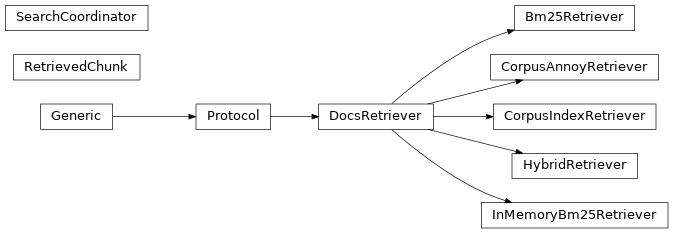

# scikitplot.mcp[#](#module-scikitplot.mcp "Link to this heading")

Composable documentation retrieval for Model Context Protocol (MCP) servers.

The default import surface is ****independent of the MCP SDK, pydantic, and the
optional corpus/vector dependencies****. Importing [`scikitplot.mcp`](#module-scikitplot.mcp "scikitplot.mcp") pulls only
the SDK-free retrieval core (contracts, fusion, the in-memory demo retriever) and
the pydantic-free capability/runtime-status helpers, so it works on the Legacy
Retrieval tier (Python 3.8+) with a base install.

The server layer (`SearchService`, `create_server`, and the pydantic output
models `SearchDocsOutput` / `CitationOutput`) is imported ****lazily**** on first
access. It requires the `[mcp]` extra (`pydantic` always; `mcp>=2.0.0,<3` on
Python >= 3.10). No models, indexes, files, or network connections are opened at
import time.

> **See also**
> * [modelcontextprotocol/python-sdk](https://github.com/modelcontextprotocol/python-sdk)
* [semantica-agi/semantica](https://github.com/semantica-agi/semantica)

****User guide.**** See the [Model Context Protocol Retrieval](../user_guide/mcp/index.html#mcp-index) section for further details.

## MCP: Capabilities[#](#mcp-capabilities "Link to this heading")

|  |  |
| --- | --- |
| [`assert_capability_vocabulary_matches_corpus`](../modules/generated/scikitplot.mcp.assert_capability_vocabulary_matches_corpus.html#scikitplot.mcp.assert_capability_vocabulary_matches_corpus "scikitplot.mcp.assert_capability_vocabulary_matches_corpus") | Verify this module's capability vocabulary still matches Corpus's. |
| [`effective_server_capabilities`](../modules/generated/scikitplot.mcp.effective_server_capabilities.html#scikitplot.mcp.effective_server_capabilities "scikitplot.mcp.effective_server_capabilities") | Return the ****effective**** surface for a specific server configuration. |
| [`server_capabilities`](../modules/generated/scikitplot.mcp.server_capabilities.html#scikitplot.mcp.server_capabilities "scikitplot.mcp.server_capabilities") | Return the ****static / potential**** tool/resource inventory, without importing the MCP SDK — safe on any interpreter, including the Legacy Retrieval tier. |
| [`server_runtime_status`](../modules/generated/scikitplot.mcp.server_runtime_status.html#scikitplot.mcp.server_runtime_status "scikitplot.mcp.server_runtime_status") | Report, ****without importing the MCP SDK****, whether the protocol server can run in this interpreter — so callers can degrade gracefully to the SDK-free retrieval layer instead of catching an exception from [`create_server`](../modules/generated/scikitplot.mcp.create_server.html#scikitplot.mcp.create_server "scikitplot.mcp.create_server"). |

## MCP: Core[#](#mcp-core "Link to this heading")

Class inheritance

|  |  |
| --- | --- |
| [`DOC_ID_RE`](../modules/generated/scikitplot.mcp.DOC_ID_RE.html#scikitplot.mcp.DOC_ID_RE "scikitplot.mcp.DOC_ID_RE") | Compiled regular expression object. |
| [`MAX_CHUNK_CHARS`](../modules/generated/scikitplot.mcp.MAX_CHUNK_CHARS.html#scikitplot.mcp.MAX_CHUNK_CHARS "scikitplot.mcp.MAX_CHUNK_CHARS") | int([x]) -> integer int(x, base=10) -> integer |
| [`MAX_QUERY_CHARS`](../modules/generated/scikitplot.mcp.MAX_QUERY_CHARS.html#scikitplot.mcp.MAX_QUERY_CHARS "scikitplot.mcp.MAX_QUERY_CHARS") | int([x]) -> integer int(x, base=10) -> integer |
| [`MAX_RESOURCE_CHARS`](../modules/generated/scikitplot.mcp.MAX_RESOURCE_CHARS.html#scikitplot.mcp.MAX_RESOURCE_CHARS "scikitplot.mcp.MAX_RESOURCE_CHARS") | int([x]) -> integer int(x, base=10) -> integer |
| [`MAX_RESULTS`](../modules/generated/scikitplot.mcp.MAX_RESULTS.html#scikitplot.mcp.MAX_RESULTS "scikitplot.mcp.MAX_RESULTS") | int([x]) -> integer int(x, base=10) -> integer |
| [`RESOURCE_METADATA_ALLOWANCE`](../modules/generated/scikitplot.mcp.RESOURCE_METADATA_ALLOWANCE.html#scikitplot.mcp.RESOURCE_METADATA_ALLOWANCE "scikitplot.mcp.RESOURCE_METADATA_ALLOWANCE") | int([x]) -> integer int(x, base=10) -> integer |
| [`DocsRetriever`](../modules/generated/scikitplot.mcp.DocsRetriever.html#scikitplot.mcp.DocsRetriever "scikitplot.mcp.DocsRetriever") | Structural contract every retrieval backend must satisfy. |
| [`RetrievedChunk`](../modules/generated/scikitplot.mcp.RetrievedChunk.html#scikitplot.mcp.RetrievedChunk "scikitplot.mcp.RetrievedChunk") | One retrieved passage with the metadata needed to cite it. |
| [`SearchCoordinator`](../modules/generated/scikitplot.mcp.SearchCoordinator.html#scikitplot.mcp.SearchCoordinator "scikitplot.mcp.SearchCoordinator") | Validated, concurrency-bounded search orchestration, free of wire models. |
| [`build_search_docs_result`](../modules/generated/scikitplot.mcp.build_search_docs_result.html#scikitplot.mcp.build_search_docs_result "scikitplot.mcp.build_search_docs_result") | Format retrieval results as an MCP `tools/call` response with citations. |
| [`is_valid_doc_id`](../modules/generated/scikitplot.mcp.is_valid_doc_id.html#scikitplot.mcp.is_valid_doc_id "scikitplot.mcp.is_valid_doc_id") | Return whether `value` is an acceptable document identifier. |

## MCP: Corpus Index Retriever[#](#mcp-corpus-index-retriever "Link to this heading")

Class inheritance

|  |  |
| --- | --- |
| [`CorpusAnnoyRetriever`](../modules/generated/scikitplot.mcp.CorpusAnnoyRetriever.html#scikitplot.mcp.CorpusAnnoyRetriever "scikitplot.mcp.CorpusAnnoyRetriever") | Docs dense retriever backed by an embedder + a vector index + a document lookup. |
| [`CorpusIndexRetriever`](../modules/generated/scikitplot.mcp.CorpusIndexRetriever.html#scikitplot.mcp.CorpusIndexRetriever "scikitplot.mcp.CorpusIndexRetriever") | Text-level retriever over a corpus `RetrievalIndex`: hybrid by default. |
| [`Embedder`](../modules/generated/scikitplot.mcp.Embedder.html#scikitplot.mcp.Embedder "scikitplot.mcp.Embedder") | Anything that turns a query string into a vector (e.g. corpus `EmbeddingEngine`). |
| [`VectorIndex`](../modules/generated/scikitplot.mcp.VectorIndex.html#scikitplot.mcp.VectorIndex "scikitplot.mcp.VectorIndex") | Anything that returns `(doc_id, score)` pairs for a query vector. |

## MCP: Corpus Hybrid Retriever[#](#mcp-corpus-hybrid-retriever "Link to this heading")

Class inheritance

|  |  |
| --- | --- |
| [`DEFAULT_RRF_K`](../modules/generated/scikitplot.mcp.DEFAULT_RRF_K.html#scikitplot.mcp.DEFAULT_RRF_K "scikitplot.mcp.DEFAULT_RRF_K") | int([x]) -> integer int(x, base=10) -> integer |
| [`Bm25Retriever`](../modules/generated/scikitplot.mcp.Bm25Retriever.html#scikitplot.mcp.Bm25Retriever "scikitplot.mcp.Bm25Retriever") | Lexical retriever (FTS/BM25) leg backed by a full-text search seam. |
| [`HybridRetriever`](../modules/generated/scikitplot.mcp.HybridRetriever.html#scikitplot.mcp.HybridRetriever "scikitplot.mcp.HybridRetriever") | Fuse several retrievers into one via Reciprocal Rank Fusion. |
| [`reciprocal_rank_fusion`](../modules/generated/scikitplot.mcp.reciprocal_rank_fusion.html#scikitplot.mcp.reciprocal_rank_fusion "scikitplot.mcp.reciprocal_rank_fusion") | Fuse weighted ranked lists into a single `key -> score` map. |

## MCP: Demo[#](#mcp-demo "Link to this heading")

|  |  |
| --- | --- |
| [`DemoDocument`](../modules/generated/scikitplot.mcp.DemoDocument.html#scikitplot.mcp.DemoDocument "scikitplot.mcp.DemoDocument") | One in-memory document used by [`InMemoryBm25Retriever`](../modules/generated/scikitplot.mcp.InMemoryBm25Retriever.html#scikitplot.mcp.InMemoryBm25Retriever "scikitplot.mcp.InMemoryBm25Retriever"). |
| [`InMemoryBm25Retriever`](../modules/generated/scikitplot.mcp.InMemoryBm25Retriever.html#scikitplot.mcp.InMemoryBm25Retriever "scikitplot.mcp.InMemoryBm25Retriever") | A compact BM25 implementation suitable for demos and small corpora. |
| [`builtin_demo_retriever`](../modules/generated/scikitplot.mcp.builtin_demo_retriever.html#scikitplot.mcp.builtin_demo_retriever "scikitplot.mcp.builtin_demo_retriever") | Return a tiny corpus that explains the sample's own mechanism. |

## MCP: Outcome[#](#mcp-outcome "Link to this heading")

Class inheritance

|  |  |
| --- | --- |
| [`CANCELLED`](../modules/generated/scikitplot.mcp.CANCELLED.html#scikitplot.mcp.CANCELLED "scikitplot.mcp.CANCELLED") | str(object='') -> str str(bytes\_or\_buffer[, encoding[, errors]]) -> str |
| [`DEGRADED`](../modules/generated/scikitplot.mcp.DEGRADED.html#scikitplot.mcp.DEGRADED "scikitplot.mcp.DEGRADED") | str(object='') -> str str(bytes\_or\_buffer[, encoding[, errors]]) -> str |
| [`EMPTY`](../modules/generated/scikitplot.mcp.EMPTY.html#scikitplot.mcp.EMPTY "scikitplot.mcp.EMPTY") | str(object='') -> str str(bytes\_or\_buffer[, encoding[, errors]]) -> str |
| [`FAILED`](../modules/generated/scikitplot.mcp.FAILED.html#scikitplot.mcp.FAILED "scikitplot.mcp.FAILED") | str(object='') -> str str(bytes\_or\_buffer[, encoding[, errors]]) -> str |
| [`SUCCESS`](../modules/generated/scikitplot.mcp.SUCCESS.html#scikitplot.mcp.SUCCESS "scikitplot.mcp.SUCCESS") | str(object='') -> str str(bytes\_or\_buffer[, encoding[, errors]]) -> str |
| [`LegRecord`](../modules/generated/scikitplot.mcp.LegRecord.html#scikitplot.mcp.LegRecord "scikitplot.mcp.LegRecord") | How one retrieval leg fared. |
| [`RetrievalOutcome`](../modules/generated/scikitplot.mcp.RetrievalOutcome.html#scikitplot.mcp.RetrievalOutcome "scikitplot.mcp.RetrievalOutcome") | Ranked hits plus the story of how they were obtained. |
| [`assert_matches_corpus`](../modules/generated/scikitplot.mcp.assert_matches_corpus.html#scikitplot.mcp.assert_matches_corpus "scikitplot.mcp.assert_matches_corpus") | Verify this module's vocabulary still matches Corpus's. |
| [`to_corpus_status`](../modules/generated/scikitplot.mcp.to_corpus_status.html#scikitplot.mcp.to_corpus_status "scikitplot.mcp.to_corpus_status") | Resolve a status string to [`scikitplot.corpus.RetrievalStatus`](../modules/generated/scikitplot.corpus.RetrievalStatus.html#scikitplot.corpus.RetrievalStatus "scikitplot.corpus.RetrievalStatus"). |

## MCP: Server[#](#mcp-server "Link to this heading")

|  |  |
| --- | --- |
| [`CitationOutput`](../modules/generated/scikitplot.mcp.CitationOutput.html#scikitplot.mcp.CitationOutput "scikitplot.mcp.CitationOutput") | Stable source metadata for one returned passage. |
| [`SearchDocsOutput`](../modules/generated/scikitplot.mcp.SearchDocsOutput.html#scikitplot.mcp.SearchDocsOutput "scikitplot.mcp.SearchDocsOutput") | Structured output schema automatically advertised by MCP SDK v2. |
| [`SearchService`](../modules/generated/scikitplot.mcp.SearchService.html#scikitplot.mcp.SearchService "scikitplot.mcp.SearchService") | Wire adapter: bounded, validated search returning pydantic tool models. |
| [`create_server`](../modules/generated/scikitplot.mcp.create_server.html#scikitplot.mcp.create_server "scikitplot.mcp.create_server") | Create an official MCP Python SDK v2 `MCPServer` instance. |