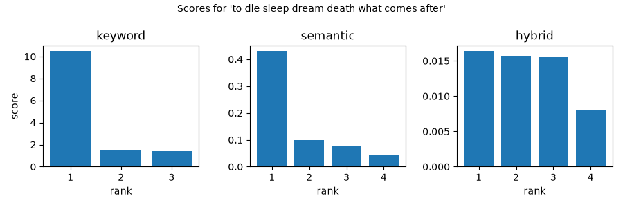
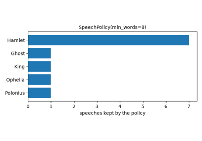

> **Note**
> [Go to the end](#sphx-glr-download-auto-examples-corpus-plot-corpus-fluent-hamlet-retrieval-script-py)
to download the full example code or to run this example in your browser via JupyterLite or Binder.

# Build and Search a Hamlet Corpus, Step by Step[#](#build-and-search-a-hamlet-corpus-step-by-step "Link to this heading")

This example builds a searchable corpus from a public-domain **Hamlet**
excerpt with [`FluentCorpus`](../../modules/generated/scikitplot.corpus.FluentCorpus.html#scikitplot.corpus.FluentCorpus "scikitplot.corpus.FluentCorpus"), starting from the smallest working
configuration and adding one capability per step:

1. ****Minimal****: one file, paragraph chunks, keyword search.
2. ****Richer documents****: normalization, keywords and dense vectors, so
   keyword, semantic and hybrid search can be compared on one query.
3. ****A growing corpus****: storage queries, adding a second source, a new
   index generation, per-request retrieval settings, and export.
4. ****Another backend****: the same plan configured for Annoy, validated
   without building it.

Every step runs offline and gives the same output on every run:
[`HAMLET_TEXT`](../../modules/generated/scikitplot.corpus.HAMLET_TEXT.html#scikitplot.corpus.HAMLET_TEXT "scikitplot.corpus.HAMLET_TEXT") is bundled with [`scikitplot.corpus`](../../apis/scikitplot.corpus.html#module-scikitplot.corpus "scikitplot.corpus"),
[`HashEmbedder`](../../modules/generated/scikitplot.corpus.HashEmbedder.html#scikitplot.corpus.HashEmbedder "scikitplot.corpus.HashEmbedder") makes vectors without a model download, and the
`bruteforce` index is exact. The one figure compares the scores of the
three search modes for the same query.

The lifecycle is the same at every step:

```
FluentCorpus (configuration)
  → materialize()  → RuntimeCorpus (components, no data read yet)
  → run()          → read, chunk, enrich, embed, store, index
  → search() / add() / query_storage() / export()
  → close()

```
```
# Authors: The scikit-plots developers
# SPDX-License-Identifier: BSD-3-Clause

```

## Imports and a temporary workspace[#](#imports-and-a-temporary-workspace "Link to this heading")

Sources and exports live in a temporary folder, so the example leaves
nothing in the gallery tree. It is removed in the last cell.

```
from __future__ import annotations

import tempfile
from pathlib import Path

import matplotlib.pyplot as plt

from scikitplot.corpus import (
    HAMLET_TEXT,
    DocumentReader,
    ExportFormat,
    FluentCorpus,
    HashEmbedder,
    InMemoryStorage,
    ParagraphChunkerConfig,
    RetrievalConfig,
    RuntimePolicy,
    SimpleEnricherSpec,
    StorageQuery,
    TextNormalizerConfig,
)

_WORKSPACE = tempfile.TemporaryDirectory(prefix="scikitplot-hamlet-")
WORK_DIR = Path(_WORKSPACE.name)
HAMLET_PATH = WORK_DIR / "hamlet_excerpt.txt"
HAMLET_PATH.write_text(HAMLET_TEXT, encoding="utf-8")

#: Network access is never needed here; the policy makes that explicit.
OFFLINE = RuntimePolicy(allow_network=False)

print("Source:", HAMLET_PATH.name, f"({len(HAMLET_TEXT):,} characters)")

```
```
Source: hamlet_excerpt.txt (3,820 characters)

```

## Step 1: the minimal corpus[#](#step-1-the-minimal-corpus "Link to this heading")

A source, a chunker, an embedder and an index are the smallest plan that
can be searched: an index needs vectors to build from, and
[`HashEmbedder`](../../modules/generated/scikitplot.corpus.HashEmbedder.html#scikitplot.corpus.HashEmbedder "scikitplot.corpus.HashEmbedder") makes them locally. Paragraph chunks keep each
speech together.

In one Python scope, the context manager opens and closes the runtime.

```
minimal = (
    FluentCorpus()
    .source(HAMLET_PATH)
    .chunker(ParagraphChunkerConfig(min_length=40, max_length=900))
    .embedder(HashEmbedder(dimension=256))
    .index(RetrievalConfig(backend="bruteforce"))
    .retrieval(RetrievalConfig(match_mode="keyword", top_k=3))
)
print("Validation problems:", minimal.validate())

with minimal.materialize(policy=OFFLINE) as rt:
    built = rt.run()
    print("Chunks:", built.n_documents)
    for rank, hit in enumerate(rt.search("ghost father"), start=1):
        print(f"#{rank} {hit.score:.3f}  {hit.doc.text[:90]!r}")

```
```
Validation problems: []
Chunks: 12
#1 3.578  "GHOST. I am thy father's spirit,\nDoom'd for a certain term to walk the night,\nAnd for the "
#2 1.769  'HAMLET. O all you host of heaven! O earth! What else?\nAnd shall I couple hell? O, fie! Hol'

```

## Step 2: richer documents and three search modes[#](#step-2-richer-documents-and-three-search-modes "Link to this heading")

The same plan with every stage named: a normalizer, a keyword enricher,
wider vectors and in-memory storage. `index` (how vectors are indexed)
and `retrieval` (how a query is matched) are separate decisions.

This runtime stays open across the following cells, because a gallery
turns each `# %%` block into its own notebook cell; it is closed in the
last cell.

```
fluent = (
    FluentCorpus()
    .source(HAMLET_PATH)
    .reader(DocumentReader)
    .normalizer(TextNormalizerConfig(steps=["unicode", "whitespace"], lowercase=False))
    .chunker(
        ParagraphChunkerConfig(min_length=40, max_length=900, overlap=0, merge_short=True)
    )
    .enricher(SimpleEnricherSpec(min_token_length=3, max_keywords=8))
    .embedder(HashEmbedder(dimension=1024))
    .storage(InMemoryStorage)
    .index(RetrievalConfig(backend="bruteforce"))
    .retrieval(RetrievalConfig(match_mode="hybrid", top_k=4, hybrid_alpha=0.55))
    .export(ExportFormat.JSONL)
)
print("Configured stages:", fluent.plan().configured)

runtime = fluent.materialize(policy=OFFLINE)
result = runtime.run()
print("Chunks:", result.n_documents, "| stored:", runtime.storage.count())
print("Dense index:", runtime.index.backend_name, "| generation:", runtime.index_generation)
print("Keywords of the first chunk:", runtime.documents[0].keywords)

```
```
Configured stages: ['source', 'reader', 'normalizer', 'chunker', 'enricher', 'embedder', 'storage', 'index', 'retrieval', 'export']
Chunks: 12 | stored: 12
Dense index: bruteforce | generation: 7385e63524caa5d7e8d7ebf0e47fe5174165458351efc26e52d4ed0042d002cb
Keywords of the first chunk: ['denmark', 'hamlet', 'prince', 'the', 'tragedy']

```

Compare the modes on one question. Keyword search matches words;
semantic search matches the hashed vectors; hybrid mixes the two with
`hybrid_alpha`. Retrieval settings change per request, without a
rebuild.

Each mode scores on its own scale (keyword is a BM25 score, semantic a
vector similarity, hybrid a weighted reciprocal-rank fusion of the two
rankings), so the figure compares the **shape** of each ranking: how far
the best hit stands out, not one mode’s numbers against another’s.

```
QUERY = "to die sleep dream death what comes after"
MODES = ("keyword", "semantic", "hybrid")
scores = {}
for mode in MODES:
    response = runtime.search(QUERY, config=RetrievalConfig(match_mode=mode, top_k=4))
    scores[mode] = [hit.score for hit in response]
    top = response[0].doc.text.replace("\n", " ")[:80] if response else "(no hit)"
    print(f"{mode:9s} hits={len(response)}  top: {top!r}")

fig, axes = plt.subplots(1, len(MODES), figsize=(9, 3))
for ax, mode in zip(axes, MODES):
    values = scores[mode]
    ax.bar(range(1, len(values) + 1), values, color="tab:blue")
    ax.set_title(mode)
    ax.set_xlabel("rank")
    ax.set_xticks(range(1, len(values) + 1))
axes[0].set_ylabel("score")
fig.suptitle(f"Scores for {QUERY!r}", fontsize=10)
fig.tight_layout()
plt.show()

```

```
keyword   hits=3  top: "HAMLET. To be, or not to be- that is the question: Whether 'tis nobler in the mi"
semantic  hits=4  top: "HAMLET. To be, or not to be- that is the question: Whether 'tis nobler in the mi"
hybrid    hits=4  top: "HAMLET. To be, or not to be- that is the question: Whether 'tis nobler in the mi"

```

## Step 3: query storage, grow the corpus, export[#](#step-3-query-storage-grow-the-corpus-export "Link to this heading")

Storage answers structured questions without the index:

```
ghost = runtime.query_storage(StorageQuery(full_text="ghost", limit=3))
print("Chunks that mention 'ghost':", ghost.total)

```
```
Chunks that mention 'ghost': 2

```

`add()` reads a new source, stores its chunks and rebuilds one index
over every document: a new generation. `run()` is one-shot by design,
so growth is always explicit.

```
ADDENDUM_PATH = WORK_DIR / "hamlet_addendum.txt"
ADDENDUM_PATH.write_text(
    "POLONIUS. Therefore, since brevity is the soul of wit,\n"
    "And tediousness the limbs and outward flourishes,\n"
    "I will be brief.\n\n"
    "HAMLET. What a piece of work is a man! How noble in reason,\n"
    "how infinite in faculty, in form and moving how express and admirable.\n",
    encoding="utf-8",
)

generation = runtime.index_generation
added = runtime.add(ADDENDUM_PATH)
print("New chunks:", added.n_documents, "| total:", len(runtime.documents))
print("Generation changed:", runtime.index_generation != generation)

hits = runtime.search("brevity soul wit")
print("Top hit after add:", hits[0].doc.text[:80] if hits else "(no hit)")

```
```
New chunks: 2 | total: 14
Generation changed: True
Top hit after add: POLONIUS. Therefore, since brevity is the soul of wit,
And tediousness the limbs

```

The plan chose JSONL, so export needs only a path. It writes the current
generation, the added source included.

```
exported = runtime.export(WORK_DIR / "hamlet_corpus.jsonl", include_embedding=False)
print("Exported:", exported.name, f"({exported.stat().st_size:,} bytes,",
      len(runtime.documents), "documents)")

```
```
Exported: hamlet_corpus.jsonl (34,799 bytes, 14 documents)

```

## Step 4: the same corpus on another index backend[#](#step-4-the-same-corpus-on-another-index-backend "Link to this heading")

A plan is immutable: `replace_index` returns a new one. Backend options
go in the generic `index_kwargs` mapping. This plan is only validated,
so the native Annoy backend is not needed to run the example.

```
annoy = fluent.replace_index(
    RetrievalConfig(
        backend="annoy",
        index_kwargs={"impl": "auto", "metric": "angular", "n_trees": 20, "search_k": -1},
    )
)
print("Backend:", fluent.plan().get("index").backend, "→", annoy.plan().get("index").backend)
print("Index options:", annoy.plan().get("index").index_kwargs)
print("Same source:", annoy.plan().get("source") == fluent.plan().get("source"))
print("Validation problems:", annoy.validate())

```
```
Backend: bruteforce → annoy
Index options: {'impl': 'auto', 'metric': 'angular', 'n_trees': 20, 'search_k': -1}
Same source: True
Validation problems: []

```

## Cleanup[#](#cleanup "Link to this heading")

`close()` is idempotent, so rerunning this cell is safe; the workspace
goes after the runtime that may hold files in it.

```
runtime.close()
_WORKSPACE.cleanup()
print("Runtime closed:", runtime.closed)

```
```
Runtime closed: True

```

Tags: [model-workflow: corpus](../../_tags/model-workflow-corpus.html) [plot-type: bar](../../_tags/plot-type-bar.html) [level: intermediate](../../_tags/level-intermediate.html) [purpose: showcase](../../_tags/purpose-showcase.html)

****Total running time of the script:**** (0 minutes 1.895 seconds)

[](https://mybinder.org/v2/gh/scikit-plots/scikit-plots/main?urlpath=lab/tree/notebooks/auto_examples/corpus/plot_corpus_fluent_hamlet_retrieval_script.ipynb)[](../../lite/lab/index.html?path=auto_examples/corpus/plot_corpus_fluent_hamlet_retrieval_script.ipynb)

[`Download Jupyter notebook: plot_corpus_fluent_hamlet_retrieval_script.ipynb`](../../_downloads/a7001b02dde766f2c658ee50a1901895/plot_corpus_fluent_hamlet_retrieval_script.ipynb)

[`Download Python source code: plot_corpus_fluent_hamlet_retrieval_script.py`](../../_downloads/aeb493bf9754d55ad436121373574ebe/plot_corpus_fluent_hamlet_retrieval_script.py)

[`Download zipped: plot_corpus_fluent_hamlet_retrieval_script.zip`](../../_downloads/b0dfcbe784afa7ee9272906864280bbb/plot_corpus_fluent_hamlet_retrieval_script.zip)

Related examples


[Build and Search a Real Hamlet Corpus with FluentCorpus](plot_corpus_fluent_hamlet_retrieval_script_v2.html)

Build and Search a Real Hamlet Corpus with FluentCorpus

[Build and Search a Real Hamlet Corpus with FluentCorpus](plot_corpus_fluent_hamlet_retrieval_script_v1.html)

Build and Search a Real Hamlet Corpus with FluentCorpus

[Write Your Own Corpus Components: a Hamlet Walkthrough](plot_corpus_hamlet_custom_components_script.html)

Write Your Own Corpus Components: a Hamlet Walkthrough

[Configure Corpus with FluentCorpus](plot_corpus_fluent_corpus_script.html)

Configure Corpus with FluentCorpus

[Gallery generated by Sphinx-Gallery](https://sphinx-gallery.github.io)