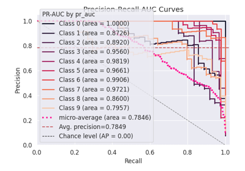

> **Note**
> [Go to the end](#sphx-glr-download-auto-examples-cython-plot-cython-template-py)
to download the full example code or to run this example in your browser via JupyterLite or Binder.

# Cython: Realtime compile\_and\_load (.pyx)[#](#cython-realtime-compile-and-load-pyx "Link to this heading")

An example showing the [`cython`](../../apis/scikitplot.cython.html#module-scikitplot.cython "scikitplot.cython") submodule..

```
# Authors: The scikit-plots developers
# SPDX-License-Identifier: BSD-3-Clause

```

## cython examples[#](#cython-examples "Link to this heading")

```
import scikitplot as sp
sp.__version_iso_8601__

```
```
'2026.11.26'

```
```
from scikitplot import cython

print(cython.__doc__)

```
```
scikitplot.cython
=================
A lightweight runtime Cython development kit with caching, pinning,
garbage collection, and templating support.

:mod:`scikitplot.cython` enables real-time, in-place (in-situ) generation of
low-level Cython packages and modules for immediate use and testing.

.. seealso::
   * https://github.com/cython/cython
   * https://cython.readthedocs.io/en/latest/index.html
   * https://doc.sagemath.org/html/en/reference/misc/sage/misc/cython.html

```
```
from scikitplot.cython import compile_and_load
m = compile_and_load("def f(int n):\n    return n*n")
m.f(10)

```
```
100

```
```
cython.list_templates()

```
```
['basic_cython/t01_square_int', 'basic_cython/t02_add_float', 'basic_cython/t03_toggle_bool', 'basic_cython/t04_repeat_str', 'basic_cython/t05_int_overflow_demo', 'basic_cython/t06_xor_bytes', 'complex_cython/t01_cpp_vector_sum', 'complex_cython/t01_fast_clip', 'complex_cython/t02_nogil_sum', 'complex_cython/t03_nogil_sum', 'complex_cython/t04_nogil_sum', 'complex_cython/t05_popcount64', 'devel_cython/t01_directives', 'devel_cython/t02_cdef_class_counter', 'devel_cython/t03_cdef_class_counter', 'devel_cython/t04_cdef_class_counter', 'devel_cython/t05_cdef_class_counter', 'devel_numcpp_cpp_api_cython/t01_cpp_language', 'devel_numcpp_cpp_api_cython/t01_cpp_memoryview', 'devel_numcpp_cpp_api_cython/t01_numpy_cpp_memoryview', 'devel_numcpp_cpp_api_cython/t02_cpp_vector_size', 'devel_numcpp_cpp_api_cython/t03_cpp_vector_size', 'devel_numpy_c_api_cython/t01_numpy_ndarray_sum', 'devel_numpy_c_api_cython/t01_numpy_typed_ndarray', 'devel_numpy_c_api_cython/t02_numpy_sum_1d', 'devel_numpy_c_api_cython/t03_numpy_sum_1d', 'devel_numpy_c_api_cython/t04_numpy_sum_1d', 'easy_cython/t01_memoryview_sum', 'easy_cython/t01_sum_memoryview', 'easy_cython/t01_sum_view', 'easy_cython/t04_vector_dot_list', 'easy_cython/t05_vector_scale_memview', 'easy_cython/t06_vector_norm2_memview', 'easy_cython/t07_vector_add_list', 'easy_cython/t08_parse_int_ascii', 'hard_cython/t01_cdef_class_counter', 'hard_cython/t01_cdef_class_vector', 'hard_cython/t01_dot_product', 'hard_cython/t02_malloc_fill', 'hard_cython/t03_malloc_fill', 'hard_cython/t04_struct_point_distance', 'medium_cython/t01_fused_add', 'medium_cython/t01_fused_types', 'medium_cython/t01_running_mean', 'medium_cython/t02_fused_add', 'medium_cython/t03_fused_add', 'medium_cython/t04_minmax_memview', 'medium_cython/t05_argmax_memview', 'mixed/t01_square_int', 'mixed/t02_fib_cpdef', 'mixed/t03_cdef_class_counter', 'mixed/t04_memoryview_sum', 'mixed/t05_numpy_ndarray_sum', 'mixed/t06_directives_boundscheck', 'mixed/t07_libc_math', 'mixed/t08_struct_point', 'mixed/t09_enum_state', 'mixed/t10_safe_div_except', 'mixed/t11_fused_types_dot', 'mixed/t12_inline_clamp', 'mixed/t13_bytes_xor', 'mixed/t14_string_reverse', 'mixed/t15_lcg_rng', 'mixed/t16_insertion_sort', 'mixed/t17_kahan_sum', 'mixed/t18_histogram_int', 'mixed/t19_popcount', 'mixed/t20_matmul_small', 'module_cython/t01_counter', 'module_cython/t01_extension_class', 'module_cython/t01_module_constants', 'module_cython/t02_cdef_class_counter', 'module_cython/t03_cdef_class_counter', 'module_cython/t90_include_pxi_square', 'module_cython/t91_extern_header_add']

```
```
cython.get_template_path(cython.list_templates()[0])

```
```
PosixPath('/home/circleci/.pyenv/versions/3.12.16/lib/python3.12/site-packages/scikitplot/cython/_templates/basic_cython/t01_square_int.pyx')

```
```
print(cython.read_template(cython.list_templates()[0]))

```
```
# cython: language_level=3
"""Basic Cython template: typed function.

This demonstrates a minimal compiled function with C integer typing.
"""


def square(int n):
    """Return n*n using C integer arithmetic."""
    return n * n

```
```
cython.get_cache_dir()

```
```
PosixPath('/home/circleci/.cache/scikitplot/cython')

```
```
cython.list_cached()

```
```
[CacheEntry(key='267b736d34e9210fe7f574ae22b9c74603f3401f39b1a04bc9dc5e0d764bfbe8', build_dir=PosixPath('/home/circleci/.cache/scikitplot/cython/267b736d34e9210fe7f574ae22b9c74603f3401f39b1a04bc9dc5e0d764bfbe8'), module_name='scikitplot_cython_267b736d34e9210f', artifact_path=PosixPath('/home/circleci/.cache/scikitplot/cython/267b736d34e9210fe7f574ae22b9c74603f3401f39b1a04bc9dc5e0d764bfbe8/scikitplot_cython_267b736d34e9210f.cpython-312-x86_64-linux-gnu.so'), created_utc='2026-11-26T15:11:42Z', fingerprint={'abi': '', 'cc': 'gcc', 'cxx': 'g++', 'cython': '3.3.2', 'ext_suffix': '.cpython-312-x86_64-linux-gnu.so', 'gil_disabled': False, 'machine': 'x86_64', 'numpy': '2.5.5', 'platform': 'Linux-7.0.0-1017-aws-x86_64-with-glibc2.35', 'pointer_size': 8, 'processor': 'x86_64', 'python': '3.12.16', 'python_impl': 'CPython', 'resolved_cc': 'gcc', 'resolved_compiler_type': 'unix', 'resolved_cxx': 'g++', 'soabi': 'cpython-312-x86_64-linux-gnu', 'sysconfig_platform': 'linux-x86_64'}), CacheEntry(key='7a940238beb35f6fd061d815017a9242e1f32cd7b9c1208107f264eda2e1406a', build_dir=PosixPath('/home/circleci/.cache/scikitplot/cython/7a940238beb35f6fd061d815017a9242e1f32cd7b9c1208107f264eda2e1406a'), module_name='multifile_demo', artifact_path=PosixPath('/home/circleci/.cache/scikitplot/cython/7a940238beb35f6fd061d815017a9242e1f32cd7b9c1208107f264eda2e1406a/multifile_demo.cpython-312-x86_64-linux-gnu.so'), created_utc='2026-11-26T15:11:53Z', fingerprint={'abi': '', 'cc': 'gcc', 'cxx': 'g++', 'cython': '3.3.2', 'ext_suffix': '.cpython-312-x86_64-linux-gnu.so', 'gil_disabled': False, 'machine': 'x86_64', 'numpy': '2.5.5', 'platform': 'Linux-7.0.0-1017-aws-x86_64-with-glibc2.35', 'pointer_size': 8, 'processor': 'x86_64', 'python': '3.12.16', 'python_impl': 'CPython', 'resolved_cc': 'gcc', 'resolved_compiler_type': 'unix', 'resolved_cxx': 'g++', 'soabi': 'cpython-312-x86_64-linux-gnu', 'sysconfig_platform': 'linux-x86_64'}), CacheEntry(key='8af444bb94dcb257a31ab93d26b96a180d90e49feccf77506ac374694b702c50', build_dir=PosixPath('/home/circleci/.cache/scikitplot/cython/8af444bb94dcb257a31ab93d26b96a180d90e49feccf77506ac374694b702c50'), module_name='scikitplot_cython_8af444bb94dcb257', artifact_path=PosixPath('/home/circleci/.cache/scikitplot/cython/8af444bb94dcb257a31ab93d26b96a180d90e49feccf77506ac374694b702c50/scikitplot_cython_8af444bb94dcb257.cpython-312-x86_64-linux-gnu.so'), created_utc='2026-11-26T15:11:46Z', fingerprint={'abi': '', 'cc': 'gcc', 'cxx': 'g++', 'cython': '3.3.2', 'ext_suffix': '.cpython-312-x86_64-linux-gnu.so', 'gil_disabled': False, 'machine': 'x86_64', 'numpy': '2.5.5', 'platform': 'Linux-7.0.0-1017-aws-x86_64-with-glibc2.35', 'pointer_size': 8, 'processor': 'x86_64', 'python': '3.12.16', 'python_impl': 'CPython', 'resolved_cc': 'gcc', 'resolved_compiler_type': 'unix', 'resolved_cxx': 'g++', 'soabi': 'cpython-312-x86_64-linux-gnu', 'sysconfig_platform': 'linux-x86_64'}), CacheEntry(key='abafd228441a62588be25ae06b55fb9fb56871cabc4934821191ef6e83ce3ef0', build_dir=PosixPath('/home/circleci/.cache/scikitplot/cython/abafd228441a62588be25ae06b55fb9fb56871cabc4934821191ef6e83ce3ef0'), module_name='scikitplot_cython_abafd228441a6258', artifact_path=PosixPath('/home/circleci/.cache/scikitplot/cython/abafd228441a62588be25ae06b55fb9fb56871cabc4934821191ef6e83ce3ef0/scikitplot_cython_abafd228441a6258.cpython-312-x86_64-linux-gnu.so'), created_utc='2026-11-26T15:11:40Z', fingerprint={'abi': '', 'cc': 'gcc', 'cxx': 'g++', 'cython': '3.3.2', 'ext_suffix': '.cpython-312-x86_64-linux-gnu.so', 'gil_disabled': False, 'machine': 'x86_64', 'numpy': '2.5.5', 'platform': 'Linux-7.0.0-1017-aws-x86_64-with-glibc2.35', 'pointer_size': 8, 'processor': 'x86_64', 'python': '3.12.16', 'python_impl': 'CPython', 'resolved_cc': 'gcc', 'resolved_compiler_type': 'unix', 'resolved_cxx': 'g++', 'soabi': 'cpython-312-x86_64-linux-gnu', 'sysconfig_platform': 'linux-x86_64'}), CacheEntry(key='ba0339daaf057b6c074bdb52ac84deff5eada091970e6afffdf49792b8a683f5', build_dir=PosixPath('/home/circleci/.cache/scikitplot/cython/ba0339daaf057b6c074bdb52ac84deff5eada091970e6afffdf49792b8a683f5'), module_name='scikitplot_cython_ba0339daaf057b6c', artifact_path=PosixPath('/home/circleci/.cache/scikitplot/cython/ba0339daaf057b6c074bdb52ac84deff5eada091970e6afffdf49792b8a683f5/scikitplot_cython_ba0339daaf057b6c.cpython-312-x86_64-linux-gnu.so'), created_utc='2026-11-26T15:11:38Z', fingerprint={'abi': '', 'cc': 'gcc', 'cxx': 'g++', 'cython': '3.3.2', 'ext_suffix': '.cpython-312-x86_64-linux-gnu.so', 'gil_disabled': False, 'machine': 'x86_64', 'numpy': '2.5.5', 'platform': 'Linux-7.0.0-1017-aws-x86_64-with-glibc2.35', 'pointer_size': 8, 'processor': 'x86_64', 'python': '3.12.16', 'python_impl': 'CPython', 'resolved_cc': 'gcc', 'resolved_compiler_type': 'unix', 'resolved_cxx': 'g++', 'soabi': 'cpython-312-x86_64-linux-gnu', 'sysconfig_platform': 'linux-x86_64'}), CacheEntry(key='bb871d316612c3da7f6faf03333638db249616b4a5254a5de8d752560eddc51f', build_dir=PosixPath('/home/circleci/.cache/scikitplot/cython/bb871d316612c3da7f6faf03333638db249616b4a5254a5de8d752560eddc51f'), module_name='scikitplot_cython_bb871d316612c3da', artifact_path=PosixPath('/home/circleci/.cache/scikitplot/cython/bb871d316612c3da7f6faf03333638db249616b4a5254a5de8d752560eddc51f/scikitplot_cython_bb871d316612c3da.cpython-312-x86_64-linux-gnu.so'), created_utc='2026-11-26T15:11:49Z', fingerprint={'abi': '', 'cc': 'gcc', 'cxx': 'g++', 'cython': '3.3.2', 'ext_suffix': '.cpython-312-x86_64-linux-gnu.so', 'gil_disabled': False, 'machine': 'x86_64', 'numpy': '2.5.5', 'platform': 'Linux-7.0.0-1017-aws-x86_64-with-glibc2.35', 'pointer_size': 8, 'processor': 'x86_64', 'python': '3.12.16', 'python_impl': 'CPython', 'resolved_cc': 'gcc', 'resolved_compiler_type': 'unix', 'resolved_cxx': 'g++', 'soabi': 'cpython-312-x86_64-linux-gnu', 'sysconfig_platform': 'linux-x86_64'}), CacheEntry(key='bd61018cc59c4e0bf53b903704d29a3ad39f3701d12680c87b8cffffabf1b609', build_dir=PosixPath('/home/circleci/.cache/scikitplot/cython/bd61018cc59c4e0bf53b903704d29a3ad39f3701d12680c87b8cffffabf1b609'), module_name='memview_scale_demo', artifact_path=PosixPath('/home/circleci/.cache/scikitplot/cython/bd61018cc59c4e0bf53b903704d29a3ad39f3701d12680c87b8cffffabf1b609/memview_scale_demo.cpython-312-x86_64-linux-gnu.so'), created_utc='2026-11-26T15:12:00Z', fingerprint={'abi': '', 'cc': 'gcc', 'cxx': 'g++', 'cython': '3.3.2', 'ext_suffix': '.cpython-312-x86_64-linux-gnu.so', 'gil_disabled': False, 'machine': 'x86_64', 'numpy': None, 'platform': 'Linux-7.0.0-1017-aws-x86_64-with-glibc2.35', 'pointer_size': 8, 'processor': 'x86_64', 'python': '3.12.16', 'python_impl': 'CPython', 'resolved_cc': 'gcc', 'resolved_compiler_type': 'unix', 'resolved_cxx': 'g++', 'soabi': 'cpython-312-x86_64-linux-gnu', 'sysconfig_platform': 'linux-x86_64'}), CacheEntry(key='d474419779b0e0b600cbec657ccd7a912a665570b08501749414df180135b250', build_dir=PosixPath('/home/circleci/.cache/scikitplot/cython/d474419779b0e0b600cbec657ccd7a912a665570b08501749414df180135b250'), module_name='scikitplot_cython_d474419779b0e0b6', artifact_path=PosixPath('/home/circleci/.cache/scikitplot/cython/d474419779b0e0b600cbec657ccd7a912a665570b08501749414df180135b250/scikitplot_cython_d474419779b0e0b6.cpython-312-x86_64-linux-gnu.so'), created_utc='2026-11-26T15:11:39Z', fingerprint={'abi': '', 'cc': 'gcc', 'cxx': 'g++', 'cython': '3.3.2', 'ext_suffix': '.cpython-312-x86_64-linux-gnu.so', 'gil_disabled': False, 'machine': 'x86_64', 'numpy': '2.5.5', 'platform': 'Linux-7.0.0-1017-aws-x86_64-with-glibc2.35', 'pointer_size': 8, 'processor': 'x86_64', 'python': '3.12.16', 'python_impl': 'CPython', 'resolved_cc': 'gcc', 'resolved_compiler_type': 'unix', 'resolved_cxx': 'g++', 'soabi': 'cpython-312-x86_64-linux-gnu', 'sysconfig_platform': 'linux-x86_64'}), CacheEntry(key='d941170c2e16f2b8bfaf9d5f800cb08641f7f40358e25105a6c038d164c24087', build_dir=PosixPath('/home/circleci/.cache/scikitplot/cython/d941170c2e16f2b8bfaf9d5f800cb08641f7f40358e25105a6c038d164c24087'), module_name='scikitplot_cython_d941170c2e16f2b8', artifact_path=PosixPath('/home/circleci/.cache/scikitplot/cython/d941170c2e16f2b8bfaf9d5f800cb08641f7f40358e25105a6c038d164c24087/scikitplot_cython_d941170c2e16f2b8.cpython-312-x86_64-linux-gnu.so'), created_utc='2026-11-26T15:12:05Z', fingerprint={'abi': '', 'cc': 'gcc', 'cxx': 'g++', 'cython': '3.3.2', 'ext_suffix': '.cpython-312-x86_64-linux-gnu.so', 'gil_disabled': False, 'machine': 'x86_64', 'numpy': '2.5.5', 'platform': 'Linux-7.0.0-1017-aws-x86_64-with-glibc2.35', 'pointer_size': 8, 'processor': 'x86_64', 'python': '3.12.16', 'python_impl': 'CPython', 'resolved_cc': 'gcc', 'resolved_compiler_type': 'unix', 'resolved_cxx': 'g++', 'soabi': 'cpython-312-x86_64-linux-gnu', 'sysconfig_platform': 'linux-x86_64'}), CacheEntry(key='d96da7695c0bf09bf0a51d9c71c76d3bf8460311f1a2af0d79ef5a47257c2e3b', build_dir=PosixPath('/home/circleci/.cache/scikitplot/cython/d96da7695c0bf09bf0a51d9c71c76d3bf8460311f1a2af0d79ef5a47257c2e3b'), module_name='wf_ext_square', artifact_path=PosixPath('/home/circleci/.cache/scikitplot/cython/d96da7695c0bf09bf0a51d9c71c76d3bf8460311f1a2af0d79ef5a47257c2e3b/wf_ext_square.cpython-312-x86_64-linux-gnu.so'), created_utc='2026-11-26T15:12:02Z', fingerprint={'abi': '', 'cc': 'gcc', 'cxx': 'g++', 'cython': '3.3.2', 'ext_suffix': '.cpython-312-x86_64-linux-gnu.so', 'gil_disabled': False, 'machine': 'x86_64', 'numpy': '2.5.5', 'platform': 'Linux-7.0.0-1017-aws-x86_64-with-glibc2.35', 'pointer_size': 8, 'processor': 'x86_64', 'python': '3.12.16', 'python_impl': 'CPython', 'resolved_cc': 'gcc', 'resolved_compiler_type': 'unix', 'resolved_cxx': 'g++', 'soabi': 'cpython-312-x86_64-linux-gnu', 'sysconfig_platform': 'linux-x86_64'}), CacheEntry(key='e91d178a574d1377eb3d75a5972d351785666e4ee1913b367be6e4cac718e9f8', build_dir=PosixPath('/home/circleci/.cache/scikitplot/cython/e91d178a574d1377eb3d75a5972d351785666e4ee1913b367be6e4cac718e9f8'), module_name='scikitplot_cython_e91d178a574d1377', artifact_path=PosixPath('/home/circleci/.cache/scikitplot/cython/e91d178a574d1377eb3d75a5972d351785666e4ee1913b367be6e4cac718e9f8/scikitplot_cython_e91d178a574d1377.cpython-312-x86_64-linux-gnu.so'), created_utc='2026-11-26T15:11:45Z', fingerprint={'abi': '', 'cc': 'gcc', 'cxx': 'g++', 'cython': '3.3.2', 'ext_suffix': '.cpython-312-x86_64-linux-gnu.so', 'gil_disabled': False, 'machine': 'x86_64', 'numpy': '2.5.5', 'platform': 'Linux-7.0.0-1017-aws-x86_64-with-glibc2.35', 'pointer_size': 8, 'processor': 'x86_64', 'python': '3.12.16', 'python_impl': 'CPython', 'resolved_cc': 'gcc', 'resolved_compiler_type': 'unix', 'resolved_cxx': 'g++', 'soabi': 'cpython-312-x86_64-linux-gnu', 'sysconfig_platform': 'linux-x86_64'}), CacheEntry(key='f0681d1904fc6832f1532f887057d1d61ef3128e63556e1651f31c1b6f57b0c3', build_dir=PosixPath('/home/circleci/.cache/scikitplot/cython/f0681d1904fc6832f1532f887057d1d61ef3128e63556e1651f31c1b6f57b0c3'), module_name='cpp_mode_demo', artifact_path=PosixPath('/home/circleci/.cache/scikitplot/cython/f0681d1904fc6832f1532f887057d1d61ef3128e63556e1651f31c1b6f57b0c3/cpp_mode_demo.cpython-312-x86_64-linux-gnu.so'), created_utc='2026-11-26T15:11:56Z', fingerprint={'abi': '', 'cc': 'gcc', 'cxx': 'g++', 'cython': '3.3.2', 'ext_suffix': '.cpython-312-x86_64-linux-gnu.so', 'gil_disabled': False, 'machine': 'x86_64', 'numpy': '2.5.5', 'platform': 'Linux-7.0.0-1017-aws-x86_64-with-glibc2.35', 'pointer_size': 8, 'processor': 'x86_64', 'python': '3.12.16', 'python_impl': 'CPython', 'resolved_cc': 'gcc', 'resolved_compiler_type': 'unix', 'resolved_cxx': 'g++', 'soabi': 'cpython-312-x86_64-linux-gnu', 'sysconfig_platform': 'linux-x86_64'})]

```
```
cython.list_cached()[0].build_dir

```
```
PosixPath('/home/circleci/.cache/scikitplot/cython/267b736d34e9210fe7f574ae22b9c74603f3401f39b1a04bc9dc5e0d764bfbe8')

```
```
cython.list_cached()[0].artifact_path

```
```
PosixPath('/home/circleci/.cache/scikitplot/cython/267b736d34e9210fe7f574ae22b9c74603f3401f39b1a04bc9dc5e0d764bfbe8/scikitplot_cython_267b736d34e9210f.cpython-312-x86_64-linux-gnu.so')

```
```
from scikitplot.cython import compile_template

m = compile_template(cython.list_templates()[2])
m = compile_template(cython.list_templates()[1])
m = compile_template(cython.list_templates()[0])
m.square(12)

```
```
144

```
```
m = compile_template('module_cython/t01_counter')
m

```
```
<module 'scikitplot_cython_8cc09e0839a880b4' from '/home/circleci/.cache/scikitplot/cython/8cc09e0839a880b49596f70ad654c4ba71f61679e199bc78d7e95074efb773cf/scikitplot_cython_8cc09e0839a880b4.cpython-312-x86_64-linux-gnu.so'>

```
```
cython.purge_cache()

```
```
cython.list_cached()

```
```
[]

```

Tags: [model-type: classification](../../_tags/model-type-classification.html) [model-workflow: model building](../../_tags/model-workflow-model-building.html) [plot-type: cython](../../_tags/plot-type-cython.html) [domain: cython](../../_tags/domain-cython.html) [level: beginner](../../_tags/level-beginner.html) [purpose: showcase](../../_tags/purpose-showcase.html)

****Total running time of the script:**** (0 minutes 6.062 seconds)

[](https://mybinder.org/v2/gh/scikit-plots/scikit-plots/main?urlpath=lab/tree/notebooks/auto_examples/cython/plot_cython_template.ipynb)[](../../lite/lab/index.html?path=auto_examples/cython/plot_cython_template.ipynb)

[`Download Jupyter notebook: plot_cython_template.ipynb`](../../_downloads/6053307ed76a82d9d7a64548e10f50aa/plot_cython_template.ipynb)

[`Download Python source code: plot_cython_template.py`](../../_downloads/d01d24a48a3cd1c5d71ccba73d308fbb/plot_cython_template.py)

[`Download zipped: plot_cython_template.zip`](../../_downloads/c158a77b0388225ed9e23d6ed4d33725/plot_cython_template.zip)

Related examples


[nc with examples](../nc/plot_nc_test.html)

nc with examples

[plot\_learning\_curve with examples](../classification/plot_learning_curve_script.html)

plot\_learning\_curve with examples

[plot\_silhouette with examples](../clustering/plot_silhouette_script.html)

plot\_silhouette with examples

[plot\_precision\_recall with examples](../classification/plot_precision_recall_script.html)

plot\_precision\_recall with examples

[Gallery generated by Sphinx-Gallery](https://sphinx-gallery.github.io)