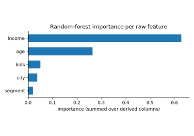

# Feature Selection[#](#feature-selection "Link to this heading")

## Feature profiling, lineage and drift[#](#feature-profiling-lineage-and-drift "Link to this heading")

Examples related to the [`feature_selection`](../../apis/scikitplot.feature_selection.html#module-scikitplot.feature_selection "scikitplot.feature_selection") submodule with
e.g., [`profile_features`](../../modules/generated/scikitplot.feature_selection.profile_features.html#scikitplot.feature_selection.profile_features "scikitplot.feature_selection.profile_features"),
[`trace_pipeline`](../../modules/generated/scikitplot.feature_selection.trace_pipeline.html#scikitplot.feature_selection.trace_pipeline "scikitplot.feature_selection.trace_pipeline") and
[`ReferenceProfile`](../../modules/generated/scikitplot.feature_selection.ReferenceProfile.html#scikitplot.feature_selection.ReferenceProfile "scikitplot.feature_selection.ReferenceProfile").

[Profile, route, trace and monitor wide tables](plot_feature_profiling_and_lineage.html)

Profile, route, trace and monitor wide tables