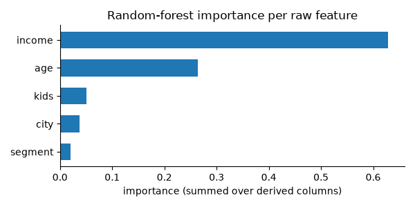

> **Note**
> [Go to the end](#sphx-glr-download-auto-examples-feature-selection-plot-feature-profiling-and-lineage-py)
to download the full example code or to run this example in your browser via JupyterLite or Binder.

# Profile, route, trace and monitor wide tables[#](#profile-route-trace-and-monitor-wide-tables "Link to this heading")

A walk through the three questions [`scikitplot.feature_selection`](../../apis/scikitplot.feature_selection.html#module-scikitplot.feature_selection "scikitplot.feature_selection")
answers for a table with many columns:

1. **What is each feature?** – [`profile_features`](../../modules/generated/scikitplot.feature_selection.profile_features.html#scikitplot.feature_selection.profile_features "scikitplot.feature_selection.profile_features") fits a
   [`FeatureSchema`](../../modules/generated/scikitplot.feature_selection.FeatureSchema.html#scikitplot.feature_selection.FeatureSchema "scikitplot.feature_selection.FeatureSchema") on the training split.
2. **What happened to each feature in the pipeline?** –
   [`trace_pipeline`](../../modules/generated/scikitplot.feature_selection.trace_pipeline.html#scikitplot.feature_selection.trace_pipeline "scikitplot.feature_selection.trace_pipeline") reads the fitted pipeline, and
   [`FeatureLineage.attribute`](../../modules/generated/scikitplot.feature_selection.FeatureLineage.html#scikitplot.feature_selection.FeatureLineage.attribute "scikitplot.feature_selection.FeatureLineage.attribute") sums one-hot importances back to raw
   columns.
3. **Has it drifted?** – [`ReferenceProfile`](../../modules/generated/scikitplot.feature_selection.ReferenceProfile.html#scikitplot.feature_selection.ReferenceProfile "scikitplot.feature_selection.ReferenceProfile") freezes the training
   distribution and compares later data with it.

```
# Authors: The scikit-plots developers
# SPDX-License-Identifier: BSD-3-Clause

```

## A synthetic customer table[#](#a-synthetic-customer-table "Link to this heading")

```
import matplotlib.pyplot as plt
import numpy as np
import pandas as pd
from sklearn.compose import ColumnTransformer
from sklearn.ensemble import RandomForestClassifier
from sklearn.impute import SimpleImputer
from sklearn.model_selection import train_test_split
from sklearn.pipeline import Pipeline
from sklearn.preprocessing import OneHotEncoder, PowerTransformer, StandardScaler

from scikitplot.feature_selection import (
    FeatureColumnSelector,
    FeatureFilter,
    ReferenceProfile,
    profile_features,
    recommend_treatments,
    trace_pipeline,
)

rng = np.random.default_rng(0)
n = 2000
X = pd.DataFrame(
    {
        "customer_id": [f"c{i:05d}" for i in range(n)],
        "income": rng.lognormal(10, 1, n),
        "age": rng.normal(45, 12, n).round(1),
        "kids": rng.integers(0, 4, n),
        "city": rng.choice(["ankara", "izmir", "bursa", "van"], n),
        "segment": rng.choice(["a", "b"], n),
        "constant": 1.0,
    }
)
X.loc[::11, "age"] = np.nan
y = (X["income"] > X["income"].median()).astype(int) ^ (rng.random(n) < 0.2)
X_train, X_test, y_train, y_test = train_test_split(X, y, random_state=0)

```

## 1. What is each feature?[#](#what-is-each-feature "Link to this heading")

Fit on the training split only; thresholds come from the policy.

```
policy = {"roles": {"identifier": ["customer_id"]}}
schema = profile_features(X_train, policy)
schema.summary()[["role", "kind", "n_unique", "skewness", "skewed", "constant"]]

```

|  | role | kind | n\_unique | skewness | skewed | constant |
| --- | --- | --- | --- | --- | --- | --- |
| feature |  |  |  |  |  |  |
| customer\_id | identifier | categorical\_nominal | 1500 | NaN | not\_applicable | false |
| income | feature | numeric\_continuous | 1500 | 3.505304 | true | false |
| age | feature | numeric\_continuous | 460 | 0.126734 | false | false |
| kids | feature | numeric\_discrete | 4 | -0.062936 | false | false |
| city | feature | categorical\_nominal | 4 | NaN | not\_applicable | false |
| segment | feature | binary | 2 | NaN | not\_applicable | false |
| constant | feature | numeric\_discrete | 1 | NaN | not\_applicable | true |

  
  
```
print(schema["income"].explain())

```
```
income: numeric_continuous (inferred), role=feature, dtype=float64
  rows=1500 missing=0 (0.0%) unique=1500
  min=900.234 median=20731.3 max=380581 skewness=3.51
  is: has_outliers, non_negative, skewed
  binning: 64 uniform bins (auto)

```

Groups by kind, and the advisory treatment per feature:

```
print(schema.groups(by="kind"))
recommend_treatments(schema)[["kind", "steps"]]

```
```
{'binary': ['segment'], 'categorical_nominal': ['city'], 'numeric_continuous': ['income', 'age'], 'numeric_discrete': ['kids', 'constant']}

```

|  | kind | steps |
| --- | --- | --- |
| feature |  |  |
| income | numeric\_continuous | (PowerTransformer(method='yeo-johnson'),) |
| age | numeric\_continuous | (SimpleImputer(strategy='median'), StandardSca... |
| kids | numeric\_discrete | (StandardScaler(),) |
| city | categorical\_nominal | (OneHotEncoder(handle\_unknown='infrequent\_if\_e... |
| segment | binary | (OrdinalEncoder(),) |
| constant | numeric\_discrete | (drop,) |

## Route columns into a pipeline by their assessments[#](#route-columns-into-a-pipeline-by-their-assessments "Link to this heading")

```
pre = ColumnTransformer(
    [
        (
            "skewed",
            PowerTransformer(),
            FeatureColumnSelector(kind="numeric_continuous", is_=("skewed",)),
        ),
        (
            "numeric",
            Pipeline([("imp", SimpleImputer()), ("sc", StandardScaler())]),
            FeatureColumnSelector(
                kind=("numeric_continuous", "numeric_discrete"),
                is_not=("skewed", "constant"),
            ),
        ),
        (
            "categorical",
            OneHotEncoder(handle_unknown="ignore", sparse_output=False),
            FeatureColumnSelector(
                kind=("categorical_nominal", "binary"), is_not=("identifier_like",)
            ),
        ),
    ]
)
model = Pipeline(
    [
        ("filter", FeatureFilter(policy=policy)),
        ("pre", pre),
        ("rf", RandomForestClassifier(n_estimators=100, random_state=0)),
    ]
).fit(X_train, y_train)
print(f"test accuracy: {model.score(X_test, y_test):.3f}")

```
```
test accuracy: 0.788

```

## 2. What happened to each feature?[#](#what-happened-to-each-feature "Link to this heading")

```
lineage = trace_pipeline(model, X=X_train.head(100))
lineage.stage_summary()[["path", "estimator", "relation", "n_in", "n_out"]]

```

|  | path | estimator | relation | n\_in | n\_out |
| --- | --- | --- | --- | --- | --- |
| 0 | input | input | input | 7 | 7 |
| 1 | filter | FeatureFilter | subset | 7 | 5 |
| 2 | pre/skewed | PowerTransformer | one\_to\_one | 1 | 1 |
| 3 | pre/numeric/imp | SimpleImputer | one\_to\_one | 2 | 2 |
| 4 | pre/numeric/sc | StandardScaler | one\_to\_one | 2 | 2 |
| 5 | pre/numeric | Pipeline | one\_to\_one | 2 | 2 |
| 6 | pre/categorical | OneHotEncoder | expand | 2 | 6 |
| 7 | pre | ColumnTransformer | expand | 5 | 9 |
| 8 | (root) | Pipeline | expand | 7 | 9 |

  
  
```
lineage.treatments()

```

|  | steps | n\_outputs | status |
| --- | --- | --- | --- |
| feature |  |  |  |
| customer\_id | () | 0 | dropped |
| income | (filter:FeatureFilter, pre/skewed:PowerTransfo... | 1 | kept |
| age | (filter:FeatureFilter, pre/numeric/imp:SimpleI... | 1 | kept |
| kids | (filter:FeatureFilter, pre/numeric/imp:SimpleI... | 1 | kept |
| city | (filter:FeatureFilter, pre/categorical:OneHotE... | 4 | kept |
| segment | (filter:FeatureFilter, pre/categorical:OneHotE... | 2 | kept |
| constant | () | 0 | dropped |

  
  
```
print(lineage.dropped())

```
```
{'customer_id': 'filter', 'constant': 'filter'}

```

Importances of one-hot columns summed back to their raw column:

```
attribution = lineage.attribute(model[-1].feature_importances_)
by_feature = attribution.by_input.sort_values()

fig, ax = plt.subplots(figsize=(6, 3))
ax.barh(by_feature.index, by_feature.to_numpy(), height=0.6)
ax.set_xlabel("importance (summed over derived columns)")
ax.set_title("Random-forest importance per raw feature")
ax.spines[["top", "right"]].set_visible(False)
fig.tight_layout()

```


## 3. Has it drifted?[#](#has-it-drifted "Link to this heading")

```
reference = ReferenceProfile.fit(X_train, schema)
later = X_test.assign(income=X_test["income"] * 1.8)
reference.drift(later)[["feature", "kind", "psi", "missing_delta", "status"]]

```

|  | feature | kind | psi | missing\_delta | status |
| --- | --- | --- | --- | --- | --- |
| 0 | income | numeric\_continuous | 0.517878 | 0.000000 | drift |
| 1 | age | numeric\_continuous | 0.028215 | -0.025333 | stable |
| 2 | kids | numeric\_discrete | 0.005480 | 0.000000 | stable |
| 3 | city | categorical\_nominal | 0.017185 | 0.000000 | stable |
| 4 | segment | binary | 0.000215 | 0.000000 | stable |
| 5 | constant | numeric\_discrete | 0.000000 | 0.000000 | stable |

  
  

****Total running time of the script:**** (0 minutes 0.833 seconds)

[](https://mybinder.org/v2/gh/scikit-plots/scikit-plots/main?urlpath=lab/tree/notebooks/auto_examples/feature_selection/plot_feature_profiling_and_lineage.ipynb)[](../../lite/lab/index.html?path=auto_examples/feature_selection/plot_feature_profiling_and_lineage.ipynb)

[`Download Jupyter notebook: plot_feature_profiling_and_lineage.ipynb`](../../_downloads/5bb63e36d377887ce56baeb62040c95d/plot_feature_profiling_and_lineage.ipynb)

[`Download Python source code: plot_feature_profiling_and_lineage.py`](../../_downloads/e232c5109a835f4ca2fa270c659ae0cd/plot_feature_profiling_and_lineage.py)

[`Download zipped: plot_feature_profiling_and_lineage.zip`](../../_downloads/f3bb795a46d59475de9de7587e8404f0/plot_feature_profiling_and_lineage.zip)

Related examples


[Enhanced KISS Random Generator - Complete Usage Examples](../random/plot_kiss_random.html)

Enhanced KISS Random Generator - Complete Usage Examples

[plot\_decileplot\_script with examples](../seaborn/plot_decileplot_script.html)

plot\_decileplot\_script with examples

[plot\_evalplot\_script with examples](../seaborn/plot_evalplot_script.html)

plot\_evalplot\_script with examples

[plot\_calibration with examples](../calibration/plot_calibration_script.html)

plot\_calibration with examples

[Gallery generated by Sphinx-Gallery](https://sphinx-gallery.github.io)