🤓 Scikit-plots Examples & Tutorials
  
 0.5.dev0+git.20261011.0ec25c0 - October 11, 2026 11:42 UTC

# Examples[#](#examples "Link to this heading")

This is the gallery of examples that showcase how scikit-plots can be used.
Some examples demonstrate the use of the [APIs Reference](../apis/index.html#apis-ref-index)
in general and some demonstrate specific applications in tutorial form.
Also check out our [user guide](../user_guide/index.html#user-guide-index) for more detailed
illustrations.

This page contains example plots. Click on any image to see the full image
and source code.

> **Tagging!**
> You can also browse the example gallery by [tags](../_tags/tagsindex.html#tagoverview).

## Jupyter Notebooks[#](#jupyter-notebooks "Link to this heading")

> **Note**
> GitHub

* [GitHub Sample Notebooks](https://github.com/scikit-plots/scikit-plots/tree/main/galleries/examples/00-jupyter_notebooks).
> **See also**
> 🚀 Try Scikit-Plots in Your Browser with Notebooks

No installation required. Launch one of the interactive environments below.

🚀 Launch Interactive Environments[#](#id16 "Link to this table")


| Interface | URL |
| --- | --- |
| Lab | <https://scikit-plots.github.io/dev/lite/lab/index.html> |
| Retro | <https://scikit-plots.github.io/dev/lite/tree/index.html> |
| REPL | <https://scikit-plots.github.io/dev/lite/repl/index.html?kernel=python&code=import%20this> |
jupyterlite (pyodide, xeus-python, c, c++)

jupyterlite lab pyodide:

* <https://jupyterlite-pyodide-kernel.readthedocs.io/en/latest/_static/lab/index.html>

jupyterlite lab all-in-one-pyodide[pyodide, xpython, r, c, cpp, sqlite, js, p5]:

* <https://jupyter.org/try-jupyter/lab/index.html>
* <https://jupyterlite.github.io/demo/lab/index.html>
* <https://jupyterlite.readthedocs.io/en/stable/_static/lab/index.html>

jupyterlite lab all-in-one-xeus[xpython, r, c, cpp, js]:

* <https://jupyterlite-xeus.readthedocs.io/en/stable/lite/lab/index.html>
* <https://jupyterlite.github.io/xeus-lite-demo/lab/index.html>

jupyterlite lab terminal[pyodide]:

* <https://jupyterlite.github.io/terminal/lab/index.html>
* <https://jupyterlite.github.io/cockle/>

jupyterlite lab misc:

* <https://jupyterlite.github.io/javascript-kernel/lab/index.html>
* <https://jupyterlite.github.io/p5-kernel/lab/index.html>
* <https://jupyterlite.github.io/echo-kernel/lab/index.html>

# Annoy[#](#annoy "Link to this heading")

Examples for [`annoy`](../apis/scikitplot.annoy.html#module-scikitplot.annoy "scikitplot.annoy") cover approximate nearest-neighbor
index construction, querying, persistence, memory mapping, precision trade-offs,
and lower-level native/Cython interfaces.

The gallery intentionally contains several API layers. Most users should
start with the public Python [`Index`](../modules/generated/scikitplot.annoy.Index.html#scikitplot.annoy.Index "scikitplot.annoy.Index") interface and move to the lower
layers only when they need dtype/native compatibility or implementation-level
benchmarking.

> **See also**
> * [Houses Prices Tree Based Models (pickling ANNImputer)](https://www.kaggle.com/code/clkmuhammed/houses-prices-tree-based-models)

## Start here: ANNoy Vector Index DB[#](#start-here-annoy-vector-index-db "Link to this heading")

****1. Simple nearest-neighbor search****

Start with `plot_simple_script.py`.

It demonstrates the shortest useful workflow:

```
from scikitplot.annoy import Index

index = Index(
    f=3,
    metric="angular",
)

index.add_item(0, [1, 0, 0])
index.add_item(1, [0, 1, 0])
index.add_item(2, [0, 0, 1])

index.build(-1)

print(index.get_nns_by_item(0, 10))
print(index.get_nns_by_vector([1.0, 0.5, 0.5], 10))

```

Use this page to understand the core lifecycle before looking at persistence,
Cython, legacy, or benchmark examples.

## Recommended learning order[#](#recommended-learning-order "Link to this heading")

| Example | Level | What to learn |
| --- | --- | --- |
| `plot_simple_script.py` | Beginner | construct, add vectors, build, and query an [`Index`](../modules/generated/scikitplot.annoy.Index.html#scikitplot.annoy.Index "scikitplot.annoy.Index") |
| `plot_Annoy_python_api.py` | Beginner / intermediate | broader public Python API, parameters, inspection, compatibility |
| `plot_mmap_script.py` | Intermediate | save, load, and memory-map an index |
| `plot_annoy_to_NPY_CSV.py` | Intermediate | inspect/export index-oriented data and plotting utilities |
| `plot_precision_script.py` | Intermediate / advanced | query/build trade-offs on a larger generated vector set |
| `plot_annoy_cython_hamlet_example.py` | Advanced | real-text vectorization plus dtype/metric/native index comparison |
| `plot_annoy_cython_api.py` | Advanced | direct Cython-layer API and concrete native type combinations |
| `plot_Annoy_legacy_c_api.py` | Advanced / compatibility | low-level/legacy C-extension compatibility behavior |
| `plot_annoy_cython_0benchmark.py` | Maintainer / benchmark | subprocess-driven native dtype benchmark coverage |

## Choose the right API layer[#](#choose-the-right-api-layer "Link to this heading")

The gallery contains three distinct layers.

| Layer | Typical import | Use when |
| --- | --- | --- |
| Public Python API | `from scikitplot.annoy import Index` | normal application code and new examples |
| Cython/native API | `from scikitplot.annoy._annoy import Index` | dtype/native experiments, implementation-level testing |
| Legacy C-extension API | `scikitplot.cexternals._annoy` | compatibility testing and migration work |

Prefer the public Python API unless the example is specifically teaching a
lower-level contract.

Private/internal imports in the advanced examples are deliberate teaching or
maintenance surfaces; they should not be copied into ordinary application code
without understanding their compatibility implications.

## Core index lifecycle[#](#core-index-lifecycle "Link to this heading")

The common Annoy lifecycle is:

```
vectors
   ↓
Index(f, metric)
   ↓
add_item(...)
   ↓
build(n_trees)
   ↓
query
  ├── get_nns_by_item(...)
  └── get_nns_by_vector(...)
   ↓
optional save(...)
   ↓
optional load(...) / mmap-backed querying

```

Build parameters affect index construction, while query parameters affect the
search work performed against an already-built index.

## Metrics[#](#metrics "Link to this heading")

Examples use several supported metric families, including:

`angular`
:   cosine-like angular distance for directional similarity.

`euclidean`
:   L2 distance.

`manhattan`
:   L1 distance.

`dot`
:   dot-product-oriented similarity.

`hamming`
:   Hamming-distance-oriented indexing where supported by the selected native
    type combination.

Not every dtype/metric/native combination should be assumed equivalent.
Use the public API defaults for ordinary applications and the Cython examples
when explicitly investigating concrete type combinations.

## Persistence and memory mapping[#](#persistence-and-memory-mapping "Link to this heading")

`plot_mmap_script.py` demonstrates the persistent workflow:

```
index.save("example.annoy")

restored = Index(
    f=3,
    metric="angular",
)
restored.load("example.annoy")

```

Annoy indexes are designed to support file-backed querying. Keep the vector
dimension and metric consistent with the index that was written.

Treat bundled `.annoy` / `.tree` files in this gallery as example/test
artifacts, not as a stable cross-version interchange format unless the relevant
compatibility contract has been explicitly verified.

## Precision and benchmark examples[#](#precision-and-benchmark-examples "Link to this heading")

The precision and benchmark pages are not beginner tutorials.

They may:

* generate many random vectors,
* build many trees,
* exercise multiple dtype/metric combinations,
* launch subprocesses or pytest benchmarks,
* write index artifacts,
* consume substantially more CPU, memory, or disk than the simple example.

Use them for engineering comparison, regression testing, or capacity planning.
Do not infer production sizing from a single gallery benchmark.

## Hamlet Cython showcase[#](#hamlet-cython-showcase "Link to this heading")

`plot_annoy_cython_hamlet_example.py` is the broadest Annoy demonstration.

It uses a real text corpus, converts passages to vectors, and compares native
Annoy behavior across advanced configurations.

Conceptually:

```
Hamlet passages
    ↓
text vectorization
    ↓
native Annoy Index
    ↓
dtype / metric variants
    ↓
nearest-neighbor search
    ↓
build-time / size / retrieval comparison

```

Use it after the public Python examples. It is a showcase of the lower-level
native implementation surface, not the minimum API required to use Annoy.

## Native capability[#](#native-capability "Link to this heading")

Annoy in scikit-plots includes compiled/native components. A gallery or CI
environment may therefore have the Python package available while a required
native implementation is unavailable for that platform/build.

The desired gallery rule is:

`native Annoy capability unavailable`
:   Report a specific `SKIP` when the example cannot truthfully continue.

`native Annoy imports successfully but build/query fails`
:   Fail visibly. Do not convert an installed-backend regression into a skip.

The same distinction applies to compiler-dependent benchmark examples.

## Files and working directories[#](#files-and-working-directories "Link to this heading")

Several historical/advanced examples read or write artifacts such as:

```
*.annoy
*.tree
*.npy
*.csv
*.joblib

```

New examples should prefer a temporary directory or a path derived from the
example location rather than relying on the caller’s current working directory.

Gallery examples should not overwrite repository test fixtures merely to
demonstrate persistence.

## Reproducibility[#](#reproducibility "Link to this heading")

For deterministic examples:

* seed random-number generators where random vectors are generated,
* keep dimensions and item counts bounded,
* print bounded result summaries,
* separate correctness checks from performance measurements,
* record the metric, number of trees, and query parameters used for benchmark
  comparisons.

Approximate nearest-neighbor results can depend on build/search configuration;
benchmark pages should make those parameters visible.

## Relationship to Corpus and MCP[#](#relationship-to-corpus-and-mcp "Link to this heading")

Annoy can also be used as a retrieval backend by higher-level scikit-plots
components.

For document retrieval:

```
scikitplot.corpus
    ↓
document embeddings
    ↓
Annoy vector backend
    ↓
retrieval

```

For a protocol/server workflow:

```
Corpus
  ↓
Annoy
  ↓
CorpusAnnoyRetriever
  ↓
scikitplot.mcp

```

Use the Corpus/MCP galleries when the goal is document ingestion or MCP
serving. Use this Annoy gallery when the goal is understanding and validating
the vector index itself.

## CI guidance[#](#ci-guidance "Link to this heading")

A practical CI split is:

****Portable/public API gate****
:   Run the small public Python examples and focused Annoy tests.

****Native capability gate****
:   Run Cython/native examples only on environments that intentionally provide
    the required compiled extension.

****Benchmark gate****
:   Keep expensive dtype/precision/compiler benchmarks separate from the normal
    documentation build when they materially increase build time or resource
    consumption.

An unavailable optional native/compiler capability should be reported
explicitly. Security, serialization, index-corruption, or installed-backend
failures should remain visible.

## Browser / WASM note[#](#browser-wasm-note "Link to this heading")

Do not assume that the native Annoy implementation, memory mapping, filesystem
semantics, subprocesses, or C/C++ compiler examples are available in
JupyterLite/Pyodide/other browser-WASM runtimes.

Use the simple/public API examples there only when the relevant native package
has been explicitly built and verified for that runtime.

The Cython, mmap, compiler, and benchmark pages should otherwise be treated as
reference material in browser environments.

## Gallery reliability rule[#](#gallery-reliability-rule "Link to this heading")

Keep Annoy examples small, explicit, and honest:

`missing optional native/compiler capability` visible `SKIP` when continuation is safe.

`wrong public API / invalid vector dimension / corrupt required artifact /
installed-backend failure` visible failure.

Do not fabricate fallback nearest-neighbor results merely to keep a gallery
page green.


[annoy.Annoy legacy c-api with examples](annoy/plot_Annoy_legacy_c_api.html)

annoy.Annoy legacy c-api with examples

[annoy.Index python-api with examples](annoy/plot_Annoy_python_api.html)

annoy.Index python-api with examples

[Index (cython) python-api benchmark with examples](annoy/plot_annoy_cython_0benchmark.html)

Index (cython) python-api benchmark with examples

[Index (cython) python-api with examples](annoy/plot_annoy_cython_api.html)

Index (cython) python-api with examples

[Approximate Nearest Neighbors with Annoy — A Hamlet Example](annoy/plot_annoy_cython_hamlet_example.html)

Approximate Nearest Neighbors with Annoy — A Hamlet Example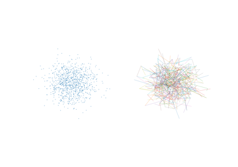

[annoy.Index to NPY or CSV with examples](annoy/plot_annoy_to_NPY_CSV.html)

annoy.Index to NPY or CSV with examples

[Mmap annoy.AnnoyIndex with examples](annoy/plot_mmap_script.html)

Mmap annoy.AnnoyIndex with examples

[Precision annoy.AnnoyIndex with examples](annoy/plot_precision_script.html)

Precision annoy.AnnoyIndex with examples

[Simple annoy.AnnoyIndex with examples](annoy/plot_simple_script.html)

Simple annoy.AnnoyIndex with examples

[Compile and run the C++ Annoy with examples](annoy/s_compile_cpp.html)

Compile and run the C++ Annoy with examples

## Array API support[#](#array-api-support "Link to this heading")

Examples related to the `_lib` submodule with e.g. [`LogisticRegression`](https://scikit-learn.org/dev/modules/generated/sklearn.linear_model.LogisticRegression.html#sklearn.linear_model.LogisticRegression "(in scikit-learn v1.10)") instance.

## Calibration[#](#calibration "Link to this heading")

Examples related to the [`metrics`](../apis/scikitplot.api.html#module-scikitplot.api.metrics "scikitplot.api.metrics") submodule with e.g. [`LogisticRegression`](https://scikit-learn.org/dev/modules/generated/sklearn.linear_model.LogisticRegression.html#sklearn.linear_model.LogisticRegression "(in scikit-learn v1.10)") instance.

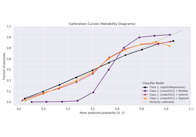

[plot\_calibration with examples](calibration/plot_calibration_script.html)

plot\_calibration with examples

## Classification[#](#classification "Link to this heading")

Examples related to the [`estimators`](../apis/scikitplot.api.html#module-scikitplot.api.estimators "scikitplot.api.estimators") submodule with e.g. [`LogisticRegression`](https://scikit-learn.org/dev/modules/generated/sklearn.linear_model.LogisticRegression.html#sklearn.linear_model.LogisticRegression "(in scikit-learn v1.10)") instance.

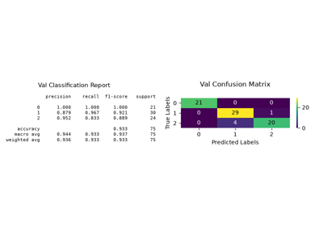

[plot\_classifier\_eval with examples](classification/plot_classifier_eval_script.html)

plot\_classifier\_eval with examples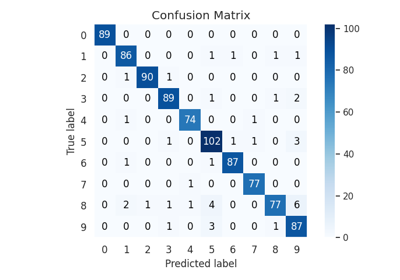

[plot\_confusion\_matrix with examples](classification/plot_confusion_matrix_script.html)

plot\_confusion\_matrix with examples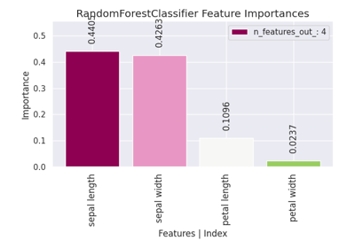

[plot\_feature\_importances with examples](classification/plot_feature_importances_script.html)

plot\_feature\_importances with examples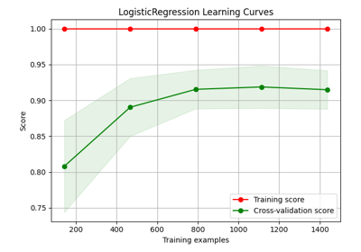

[plot\_learning\_curve with examples](classification/plot_learning_curve_script.html)

plot\_learning\_curve with examples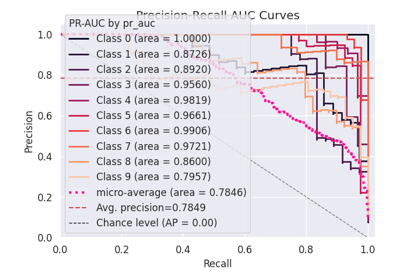

[plot\_precision\_recall with examples](classification/plot_precision_recall_script.html)

plot\_precision\_recall with examples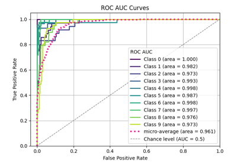

[plot\_roc\_curve with examples](classification/plot_roc_script.html)

plot\_roc\_curve with examples

# Cleanprompt[#](#cleanprompt "Link to this heading")

Examples for [`cleanprompt`](../apis/scikitplot.cleanprompt.html#module-scikitplot.cleanprompt "scikitplot.cleanprompt") are ordered as a learning path.
The submodule replaces sensitive values in a text with stable placeholders
before that text is sent to a language model, and puts the values back
afterwards:

```
your text
    ↓
detect        regular expressions, and optionally named entities
    ↓
assign        one stable label per distinct value
    ↓
rewrite       a single pass over the original text
    ↓
── the model ──   the only hop this submodule does not control
    ↓
restore       the labels become the values again

```
```
# The base tier needs nothing beyond the standard library
pip install scikit-plots

# Optional tiers, each independent of the others
# spaCy entity detection, NLTK entity detection, local Flask interface, the Fernet vault cipher
pip install scikit-plots[cleanprompt]

# The same two scripts serve Docker images, the devcontainer and
# the documentation build; see their headers for the options.
bash docker/scripts/install_nltk.sh
bash docker/scripts/install_spacy.sh

# What is active on this machine, and what is blind
python -m scikitplot.cleanprompt doctor

```
> **See also**
> * [takashiishida/cleanprompt](https://github.com/takashiishida/cleanprompt) — the upstream project this
  submodule was restructured from.
* [Mcp](mcp/index.html#mcp-examples) — the other submodule with a centrally registered CLI.

## Start here[#](#start-here "Link to this heading")

1. ****Basics**** — hide one value, send the prompt, get the value back. The whole
   loop in four commands and four function calls.
2. ****The command line**** — every input route, the option grammar, exit codes,
   and the edge cases that bite: a pasted paragraph, a dash-leading value,
   `--`, abbreviations, pipes, and a closed pipe.
3. ****The Python API**** — [`encode`](../modules/generated/scikitplot.cleanprompt.encode.html#scikitplot.cleanprompt.encode "scikitplot.cleanprompt.encode")/[`decode`](../modules/generated/scikitplot.cleanprompt.decode.html#scikitplot.cleanprompt.decode "scikitplot.cleanprompt.decode"), [`Session`](../modules/generated/scikitplot.cleanprompt.Session.html#scikitplot.cleanprompt.Session "scikitplot.cleanprompt.Session"),
   [`Redactor`](../modules/generated/scikitplot.cleanprompt.Redactor.html#scikitplot.cleanprompt.Redactor "scikitplot.cleanprompt.Redactor"), and what each one does when the input is degenerate.
4. ****Notebooks and modules**** — send a whole `.ipynb` or `.py`: the schema
   renamed role by role, paths and rendered data removed, and the code still
   readable enough for a model to help with.
5. ****Moderate**** — policies and profiles, the vault lifecycle, append versus
   overwrite, entity engines and whether they are **ready** (package, language
   and data), languages, and the surrogate style.
6. ****Advanced**** — custom detectors, overlap arbitration, vault encryption
   without a compiled dependency, the lossy model hop, values written with
   invisible or full-width characters, and the nine core runtime invariants.
7. ****Recipes**** — a CI gate, a notebook helper, a logging filter, a batch
   pipeline, an agent loop, and container files that stay on loopback.
8. ****Packs and formats**** — records, configs and whole folders: YAML packs that
   read field names (`mrn`, `DB_PASSWORD`, `member_id`), formats from
   CSV to Word to zip, the fluent plan (`all`, one domain, or any
   combination), your own pack from a JSON or YAML file (and why a pack file
   is trusted like code), and the corpus bridge.
9. ****A gate for any model or agent**** — [`Guard`](../modules/generated/scikitplot.cleanprompt.Guard.html#scikitplot.cleanprompt.Guard "scikitplot.cleanprompt.Guard") in front of any client:
   checked outgoing text, chat messages, tool calls, streamed replies,
   `ask --via` for command-line models, the agent skill, the MCP server for
   agents without code, plan files a team pins, and audit logs that record what
   left without keeping what was removed.

## Which surface should I use?[#](#which-surface-should-i-use "Link to this heading")

| Goal | Start with |
| --- | --- |
| Paste a prompt into a chat window by hand | `cleanprompt encode` / `cleanprompt decode` |
| See what **would** be removed, changing nothing | `cleanprompt inspect` |
| Fail a build when a file contains sensitive values | `cleanprompt scan` |
| One call in an application | [`encode`](../modules/generated/scikitplot.cleanprompt.encode.html#scikitplot.cleanprompt.encode "scikitplot.cleanprompt.encode") and [`decode`](../modules/generated/scikitplot.cleanprompt.decode.html#scikitplot.cleanprompt.decode "scikitplot.cleanprompt.decode") |
| A multi-turn conversation with one stable vault | [`Session`](../modules/generated/scikitplot.cleanprompt.Session.html#scikitplot.cleanprompt.Session "scikitplot.cleanprompt.Session"), usually as a `with` block |
| Full control of detectors, overlap and limits | [`Redactor`](../modules/generated/scikitplot.cleanprompt.Redactor.html#scikitplot.cleanprompt.Redactor "scikitplot.cleanprompt.Redactor") with a [`RedactionPolicy`](../modules/generated/scikitplot.cleanprompt.RedactionPolicy.html#scikitplot.cleanprompt.RedactionPolicy "scikitplot.cleanprompt.RedactionPolicy") |
| Add a detector of your own | [`RegexDetector`](../modules/generated/scikitplot.cleanprompt.RegexDetector.html#scikitplot.cleanprompt.RegexDetector "scikitplot.cleanprompt.RegexDetector") / [`LiteralDetector`](../modules/generated/scikitplot.cleanprompt.LiteralDetector.html#scikitplot.cleanprompt.LiteralDetector "scikitplot.cleanprompt.LiteralDetector") in a [`DetectorRegistry`](../modules/generated/scikitplot.cleanprompt.DetectorRegistry.html#scikitplot.cleanprompt.DetectorRegistry "scikitplot.cleanprompt.DetectorRegistry") |
| Send a notebook, a module or any analysis file | `cleanprompt encode --in analysis.ipynb --out analysis.clean.ipynb` |
| See a file’s schema before sending it | `cleanprompt inspect --in analysis.ipynb` |
| Records, configs, Office files, a whole folder or a zip | [`FluentCleanPrompt`](../modules/generated/scikitplot.cleanprompt.FluentCleanPrompt.html#scikitplot.cleanprompt.FluentCleanPrompt "scikitplot.cleanprompt.FluentCleanPrompt") → [`Cleaner`](../modules/generated/scikitplot.cleanprompt.Cleaner.html#scikitplot.cleanprompt.Cleaner "scikitplot.cleanprompt.Cleaner"), or `cleanprompt batch SRC --out DST` |
| Hide your own domain’s fields | a pack file: `cleanprompt batch --pack-file hr.yaml --pack hr` |
| Make corpus documents safe before indexing | `redact_documents` |
| Put any model, SDK or agent behind one privacy gate | [`Guard`](../modules/generated/scikitplot.cleanprompt.Guard.html#scikitplot.cleanprompt.Guard "scikitplot.cleanprompt.Guard") (`FluentCleanPrompt().guard()`) |
| Guard a command-line model (`ollama`, `llm`, …) | `cleanprompt ask --via "COMMAND"` |
| Teach an AI assistant to use it | `cleanprompt skill --write DIR` |
| Give any MCP agent the gate, without code | `cleanprompt mcp --root PROJECT` |
| Pin a team’s packs and rules, and fail CI when they drift | `cleanprompt plan --write` / `--check`, and `--plan FILE` |

## Capability matrix[#](#capability-matrix "Link to this heading")

The base tier imports ****no third-party package****, so the normal gallery path
runs on a bare installation. Optional capabilities are preflighted and reported
as a visible `SKIP` when unavailable, never silently omitted.

| Example | Normal path | Optional capability | Behavior when unavailable |
| --- | --- | --- | --- |
| Basics | standard library | none | not applicable |
| Command line | standard library | `click` frontend | falls back to `argparse`; parity is asserted either way |
| Python API | standard library | none | not applicable |
| Notebooks and modules | standard library | none | not applicable |
| Moderate | standard library | spaCy / NLTK entity engines | specific `SKIP` per engine; the pattern half still runs |
| Advanced | standard library | `cryptography` for `--cipher fernet` | the `portable` cipher runs regardless; Fernet section `SKIP` |
| Recipes | standard library | Flask for the web recipe | configuration shown, server not started |
| Packs and formats | standard library (packs are compiled JSON) | PyYAML for YAML packs; [`scikitplot.corpus`](../apis/scikitplot.corpus.html#module-scikitplot.corpus "scikitplot.corpus") for the bridge | JSON packs still shown; specific `SKIP` for each |
| A gate for any model | standard library | none (the model is a stand-in function) | not applicable |

## Gallery reliability rule[#](#id1 "Link to this heading")

The examples distinguish optional capability absence from real defects:

`missing optional package, model or data package`
:   Report a visible, specific `SKIP` and continue when the example can
    remain truthful.

`invalid public API / failed round trip / a value surviving into the redacted text`
:   Fail visibly. The gallery must not convert a leak or a regression into a
    skip, because the one property this submodule sells is that the value did
    not go to the model.

Every example asserts its own round trip. An example that prints a redacted
prompt has already checked that the original value is absent from it.

## Where the vault goes during a documentation build[#](#where-the-vault-goes-during-a-documentation-build "Link to this heading")

A vault holds the ****removed values in clear text****. Left to itself the CLI
writes one into the platform state directory —
`$XDG_STATE_HOME/cleanprompt/vault.json` on Linux,
`%LOCALAPPDATA%\cleanprompt\` on Windows — which is right for a person at a
terminal and wrong for a documentation builder.

Every script here therefore points `CLEANPROMPT_VAULT` at a
[`TemporaryDirectory`](https://docs.python.org/3/library/tempfile.html#tempfile.TemporaryDirectory "(in Python v3.15)") in its first cell and removes it in its
last. Nothing a gallery run produces outlives the build, and nothing is written
next to the source tree, where a `git add .` could commit it.

## Reading the examples is not the same as running them[#](#reading-the-examples-is-not-the-same-as-running-them "Link to this heading")

The redacted prompts printed by these examples contain no real values: the
addresses use the reserved `example.com` and `example.invalid` domains
([****RFC 2606****](https://datatracker.ietf.org/doc/html/rfc2606.html)), the telephone numbers the North American fiction block
`+1 555 0100`–`0199`, the addresses the documentation ranges
`192.0.2.0/24` ([****RFC 5737****](https://datatracker.ietf.org/doc/html/rfc5737.html)) and `2001:db8::/32` ([****RFC 3849****](https://datatracker.ietf.org/doc/html/rfc3849.html)), and the
card number the publicly published test value.

Use the same discipline in your own examples and tests. A tutorial that leaks a
real value has undone the thing it was teaching.

## Browser / WASM note[#](#id2 "Link to this heading")

The base tier is pure Python and has no filesystem requirement beyond the vault
path, so pattern detection, the API and the placeholder round trip are strong
JupyterLite candidates. Subprocess execution, the platform state directory,
`getpass` prompts, native spaCy models, NLTK data downloads and a listening
Flask server should not be assumed available in a browser runtime.

The examples that shell out to the CLI say so, and the equivalent Python call
is shown beside every one of them.


[Cleanprompt Advanced: Invariants, Encryption, and the Lossy Model Hop](cleanprompt/plot_cleanprompt_advanced_script.html)

Cleanprompt Advanced: Invariants, Encryption, and the Lossy Model Hop

[Cleanprompt Basics: Hide a Value, Then Get It Back](cleanprompt/plot_cleanprompt_basics_script.html)

Cleanprompt Basics: Hide a Value, Then Get It Back

[Cleanprompt on the Command Line: Single Commands and Edge Cases](cleanprompt/plot_cleanprompt_cli_usage_script.html)

Cleanprompt on the Command Line: Single Commands and Edge Cases

[Cleanprompt as a Gate: Any Model, Any Agent, Nothing Private Leaves](cleanprompt/plot_cleanprompt_guard_agents_script.html)

Cleanprompt as a Gate: Any Model, Any Agent, Nothing Private Leaves

[Cleanprompt Moderate: Policies, Entities, and the Vault’s Lifecycle](cleanprompt/plot_cleanprompt_moderate_script.html)

Cleanprompt Moderate: Policies, Entities, and the Vault's Lifecycle

[Cleanprompt for Notebooks: Sending an Analysis Without Sending the Data](cleanprompt/plot_cleanprompt_notebooks_script.html)

Cleanprompt for Notebooks: Sending an Analysis Without Sending the Data

[Cleanprompt Packs and Formats: Records, Configs and Whole Folders](cleanprompt/plot_cleanprompt_packs_formats_script.html)

Cleanprompt Packs and Formats: Records, Configs and Whole Folders

[Cleanprompt from Python: Single Calls and Edge Cases](cleanprompt/plot_cleanprompt_python_api_script.html)

Cleanprompt from Python: Single Calls and Edge Cases

[Cleanprompt Recipes: CI Gates, Notebooks, Pipelines and Agents](cleanprompt/plot_cleanprompt_recipes_script.html)

Cleanprompt Recipes: CI Gates, Notebooks, Pipelines and Agents

## Clustering[#](#clustering "Link to this heading")

Examples related to the [`estimators`](../apis/scikitplot.api.html#module-scikitplot.api.estimators "scikitplot.api.estimators") submodule with e.g. [`LogisticRegression`](https://scikit-learn.org/dev/modules/generated/sklearn.linear_model.LogisticRegression.html#sklearn.linear_model.LogisticRegression "(in scikit-learn v1.10)") instance.

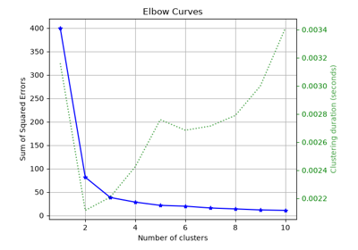

[plot\_elbow with examples](clustering/plot_elbow_script.html)

plot\_elbow with examples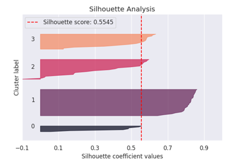

[plot\_silhouette with examples](clustering/plot_silhouette_script.html)

plot\_silhouette with examples

# Corpus[#](#corpus "Link to this heading")

Examples for [`corpus`](../apis/scikitplot.corpus.html#module-scikitplot.corpus "scikitplot.corpus") are ordered as a learning path rather
than by implementation detail.

```
# 💡 corpus Need additionals packages
curl -O https://raw.githubusercontent.com/scikit-plots/scikit-plots/main/requirements/corpus.txt
pip install -r requirements/corpus.txt
pip install scikit-plots[corpus]

# (Recommended)
# !pip install datasets transformers
# !pip install nltk gensim langdetect faster-whisper openai-whisper pytesseract youtube-transcript-api
# sudo apt-get install tesseract-ocr

```
> **See also**
> * [modelcontextprotocol/python-sdk](https://github.com/modelcontextprotocol/python-sdk)
* [semantica-agi/semantica](https://github.com/semantica-agi/semantica)
* <https://docs.getsemantica.ai/guides/distance-intelligence/#common-pitfalls>

## Start here[#](#id3 "Link to this heading")

1. ****Configure Corpus declaratively**** — learn `FluentCorpus`, immutable
   plans, validation, branching, fingerprints, bounded lazy configuration
   variants, and the `materialize()` boundary.
2. ****Compose policy families explicitly**** — use `CorpusPolicyBundle`
   for reusable local/strict/networked/docs presets without collapsing runtime,
   backend, downloader, and per-document error semantics.
3. ****Customize optional backends safely**** — preflight the exact reader chain,
   inspect readiness, order backends with `BackendPolicy`, and plug in a
   user-side `ASRBackend` without model downloads.
4. ****Use lexical edit distance**** — use [`scikitplot.levenshtein`](../apis/scikitplot.levenshtein.html#module-scikitplot.levenshtein "scikitplot.levenshtein") directly
   and as a deterministic Corpus retrieval scorer.
5. ****Build and search a real Hamlet corpus**** — use
   `RuntimeCorpus` end to end: `run()`, `add()`, storage, retrieval,
   export, and lifecycle.
6. ****Compare chunking strategies**** — compare sentence, word, fixed-window, and
   morphological semantic chunking on the same OCR text.
7. ****Process an MP3**** — learn audio provenance and companion-transcript
   precedence without requiring Whisper in the normal gallery path.
8. ****Process a mixed-media ZIP**** — inspect archive-member routing,
   `archive.zip/member.ext` provenance, and per-extension reader settings.
9. ****Process a YouTube transcript**** — execute a deterministic local proxy,
   configure the real YouTube reader, and keep the live transcript request
   explicit and optional.
10. ****Build a multi-source WHO corpus**** — see the explicit stage-by-stage

> integration path, partial source success, keyword retrieval, adapters, and
> where `CorpusBuilder` fits.

## Which API should I use?[#](#which-api-should-i-use "Link to this heading")

| Goal | Start with |
| --- | --- |
| Process one source with direct stage control | `CorpusPipeline` |
| Build/search heterogeneous sources with partial-success reporting | `CorpusBuilder` |
| Create immutable, reusable, branchable configuration | `FluentCorpus` |
| Execute a Fluent plan and manage runtime state/lifecycle | `RuntimeCorpus` |
| Extend vector indexing/retrieval directly | `RetrievalIndex` / `VectorIndexBackend` |

## Capability matrix[#](#id4 "Link to this heading")

The normal gallery path prefers deterministic local execution. Optional
capabilities are either preflighted and skipped when unavailable, or shown as
configuration-only examples.

| Example | Normal path | Optional capability | Behavior when unavailable |
| --- | --- | --- | --- |
| FluentCorpus basics | local/core | none | not applicable |
| Policy bundle | local/core | none | composes existing policies; performs no I/O by itself |
| Backend policy and custom ASR | local/core | none; capability probes only | preflight and execution use the same candidate chain; no model is loaded or downloaded by preflight |
| Levenshtein retrieval | bundled/pure Python | RapidFuzz acceleration | facade remains importable through safe fallback |
| Hamlet RuntimeCorpus | local/core + NumPy | native Annoy branch | configuration only; not built |
| OCR chunking comparison | local image | Tesseract, NLTK | explicit `SKIP` for unavailable capability |
| MP3 ingestion | MP3 + local SRT companion | NLTK, Whisper | optional sections `SKIP` |
| Mixed-media ZIP | local archive | PDF/OCR/Whisper readers | individual optional member capability may produce no documents; archive-security failures still fail |
| YouTube transcript | local synthetic proxy | youtube-transcript-api + network, NLTK | live/optional sections `SKIP` |
| WHO multi-source integration | local sidecars only | PDF/OCR/Whisper | each unavailable source reports `SKIP`; successful evidence remains |

## Gallery reliability rule[#](#id5 "Link to this heading")

The examples distinguish optional capability absence from real defects:

`missing optional package/resource/native capability/network opt-in`
:   Report a visible, specific `SKIP` and continue when the example can
    remain truthful.

`invalid public API / security-policy failure`
:   Fail visibly. The gallery must not convert these into a skip.

`optional ASR backend defect`
:   Remain observable. Audio/video readers warn and try the next Whisper backend;
    their default `strict=False` policy yields no ASR chunks only after the
    fallback chain is exhausted. `reader.backend_reports` keeps a structured,
    JSON-compatible `degraded`/`failed` record for programmatic inspection.
    Use `strict=True` for fail-fast validation.

A missing local sidecar never silently enables public-network access.

## Install only what you need[#](#install-only-what-you-need "Link to this heading")

The core text/runtime examples use the normal Corpus installation. Media and
NLP examples may additionally use packages such as NLTK, an OCR backend,
Whisper, or `youtube-transcript-api`. System tools such as Tesseract may also
be required for the corresponding optional path.

Do not install every optional dependency merely to read the gallery. The
portable path is designed to remain useful when those capabilities are absent.

## Browser / WASM note[#](#id6 "Link to this heading")

Declarative configuration, local text processing, and portable brute-force
retrieval are the strongest browser/WASM candidates. OCR, Whisper, native ANN
backends, and live external services depend on the actual JupyterLite/xeus
runtime and should not be assumed available until verified in that target
environment.


[Process an MP3 with Corpus](corpus/plot_corpus_a_tale_of_two_cities_mp3_script.html)

Process an MP3 with Corpus

[Customize Corpus backends and readiness policies](corpus/plot_corpus_backend_policy_script.html)

Customize Corpus backends and readiness policies

[Configure Corpus with FluentCorpus](corpus/plot_corpus_fluent_corpus_script.html)

Configure Corpus with FluentCorpus

[Build and Search a Real Hamlet Corpus with FluentCorpus](corpus/plot_corpus_fluent_hamlet_retrieval_script.html)

Build and Search a Real Hamlet Corpus with FluentCorpus

[Build and Search a Real Hamlet Corpus with FluentCorpus](corpus/plot_corpus_fluent_hamlet_retrieval_script_v1.html)

Build and Search a Real Hamlet Corpus with FluentCorpus

[Build and Search a Real Hamlet Corpus with FluentCorpus](corpus/plot_corpus_fluent_hamlet_retrieval_script_v2.html)

Build and Search a Real Hamlet Corpus with FluentCorpus

[Compare Corpus Chunking Strategies on OCR Text](corpus/plot_corpus_knowledge_script.html)

Compare Corpus Chunking Strategies on OCR Text

[Use Levenshtein distance with Corpus retrieval](corpus/plot_corpus_levenshtein_script.html)

Use Levenshtein distance with Corpus retrieval

[Compose Corpus policies without hiding boundaries](corpus/plot_corpus_policy_bundle_script.html)

Compose Corpus policies without hiding boundaries

[Build a Multi-Source WHO Corpus](corpus/plot_corpus_who_per_file_script.html)

Build a Multi-Source WHO Corpus

[Process a YouTube Transcript with Corpus](corpus/plot_corpus_who_youtube_script.html)

Process a YouTube Transcript with Corpus

[Process a Mixed-Media ZIP Archive with Corpus](corpus/plot_corpus_who_zip_script.html)

Process a Mixed-Media ZIP Archive with Corpus

## Cython[#](#id7 "Link to this heading")

Examples related to the [`cython`](../apis/scikitplot.cython.html#module-scikitplot.cython "scikitplot.cython") submodule.

```
# 💡cython Need cython and setuptools
pip install scikitplot[build] setuptools

# (Recommended)
# !pip install cython setuptools

```


[Cython quickstart: compile\_and\_load](cython/plot_00_quickstart_compile_and_load.html)

Cython quickstart: compile\_and\_load

[Browse and compile templates](cython/plot_01_browse_and_compile_templates.html)

Browse and compile templates

[Build profiles: fast-debug, release, annotate](cython/plot_02_build_profiles.html)

Build profiles: fast-debug, release, annotate

[Cache and restart reuse](cython/plot_03_cache_and_restart_reuse.html)

Cache and restart reuse

[Pin/Alias: stable handles for cached builds](cython/plot_04_pin_alias.html)

Pin/Alias: stable handles for cached builds

[Multi-module package builds (5 package examples)](cython/plot_05_package_examples_multimodule.html)

Multi-module package builds (5 package examples)

[Multi-file builds: .pxi includes and external headers](cython/plot_06_multifile_support_files.html)

Multi-file builds: .pxi includes and external headers

[C++ mode basics: cppclass and libcpp containers](cython/plot_07_cpp_mode_basics.html)

C++ mode basics: cppclass and libcpp containers

[Vector ops without NumPy: array(‘d’) + memoryviews](cython/plot_08_vector_ops_without_numpy.html)

Vector ops without NumPy: array('d') + memoryviews

[Workflow templates (train / hpo / predict) + CLI entry template](cython/plot_09_workflow_templates_cli.html)

Workflow templates (train / hpo / predict) + CLI entry template

[Cython: Realtime compile\_and\_load (.pyx)](cython/plot_cython_template.html)

Cython: Realtime compile\_and\_load (.pyx)

## Decile[#](#decile "Link to this heading")

Examples related to the [`decile`](../apis/scikitplot.decile.html#module-scikitplot.decile "scikitplot.decile") submodule with e.g. [`LogisticRegression`](https://scikit-learn.org/dev/modules/generated/sklearn.linear_model.LogisticRegression.html#sklearn.linear_model.LogisticRegression "(in scikit-learn v1.10)") instance.

> **See also**
> * Seaborn-style decile analysis (Lift / Gain / KS) [`decileplot`](../modules/generated/scikitplot.seaborn.decileplot.html#scikitplot.seaborn.decileplot "scikitplot.seaborn.decileplot")
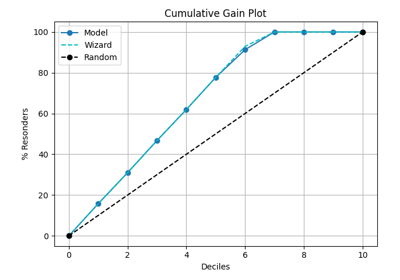

[plot\_cumulative\_gain with examples](decile/plot_cumulative_gain_script.html)

plot\_cumulative\_gain with examples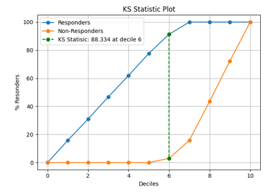

[plot\_ks\_statistic with examples](decile/plot_ks_statistic_script.html)

plot\_ks\_statistic with examples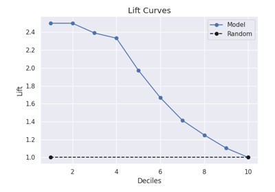

[plot\_lift with examples](decile/plot_lift_script.html)

plot\_lift with examples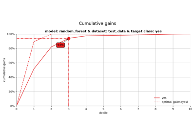

[Introduction to modelplotpy (legacy)](decile/plot_modelplotpy_legacy_script.html)

Introduction to modelplotpy (legacy)

[Introduction to modelplotpy](decile/plot_modelplotpy_script.html)

Introduction to modelplotpy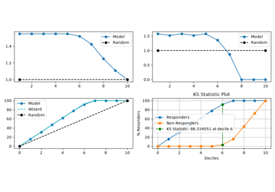

[plot\_report with examples](decile/plot_report_script.html)

plot\_report with examples

## Decomposition[#](#decomposition "Link to this heading")

Examples related to the [`decomposition`](../apis/scikitplot.api.html#module-scikitplot.api.decomposition "scikitplot.api.decomposition") submodule with e.g. [`PCA`](https://scikit-learn.org/dev/modules/generated/sklearn.decomposition.PCA.html#sklearn.decomposition.PCA "(in scikit-learn v1.10)") instance.

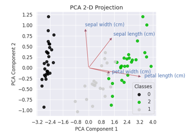

[plot\_pca\_2d\_projection with examples](decomposition/plot_pca_2d_projection_script.html)

plot\_pca\_2d\_projection with examples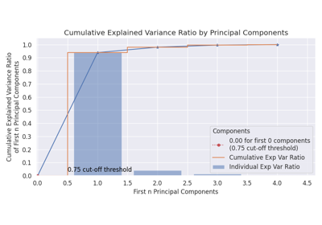

[plot\_pca\_component\_variance with examples](decomposition/plot_pca_component_variance_script.html)

plot\_pca\_component\_variance with examples

## Impute[#](#impute "Link to this heading")

Examples related to the [`impute`](../apis/scikitplot.impute.html#module-scikitplot.impute "scikitplot.impute") submodule
with a scikit-learn regressor (e.g., [`LinearRegression`](https://scikit-learn.org/dev/modules/generated/sklearn.linear_model.LinearRegression.html#sklearn.linear_model.LinearRegression "(in scikit-learn v1.10)")) instance.

> **See also**
> * [Houses Prices Tree Based Models (pickling ANNImputer)](https://www.kaggle.com/code/clkmuhammed/houses-prices-tree-based-models)
```
# 💡impute may need voyager
pip install scikitplot[core]

# (Optionally)
# !pip install voyager

```


[annoy impute with examples](impute/plot_impute_script.html)

annoy impute with examples

# Levenshtein[#](#levenshtein "Link to this heading")

These examples form a small learning path for exact edit distance and fuzzy
ranking. They are deterministic, local and network-free.

```
two sequences
     ↓
unit-cost edit distance
     ↓
normalized similarity
     ↓
optional ranking / cutoff
     ↓
actual backend provenance

```

## Start here[#](#id9 "Link to this heading")

1. ****Basics**** — the classic `kitten` → `sitting` distance and normalized
   metrics.
2. ****Backends**** — inspect internal, RapidFuzz, explicit GPL and pure-Python
   capabilities without requiring any optional backend to be installed.
3. ****Ranking**** — stable ties, `limit`, `score_cutoff` and object `key`.
4. ****Sequences**** — bytes, token sequences and explicit Unicode normalization.
5. ****Corpus**** — use Levenshtein as a deterministic local Corpus retrieval
   scorer.

## Reliability rules[#](#reliability-rules "Link to this heading")

Every script:

* uses only local literal data;
* performs no network access or downloads;
* has a pure-Python path;
* asserts the result it demonstrates;
* does not turn a wrong distance into a skip.

An unavailable optional accelerator can be reported as unavailable. Metric
correctness cannot be skipped.

## Backend note[#](#backend-note "Link to this heading")

`auto` never chooses the external GPL `Levenshtein` backend. The examples
do not require it.

The gallery demonstrates the facade contract rather than benchmarking one
machine’s accelerator installation.


[Backend discovery and safe fallback](levenshtein/plot_levenshtein_backends_script.html)

Backend discovery and safe fallback

[Levenshtein basics](levenshtein/plot_levenshtein_basics_script.html)

Levenshtein basics

[Use Levenshtein with Corpus](levenshtein/plot_levenshtein_corpus_script.html)

Use Levenshtein with Corpus

[Rank fuzzy matches](levenshtein/plot_levenshtein_ranking_script.html)

Rank fuzzy matches

[Sequences and explicit normalization](levenshtein/plot_levenshtein_sequences_script.html)

Sequences and explicit normalization

# Mcp[#](#mcp "Link to this heading")

Examples for [`mcp`](../apis/scikitplot.mcp.html#module-scikitplot.mcp "scikitplot.mcp") focus on exposing local scikit-plots
evidence through a small, read-only Model Context Protocol (MCP) surface.

The current showcase connects three public submodules:

`scikitplot.corpus`
:   builds deterministic local evidence with
    [`HAMLET_TEXT`](../modules/generated/scikitplot.corpus.HAMLET_TEXT.html#scikitplot.corpus.HAMLET_TEXT "scikitplot.corpus.HAMLET_TEXT") and
    [`HashEmbedder`](../modules/generated/scikitplot.corpus.HashEmbedder.html#scikitplot.corpus.HashEmbedder "scikitplot.corpus.HashEmbedder").

`scikitplot.annoy`
:   provides the optional native approximate-nearest-neighbor backend.

`scikitplot.mcp`
:   serves the indexed evidence through `search_docs` and
    `docs://chunk/{doc_id}`.

```
# MCP server/client dependencies
pip install scikit-plots[mcp]

# Verify the centralized CLI
scikitplot mcp --help

```

## Start here[#](#id10 "Link to this heading")

****Serve a real Hamlet corpus over MCP with Annoy****

The showcase follows one complete local workflow:

```
HAMLET_TEXT
    ↓
local corpus directory
    ↓
HashEmbedder
    ↓
Annoy
    ↓
CorpusAnnoyRetriever
    ↓
scikitplot mcp --self-test
    ↓
scikitplot mcp --docker
    ↓
MCP client context
    ↓
search_docs(...)
    ↓
citations + docs://chunk/{doc_id}

```

It is intentionally built from local data so the retrieval result does not
depend on a model download or an external document service.

## Execution layers[#](#execution-layers "Link to this heading")

The example separates increasingly optional capabilities instead of requiring
the full server stack for every documentation build.

| Layer | Requires | Normal purpose | If unavailable |
| --- | --- | --- | --- |
| Hamlet corpus | Corpus core | create local evidence | runs normally |
| Hash embedding | NumPy / Corpus core | deterministic document/query vectors | runs normally |
| Corpus + Annoy retrieval | native `scikitplot.annoy` | real ANN search | specific `SKIP` |
| CLI `--self-test` | Corpus + Annoy | verify backend without opening a server | specific `SKIP` when Annoy is absent |
| MCP HTTP server | MCP server dependencies | expose tools/resources | specific `SKIP` |
| MCP client round trip | MCP SDK + local server | verify the real protocol boundary | run only in provisioned CI/manual environments |

## CLI self-test first[#](#cli-self-test-first "Link to this heading")

Before opening a listening server, validate the exact Corpus + Annoy
configuration with the bounded CLI self-test:

```
scikitplot mcp \
    --corpus-annoy /tmp/scikitplot-mcp-hamlet \
    --hash-dimension 256 \
    --annoy-n-trees 10 \
    --self-test \
    --self-test-query "sleep dream death" \
    --self-test-require-match

```

This is the preferred first CI gate because it verifies corpus loading,
embedding, index construction, querying, and the MCP result contract without
requiring an HTTP client/server round trip.

## Two-terminal server workflow[#](#two-terminal-server-workflow "Link to this heading")

****Terminal 1 — server****

```
scikitplot mcp --docker \
    --host 127.0.0.1 \
    --corpus-annoy /tmp/scikitplot-mcp-hamlet \
    --hash-dimension 256 \
    --annoy-n-trees 10

```

****Terminal 2 — client****

```
from mcp import Client

async with Client("http://127.0.0.1:8000/mcp") as client:
    result = await client.call_tool(
        "search_docs",
        {
            "query": "sleep dream death",
            "k": 3,
        },
    )

print(result.structured_content)

```

The showcase also polls `/healthz` before creating the client and always
terminates the server subprocess during cleanup.

## CI / documentation mode[#](#ci-documentation-mode "Link to this heading")

For an ordinary documentation build, keep the live HTTP round trip disabled:

```
export SCIKITPLOT_GALLERY_RUN_MCP_DOCKER=0

```

To execute the full local server/client round trip in a provisioned CI
container:

```
export SCIKITPLOT_GALLERY_RUN_MCP_DOCKER=1
python galleries/examples/mcp/plot_mcp_corpus_annoy_hamlet_script.py

```

The CI subprocess explicitly binds to `127.0.0.1`. This keeps the
unauthenticated showcase server on loopback rather than exposing it beyond the
container/host merely to test the protocol path.

## What `--docker` means here[#](#what-docker-means-here "Link to this heading")

The example invokes:

```
scikitplot mcp --docker ...

```

through Python’s `subprocess` module.

It is the scikit-plots MCP server’s Docker-oriented runtime profile; the Python
gallery itself is not a replacement for `docker run` or container
orchestration. The same command can be launched inside your normal CI/Docker
environment.

## Gallery reliability rule[#](#id11 "Link to this heading")

The MCP examples use the same reliability distinction as the Corpus gallery:

`missing optional native Annoy / MCP SDK / intentionally disabled live server`
:   Report a visible, specific `SKIP` when the remaining example can stay
    truthful.

`invalid public API / broken installed backend / malformed MCP result / server crash`
:   Fail visibly. Do not convert a real integration regression into a skip.

The local deterministic path must never fabricate Annoy or MCP success when
those capabilities were not actually exercised.

## Security and lifecycle[#](#security-and-lifecycle "Link to this heading")

The showcase is read-only and uses bounded result previews.

For automated server execution it also:

* chooses a free loopback port,
* waits for `/healthz` before connecting,
* binds explicitly to `127.0.0.1`,
* terminates the child process in a `finally`/context cleanup path,
* escalates to `kill()` only if graceful termination exceeds the timeout.

Treat wider network exposure, authentication, reverse proxies, TLS, and
production process supervision as deployment concerns rather than gallery
defaults.

## Browser / WASM note[#](#id12 "Link to this heading")

The deterministic Corpus and hashing pieces are portable Python/NumPy
candidates. Native Annoy, subprocess management, listening sockets, and a real
MCP HTTP server should not be assumed available in JupyterLite or other
browser/WASM runtimes.

Use the gallery there as architecture/reference material unless those runtime
capabilities have been explicitly verified.


[Serve a Real Hamlet Corpus over MCP with Annoy](mcp/plot_mcp_corpus_annoy_hamlet_script.html)

Serve a Real Hamlet Corpus over MCP with Annoy

## MemMap[#](#memmap "Link to this heading")

Examples related to the [`memmap`](../apis/scikitplot.memmap.html#module-scikitplot.memmap "scikitplot.memmap") submodule.

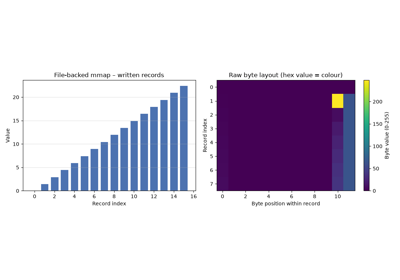

[Memory-Mapping Showcase – Basic / Medium / Advanced](memmap/plot_mman.html)

Memory-Mapping Showcase – Basic / Medium / Advanced

## Misc[#](#misc "Link to this heading")

Examples related to the `misc` submodule.


[Misc Showcase](misc/plot_misc_script.html)

Misc Showcase

## MLflow[#](#id13 "Link to this heading")

Examples related to the [`mlflow`](../apis/scikitplot.mlflow.html#module-scikitplot.mlflow "scikitplot.mlflow") submodule
with a scikit-learn regressor (e.g., [`LinearRegression`](https://scikit-learn.org/dev/modules/generated/sklearn.linear_model.LinearRegression.html#sklearn.linear_model.LinearRegression "(in scikit-learn v1.10)")) instance.

```
# 💡mlflow Need mlflow
pip install scikitplot[mlflow]

# (Recommended)
# !pip install mlflow

```


[MLflow](mlflow/plot_mlflow.html)

MLflow

## Nc (NumCpp)[#](#nc-numcpp "Link to this heading")

Examples related to the [`nc`](../apis/scikitplot.nc.html#module-scikitplot.nc "scikitplot.nc") submodule.


[nc with examples](nc/plot_nc_test.html)

nc with examples

## Preprocessing[#](#preprocessing "Link to this heading")

Examples related to the [`preprocessing`](../apis/scikitplot.preprocessing.html#module-scikitplot.preprocessing "scikitplot.preprocessing") submodule with
e.g., [`DummyCodeEncoder`](../modules/generated/scikitplot.preprocessing.DummyCodeEncoder.html#scikitplot.preprocessing.DummyCodeEncoder "scikitplot.preprocessing.DummyCodeEncoder"),
[`GetDummies`](../modules/generated/scikitplot.preprocessing.GetDummies.html#scikitplot.preprocessing.GetDummies "scikitplot.preprocessing.GetDummies") instance.

> **See also**
> * [DummyCodeEncoder vs GetDummies](https://www.kaggle.com/code/clkmuhammed/expand-equipment-x-features)
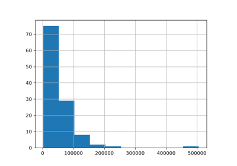

[Comparing DummyCode Encoder with Other Encoders](preprocessing/plot_dummy_code_encoder.html)

Comparing DummyCode Encoder with Other Encoders

## Random[#](#random "Link to this heading")

Examples related to the [`random`](../apis/scikitplot.random.html#module-scikitplot.random "scikitplot.random") submodule.

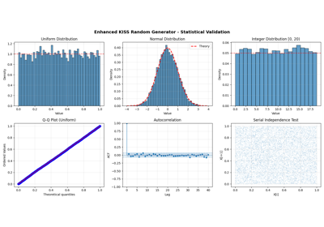

[Enhanced KISS Random Generator - Complete Usage Examples](random/plot_kiss_random.html)

Enhanced KISS Random Generator - Complete Usage Examples

# Rank-BM25[#](#rank-bm25 "Link to this heading")

Examples for [`rank_bm25`](../apis/scikitplot.rank_bm25.html#module-scikitplot.rank_bm25 "scikitplot.rank_bm25") are arranged as a learning path for
lexical retrieval rather than as isolated API demonstrations. They use only
small in-memory corpora, make no network requests, and keep result identities
bound to the index whenever a result could leave the process.

The examples intentionally avoid inventing a plotting layer for a text-ranking
API. Sphinx-Gallery still uses `plot_*.py` filenames, but these examples
render their useful output as code and text.

## Install[#](#install "Link to this heading")

The full Scikit-Plots distribution already includes Rank-BM25:

```
python -m pip install scikit-plots

```

For a smaller installation that owns only the Rank-BM25 package and the
Scikit-Plots core dependencies:

```
python -m pip install scikit-plots-rank-bm25

```

Do not install the full and partial distributions into the same environment;
they own overlapping `scikitplot` package files. See
[Scikit-Plots Partial Distributions](../affiliated/index.html#affiliated-packages-index) for the partial-distribution
model.

## Start here[#](#id14 "Link to this heading")

1. ****Quick start and stable identities**** — build a [`BM25Okapi`](../modules/generated/scikitplot.rank_bm25.BM25Okapi.html#scikitplot.rank_bm25.BM25Okapi "scikitplot.rank_bm25.BM25Okapi") index,
   retrieve by document ID, see deterministic tie ordering, and verify that an
   out-of-vocabulary query returns no sparse hits.
2. ****Choose a recipe**** — run the same corpus through [`BM25Okapi`](../modules/generated/scikitplot.rank_bm25.BM25Okapi.html#scikitplot.rank_bm25.BM25Okapi "scikitplot.rank_bm25.BM25Okapi"),
   [`BM25L`](../modules/generated/scikitplot.rank_bm25.BM25L.html#scikitplot.rank_bm25.BM25L "scikitplot.rank_bm25.BM25L"), and [`BM25Plus`](../modules/generated/scikitplot.rank_bm25.BM25Plus.html#scikitplot.rank_bm25.BM25Plus "scikitplot.rank_bm25.BM25Plus"); inspect the versioned recipe identity
   and compare rankings without treating one score scale as interchangeable
   with another.
3. ****Sparse retrieval versus dense diagnostics**** — use
   [`BM25.candidate_count`](../modules/generated/scikitplot.rank_bm25.BM25.html#scikitplot.rank_bm25.BM25.candidate_count "scikitplot.rank_bm25.BM25.candidate_count"), [`BM25.get_top_ids`](../modules/generated/scikitplot.rank_bm25.BM25.html#scikitplot.rank_bm25.BM25.get_top_ids "scikitplot.rank_bm25.BM25.get_top_ids"), and
   [`BM25.get_scores`](../modules/generated/scikitplot.rank_bm25.BM25.html#scikitplot.rank_bm25.BM25.get_scores "scikitplot.rank_bm25.BM25.get_scores") for the jobs they actually perform.
4. ****Save and reload an index**** — publish a pre-tokenized index to a temporary
   directory, reload it, and verify that identities and retrieval survive the
   round trip.

## Which example should I use?[#](#which-example-should-i-use "Link to this heading")

| Goal | Example |
| --- | --- |
| Add lexical search to an application | [Rank-BM25 Quick Start with Stable Document IDs](rank_bm25/plot_rank_bm25_quickstart_script.html#sphx-glr-auto-examples-rank-bm25-plot-rank-bm25-quickstart-script-py) |
| Decide among Okapi, BM25L, and BM25+ | [Compare the Three Rank-BM25 Scoring Recipes](rank_bm25/plot_rank_bm25_recipes_script.html#sphx-glr-auto-examples-rank-bm25-plot-rank-bm25-recipes-script-py) |
| Understand candidate filtering and whole-corpus scores | [Sparse Retrieval and Dense BM25 Diagnostics](rank_bm25/plot_rank_bm25_sparse_dense_script.html#sphx-glr-auto-examples-rank-bm25-plot-rank-bm25-sparse-dense-script-py) |
| Persist an index across process starts | [Persist and Reload a Rank-BM25 Index](rank_bm25/plot_rank_bm25_persistence_script.html#sphx-glr-auto-examples-rank-bm25-plot-rank-bm25-persistence-script-py) |

## What the gallery treats as the contract[#](#what-the-gallery-treats-as-the-contract "Link to this heading")

The examples follow the current public behavior rather than assumptions from
other BM25 libraries:

* corpus rows are token sequences unless `tokenizer=` is supplied;
* stable `doc_ids` are preferred over caller-owned row offsets;
* [`BM25.get_top_ids`](../modules/generated/scikitplot.rank_bm25.BM25.html#scikitplot.rank_bm25.BM25.get_top_ids "scikitplot.rank_bm25.BM25.get_top_ids") uses sparse candidate retrieval and an unknown term
  can therefore return an empty result;
* [`BM25.get_scores`](../modules/generated/scikitplot.rank_bm25.BM25.html#scikitplot.rank_bm25.BM25.get_scores "scikitplot.rank_bm25.BM25.get_scores") is a dense diagnostic vector with one value per
  corpus row;
* equal retrieval scores are ordered by original corpus position;
* exact floating-point values are not used as cross-recipe compatibility
  assertions; and
* persistence examples use pre-tokenized data because the public namespace does
  not currently expose the durable analyzer declaration used by the internal
  tokenizer persistence path.

The corpus is deliberately tiny. These are correctness and workflow examples,
not performance benchmarks or evidence that an in-process NumPy index is the
right backend for every corpus size.

> **See also**
> * [BM25 lexical ranking](../user_guide/rank_bm25/index.html#rank-bm25-index) — concepts,
  contracts, failure modes, persistence boundaries, and performance choices.
* [Corpus User Guide](../user_guide/corpus/index.html#corpus-index) — corpus ingestion and
  retrieval workflows.
* [Annoy vector search](../user_guide/annoy/index.html#annoy-index) — approximate
  nearest-neighbor vector retrieval.


[Persist and Reload a Rank-BM25 Index](rank_bm25/plot_rank_bm25_persistence_script.html)

Persist and Reload a Rank-BM25 Index

[Rank-BM25 Quick Start with Stable Document IDs](rank_bm25/plot_rank_bm25_quickstart_script.html)

Rank-BM25 Quick Start with Stable Document IDs

[Compare the Three Rank-BM25 Scoring Recipes](rank_bm25/plot_rank_bm25_recipes_script.html)

Compare the Three Rank-BM25 Scoring Recipes

[Sparse Retrieval and Dense BM25 Diagnostics](rank_bm25/plot_rank_bm25_sparse_dense_script.html)

Sparse Retrieval and Dense BM25 Diagnostics

## Regression[#](#regression "Link to this heading")

Examples related to the [`metrics`](../apis/scikitplot.api.html#module-scikitplot.api.metrics "scikitplot.api.metrics") submodule with e.g., [`LinearRegression`](https://scikit-learn.org/dev/modules/generated/sklearn.linear_model.LinearRegression.html#sklearn.linear_model.LinearRegression "(in scikit-learn v1.10)") instance.

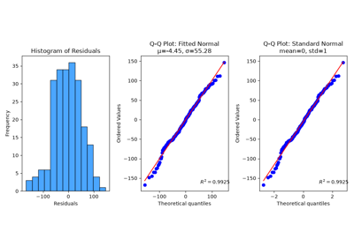

[plot\_residuals\_distribution with examples](regression/plot_residuals_distribution_script.html)

plot\_residuals\_distribution with examples

## Seaborn[#](#id15 "Link to this heading")

Examples related to the [`seaborn`](../apis/scikitplot.seaborn.html#module-scikitplot.seaborn "scikitplot.seaborn") submodule
with a scikit-learn regressor (e.g., [`LinearRegression`](https://scikit-learn.org/dev/modules/generated/sklearn.linear_model.LinearRegression.html#sklearn.linear_model.LinearRegression "(in scikit-learn v1.10)")) instance.

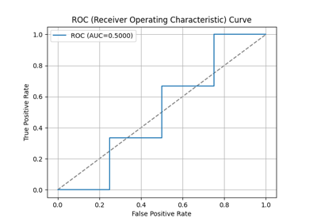

[plot\_aucplot\_script with examples](seaborn/plot_aucplot_script.html)

plot\_aucplot\_script with examples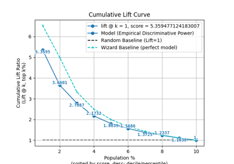

[plot\_decileplot\_script with examples](seaborn/plot_decileplot_script.html)

plot\_decileplot\_script with examples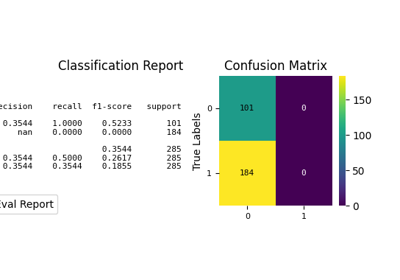

[plot\_evalplot\_script with examples](seaborn/plot_evalplot_script.html)

plot\_evalplot\_script with examples

## Stats[#](#stats "Link to this heading")

Examples related to the [`stats`](../apis/scikitplot.stats.html#module-scikitplot.stats "scikitplot.stats") submodule with e.g. [`LinearRegression`](https://scikit-learn.org/dev/modules/generated/sklearn.linear_model.LinearRegression.html#sklearn.linear_model.LinearRegression "(in scikit-learn v1.10)") instance.

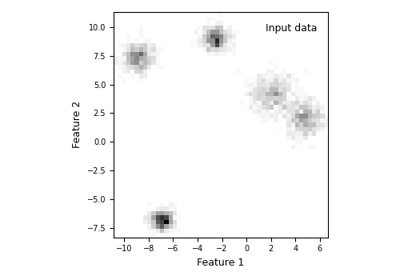

[Gaussian Mixture Models — AIC, AICc, and BIC Model Selection](stats/plot_gaussian_mixture_models.html)

Gaussian Mixture Models — AIC, AICc, and BIC Model Selection

[plot\_residuals\_distribution with examples](stats/plot_residuals_distribution_script.html)

plot\_residuals\_distribution with examples

## Visualkeras[#](#visualkeras "Link to this heading")

Examples related to the [`visualkeras`](../apis/scikitplot.visualkeras.html#module-scikitplot.visualkeras "scikitplot.visualkeras") submodule with
e.g. a DL (ANN, CNN, NLP) [`tf.keras.Model`](https://www.tensorflow.org/api_docs/python/tf/keras/Model "(in TensorFlow v2.8)") model instance.

> **Important**
> * ⚠️ Hugging Face Deprecated Transformers models are not supported in TensorFlow — use KerasNLP or KerasHub instead.
* [🚫 transformers deprecated models](https://www.linkedin.com/feed/update/urn:li:activity:7338966863403528192/).
```
# 💡visualkeras Need aggdraw tensorflow or tensorflow-cpu
pip install scikitplot[core, cpu]

# (Recommended)
# !pip install aggdraw
# !pip install tensorflow

python -c "import tensorflow as tf, google.protobuf as pb; print('tf', tf.__version__); print('protobuf', pb.__version__)"
python -m pip check

# If Needed
# pip install -U "protobuf<6"
# pip install protobuf==5.29.4
import tensorflow as tf

```
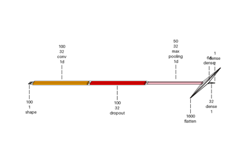

[Visualkeras: Spam Classification Conv1D Dense Example](visualkeras/plot_dl_ann_conv_dense.html)

Visualkeras: Spam Classification Conv1D Dense Example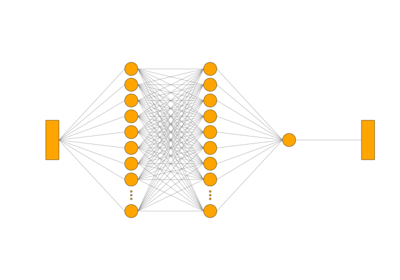

[visualkeras: Spam Dense example](visualkeras/plot_dl_ann_dense.html)

visualkeras: Spam Dense example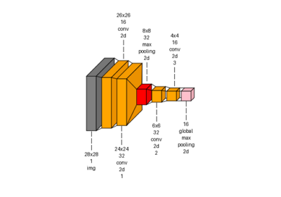

[visualkeras: autoencoder example](visualkeras/plot_dl_cnn_autoencoder.html)

visualkeras: autoencoder example

[visualkeras: custom vgg16 example](visualkeras/plot_dl_cnn_custom_vgg16.html)

visualkeras: custom vgg16 example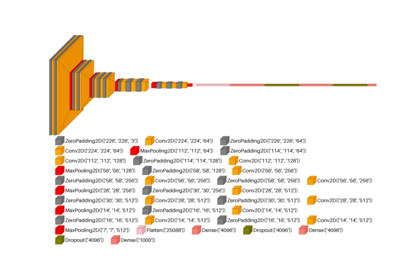

[visualkeras: custom vgg16 show dimension example](visualkeras/plot_dl_cnn_custom_vgg16_show_dimension.html)

visualkeras: custom vgg16 show dimension example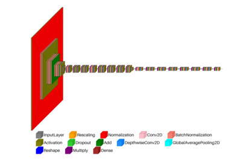

[visualkeras: EfficientNetV2 example](visualkeras/plot_dl_cnn_efficientnetv2.html)

visualkeras: EfficientNetV2 example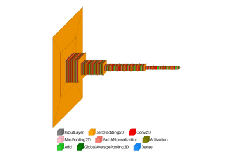

[visualkeras: ResNetV2 example](visualkeras/plot_dl_cnn_resnetv2.html)

visualkeras: ResNetV2 example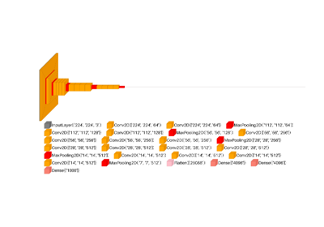

[visualkeras: custom VGG example](visualkeras/plot_dl_cnn_vgg.html)

visualkeras: custom VGG example

[visualkeras: Vector Index DB](visualkeras/plot_dl_nlp_vector_index_db.html)

visualkeras: Vector Index DB

[`Download all examples in Python source code: auto_examples_python.zip`](../_downloads/07fcc19ba03226cd3d83d4e40ec44385/auto_examples_python.zip)

[`Download all examples in Jupyter notebooks: auto_examples_jupyter.zip`](../_downloads/6f1e7a639e0699d6164445b55e6c116d/auto_examples_jupyter.zip)

[Gallery generated by Sphinx-Gallery](https://sphinx-gallery.github.io)