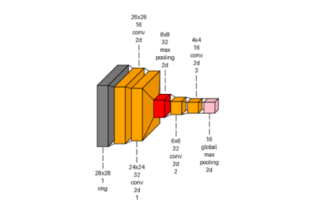

> **Note**
> [Go to the end](#sphx-glr-download-auto-examples-lean-plot-lean-layers-script-py)
to download the full example code or to run this example in your browser via JupyterLite or Binder.

# Index a Lean Project over its Saved Dependencies with LeanIndex[#](#index-a-lean-project-over-its-saved-dependencies-with-leanindex "Link to this heading")

A Lean project sits on dependencies far larger than itself: a few hundred
files over mathlib’s ten thousand. Reading the dependency once, saving its
index, and adding each project over it as a **layer** keeps the cost of a
review to the project’s own files, with the same reports as one index of
everything. This example:

1. indexes a dependency once and saves it to one file;
2. loads it and adds a project over it;
3. checks the layered index against one index of both folders;
4. reports on the project’s layer only, while every use still counts;
5. lists a module two layers both provide, and statements a project
   restates from its dependency;
6. puts two projects over one saved dependency;
7. runs the same from the command line, failing on the project’s flags only;
8. refreshes after an edit, reading again only the files that changed;
9. times reading everything against loading and adding, on a generated
   dependency.

Everything runs on files the example writes: no Lean toolchain, no download.

> **Note**
> The index is lexical: it reads the text, it does not check proofs. Its
reports name the kernel checks (`lake build`, `#print axioms`) that
decide.
```
# Authors: The scikit-plots developers
# SPDX-License-Identifier: BSD-3-Clause

```
```
from __future__ import annotations

import contextlib
import io
import json
import tempfile
import textwrap
import time
from pathlib import Path

from scikitplot.lean import LeanIndex
from scikitplot.lean._index import main

work = Path(tempfile.mkdtemp(prefix="lean_layers_"))


def project(name, files):
    """Write *files* (path to Lean source) under a new folder and return it."""
    root = work / name
    for path, source in files.items():
        target = root / path
        target.parent.mkdir(parents=True, exist_ok=True)
        target.write_text(textwrap.dedent(source).lstrip("\n"), encoding="utf-8")
    return root

```

## 1. A dependency, indexed once and saved[#](#a-dependency-indexed-once-and-saved "Link to this heading")

`LeanIndex.save` writes the index to one file: numbers and text only,
a checksum, the same bytes for the same files. Nothing in it runs when it
is loaded.

```
library = project(
    "library",
    {
        "Lib/Defs.lean": """
            def Good (n : Nat) : Prop := n = n
            theorem shaky : 1 = 1 := sorry
        """,
        "Lib/Util.lean": """
            import Lib.Defs
            theorem good_all (n : Nat) : Good n := rfl
            theorem uses_shaky : 1 = 1 := shaky
            theorem unused : 2 = 2 := rfl
        """,
    },
)
saved = LeanIndex.from_folder(library).save(work / "library.leanidx")
again = LeanIndex.from_folder(library).save(work / "again.leanidx")
print(f"{saved.name}: {saved.stat().st_size:,} bytes")
print("same bytes from a second build:", saved.read_bytes() == again.read_bytes())

```
```
library.leanidx: 2,472 bytes
same bytes from a second build: True

```

## 2. A project over the dependency[#](#a-project-over-the-dependency "Link to this heading")

`LeanIndex.load` reads the saved dependency (`root` is where its
files are, to quote statements); `LeanIndex.add_folder` reads only
the project’s files, labelled `name:path`. The project’s names resolve
into the layer below.

```
app = project(
    "app",
    {
        "App/Main.lean": """
            import Lib.Util
            theorem main : ∀ n, Good n := fun n => good_all n
            theorem main_shaky : 1 = 1 := uses_shaky
        """,
    },
)
index = LeanIndex.load(saved, root=library)
index.add_folder(app, name="app")
dossier = index.dossier("main_shaky")
print(dossier["target"]["file"], "-", dossier["verdict"])
for item in dossier["dependencies"]["red_flags"]["items"]:
    steps = " -> ".join(f"{s['declaration']} ({s['file']})" for s in item["path"])
    print("  ", item["flags"], "via main_shaky ->", steps)

```
```
app:App/Main.lean - lexical red flags: named_dependencies
   ['sorry'] via main_shaky -> uses_shaky (Lib/Util.lean) -> shaky (Lib/Defs.lean)

```

## 3. The same as one index of both folders[#](#the-same-as-one-index-of-both-folders "Link to this heading")

Copy both into one folder and read it whole: once the `app:` prefix is
set aside, the dossiers are the same.

```
both = project(
    "both",
    {
        str(p.relative_to(folder)): p.read_text(encoding="utf-8")
        for folder in (library, app)
        for p in folder.rglob("*.lean")
    },
)
whole = LeanIndex.from_folder(both)


def essence(report):
    """A dossier without the layer prefix of its labels, nor quoted text."""
    found = json.loads(json.dumps(report, sort_keys=True).replace('"app:', '"'))
    found["target"].pop("statement", None)
    for item in found["statement"]["local_definitions"]["items"]:
        item.pop("text", None)
        item.pop("text_cut", None)
    return found


for name in ("main", "main_shaky"):
    print(name, "same:", essence(index.dossier(name)) == essence(whole.dossier(name)))

```
```
main same: True
main_shaky same: True

```

## 4. Reports on one layer[#](#reports-on-one-layer "Link to this heading")

`layer=` in `LeanIndex.summary`, `LeanIndex.discover` and
`LeanIndex.export` describes one layer’s files (`""` is the
first). Uses are still counted across layers: the dependency’s
`good_all` is load-bearing because the project names it, and listed
only in the dependency’s layer.

```
for layer in ("", "app"):
    summary = index.summary(layer=layer)
    found = index.discover(layer=layer)
    print(
        f"layer {layer!r}: {summary['files']} file(s),"
        f" {summary['declarations']} declarations, flags {sorted(summary['flags'])};"
        f" headline {[i['declaration'] for i in found['headline_results']['items']]}"
    )
rules = index.discover(layer="")["rules"]["load_bearing_theorems"]["items"]
print({i["declaration"]: i["named_from_files"] for i in rules})

```
```
layer '': 2 file(s), 5 declarations, flags ['sorry']; headline []
layer 'app': 1 file(s), 2 declarations, flags []; headline ['main', 'main_shaky']
{'good_all': 1, 'shaky': 1, 'uses_shaky': 1}

```

## 5. A module two layers provide[#](#a-module-two-layers-provide "Link to this heading")

Lean gives each module one name across all packages, and refuses a build
where two provide it. The lower layer’s file is used; the other is listed.

```
fork = project("fork", {"Lib/Defs.lean": "def Good (n : Nat) : Prop := True\n"})
index.add_folder(fork, name="fork")
print(index.summary()["imports"]["module_clashes"]["items"])

```
```
[{'module': 'Lib.Defs', 'used': 'Lib/Defs.lean', 'also_in': 'fork:Lib/Defs.lean'}]

```

`LeanIndex.near_duplicates` pairs results whose statements are nearly
the same, one side in each layer asked for. The search is exact: every
pair at or above the threshold, none below.

```
restating = project(
    "restating",
    {
        "Re/A.lean": """
            import Lib.Util
            theorem good_all' (n : Nat) (h : 0 ≤ n) : Good n := good_all n
        """,
    },
)
index.add_folder(restating, name="re")
for pair in index.near_duplicates(threshold=0.5, layer="re", against="")["pairs"][
    "items"
]:
    print(
        f"{pair['similarity']:.0%}: {pair['a']['declaration']} ({pair['a']['file']})"
        f" ~ {pair['b']['declaration']} ({pair['b']['file']})"
    )

```
```
56%: good_all (Lib/Util.lean) ~ good_all' (re:Re/A.lean)

```

With `keep_shapes=True` the statement shapes are kept when the files are
read, and saved: the search then reads no file, so a saved dependency is
enough, without its folder.

```
kept = LeanIndex.from_folder(library, keep_shapes=True).save(work / "kept.leanidx")
blind = LeanIndex.load(kept)  # no root: the library's files are not read
blind.add_folder(restating, name="re")
found = blind.near_duplicates(threshold=0.5, layer="re", against="")
print(found["pairs"]["count"], "pair(s); files not read:", found["files_not_read"]["count"])

```
```
1 pair(s); files not read: 0

```

## 6. Two projects over one dependency[#](#two-projects-over-one-dependency "Link to this heading")

Each review loads the same saved file: one index per project, one read of
the dependency for all of them. Loading again costs the load, not a
second reading of the library.

```
other = project(
    "other",
    {"Other/A.lean": "import Lib.Defs\ntheorem other : Good 0 := rfl\n"},
)
for folder, name in ((app, "app"), (other, "other")):
    each = LeanIndex.load(saved)
    each.add_folder(folder, name=name)
    print(name, "-", each.summary(layer=name)["declarations"], "declaration(s) of its own")

```
```
app - 2 declaration(s) of its own
other - 1 declaration(s) of its own

```

## 7. The command line[#](#the-command-line "Link to this heading")

`--base FILE` loads the dependency and adds `FOLDER` over it, named
`--name` or the folder’s name; `--layer` limits the summary and
`--fail-on` to one layer, so a pipeline fails on the project’s own
`sorry` and not on a dependency’s.

```
for layer in ("app", ""):
    with contextlib.redirect_stdout(io.StringIO()):
        status = main(
            [str(app), "--base", str(saved), "--layer", layer, "--fail-on", "sorry"]
        )
    print(f"--layer {layer!r}: exit {status}")

```
```
--layer 'app': exit 0
--layer '': exit 1

```

## 8. Refresh after an edit[#](#refresh-after-an-edit "Link to this heading")

`LeanIndex.refresh` reads every file of one layer once, for its
digest and the commands it defines, and parses only the new and changed
ones. The refreshed index saves to the same bytes as a new read.

```
index = LeanIndex.load(saved, root=library)
index.add_folder(app, name="app")
(app / "App" / "Main.lean").write_text(
    "import Lib.Util\ntheorem main : ∀ n, Good n := sorry\n", encoding="utf-8"
)
(app / "App" / "Extra.lean").write_text(
    "import App.Main\ntheorem extra : Good 3 := main 3\n", encoding="utf-8"
)
report = index.refresh("app")
print(
    "changed", report["changed"]["items"], "added", report["added"]["items"],
    "removed", report["removed"]["items"], "- files read:", report["files_read"],
)  # fmt: skip
print("extra:", index.dossier("extra")["flags_found"])
again = LeanIndex.load(saved, root=library)
again.add_folder(app, name="app")
same = index.save(work / "r1.leanidx").read_bytes() == again.save(
    work / "r2.leanidx"
).read_bytes()
print("same bytes as a new read:", same)

```
```
changed ['app:App/Main.lean'] added ['app:App/Extra.lean'] removed [] - files read: 2
extra: ['sorry']
same bytes as a new read: True

```

## 9. Read everything, or load and add[#](#read-everything-or-load-and-add "Link to this heading")

A generated dependency of 400 modules and a project of 5. Reading both
grows with the dependency; loading it and adding the project grows with
the project.

```
big = {}
for m in range(400):
    head = f"import Dep.M{m - 1}\n" if m else ""
    body = [f"theorem t{m}_{i} : {i} = {i} := rfl" for i in range(20)]
    body.append(f"theorem link{m} : True := {f'link{m - 1}' if m else 'trivial'}")
    big[f"Dep/M{m}.lean"] = head + "\n".join(body) + "\n"
dep = project("dep", big)
mine = {
    f"Mine/P{k}.lean": f"import Dep.M399\ntheorem mine{k} : True := link399\n"
    for k in range(5)
}
proj = project("proj", mine)
combined = project("combined", {**big, **mine})

start = time.perf_counter()
LeanIndex.from_folder(combined).dossier("mine4")
read_all = time.perf_counter() - start
dep_saved = LeanIndex.from_folder(dep).save(work / "dep.leanidx")
start = time.perf_counter()
layered = LeanIndex.load(dep_saved)
layered.add_folder(proj, name="proj")
reached = layered.dossier("mine4")["dependencies"]["declarations"]
load_add = time.perf_counter() - start
print(f"read both: {read_all:.2f} s; load and add: {load_add:.2f} s")
print("mine4 reaches", reached, "declarations through the dependency")

```
```
read both: 0.86 s; load and add: 0.04 s
mine4 reaches 400 declarations through the dependency

```

Tags: [model-workflow: lean](../../_tags/model-workflow-lean.html) [plot-type: text](../../_tags/plot-type-text.html) [level: intermediate](../../_tags/level-intermediate.html) [purpose: showcase](../../_tags/purpose-showcase.html)

****Total running time of the script:**** (0 minutes 1.912 seconds)

[](https://mybinder.org/v2/gh/scikit-plots/scikit-plots/main?urlpath=lab/tree/notebooks/auto_examples/lean/plot_lean_layers_script.ipynb)[](../../lite/lab/index.html?path=auto_examples/lean/plot_lean_layers_script.ipynb)

[`Download Jupyter notebook: plot_lean_layers_script.ipynb`](../../_downloads/5b998608e436704b74f50a3b1fc2336b/plot_lean_layers_script.ipynb)

[`Download Python source code: plot_lean_layers_script.py`](../../_downloads/8f921e588165d7ea605b6db1ee7d7826/plot_lean_layers_script.py)

[`Download zipped: plot_lean_layers_script.zip`](../../_downloads/9f4fd4f8440856241232481c331c12cc/plot_lean_layers_script.zip)

Related examples


[Gather the Evidence on a Lean Proof with LeanIndex](plot_lean_index_script.html)

Gather the Evidence on a Lean Proof with LeanIndex

[Audit an AI-Assisted Formal Proof with LeanIndex](plot_lean_audit_script.html)

Audit an AI-Assisted Formal Proof with LeanIndex

[Read Lean Proofs with LeanReader: Tracing Every Line of a Formal Development](../corpus/plot_corpus_lean_reader_script.html)

Read Lean Proofs with LeanReader: Tracing Every Line of a Formal Development

[visualkeras: autoencoder example](../visualkeras/plot_dl_cnn_autoencoder.html)

visualkeras: autoencoder example

[Gallery generated by Sphinx-Gallery](https://sphinx-gallery.github.io)