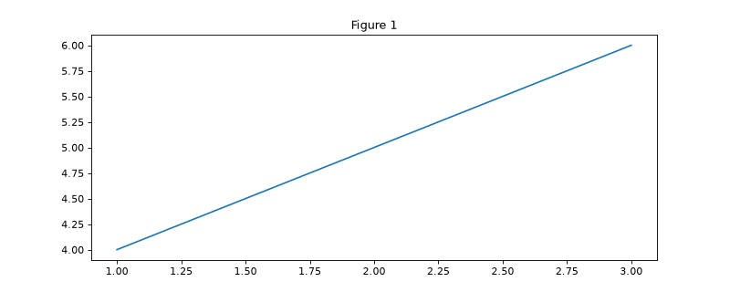
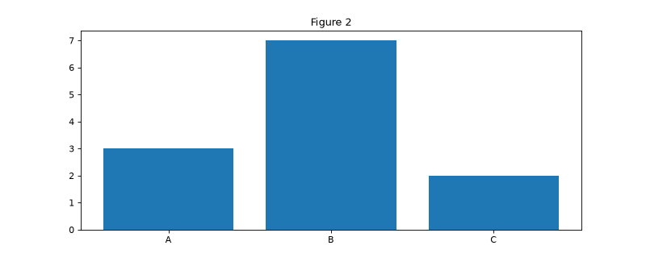
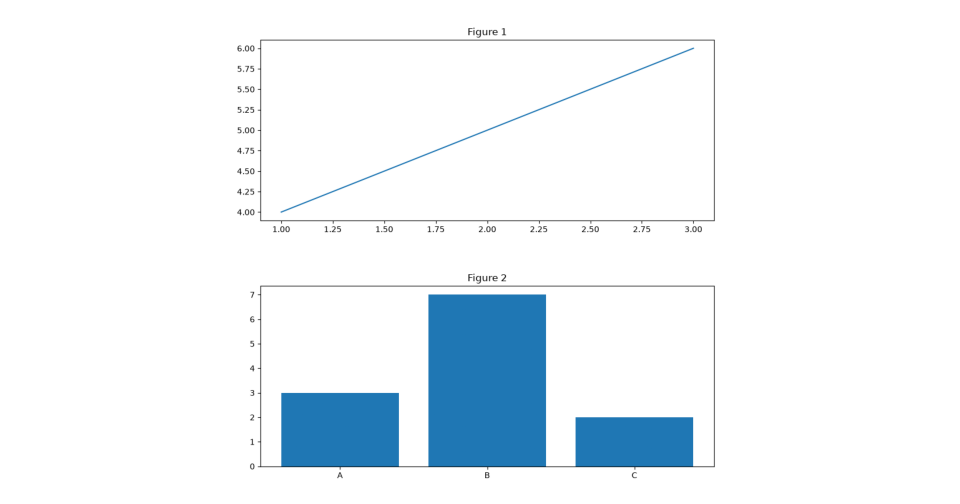

# stack[#](#stack "Link to this heading")

scikitplot.api.stack(**\*figs**, **orient='vertical'**, **padding=None**, **\*\*kwargs**)[[source]](https://github.com/scikit-plots/scikit-plots/blob/fbd8e1af/scikitplot/utils/_matplotlib.py#L417)[#](#scikitplot.api.stack "Link to this definition")
:   Stack multiple matplotlib figures into a single combined figure.

    Save it (if specified).

    Parameters:
    :   ****figs****tuple of matplotlib.figure.Figure
        :   Figures to be combined.

        ****orient****{‘vertical’, ‘horizontal’, ‘v’, ‘h’, ‘x’, ‘y’}, default=’vertical’
        :   Direction to stack the figures.

        ****padding****float, optional
        :   Space between stacked figures, in inches.

        ****\*\*kwargs****dict
        :   Additional keyword arguments passed to plt.subplots() (e.g., figsize, dpi).

    Returns:
    :   matplotlib.figure.Figure
        :   A new combined figure containing all input figures.

    Other Parameters:
    :   ****%(\_save\_plot\_decorator\_kwargs\_doc)s****

    Parameters:
    :   * ****figs**** ([**tuple**](https://docs.python.org/3/builtins/stdtypes.html#tuple "(in Python v3.15)"))
        * ****orient**** ([**str**](https://docs.python.org/3/builtins/stdtypes.html#str "(in Python v3.15)"))
        * ****padding**** ([**float**](https://docs.python.org/3/builtins/functions.html#float "(in Python v3.15)") **|** **None**)

    Examples

    Try it in your browser!
    ```
    >>> import matplotlib.pyplot as plt
    >>> fig1, ax1 = plt.subplots()
    >>> ax1.plot([1, 2, 3], [4, 5, 6])
    >>> ax1.set_title("Figure 1")
    >>> fig2, ax2 = plt.subplots()
    >>> ax2.bar(["A", "B", "C"], [3, 7, 2])
    >>> ax2.set_title("Figure 2")
    >>> import scikitplot as sp
    >>> fig = sp.stack(fig1, fig2)

    ```

    ([`Source code`](../../_downloads/264a49381e445acdb35857bb2a96f8b8/scikitplot-api-stack-1.py))

    


    ([`png`](../../_downloads/79408530b0648e058645111b881cf7a2/scikitplot-api-stack-1_00.png))[#](#id1 "Link to this image")


    


    ([`png`](../../_downloads/1af446ae53d6d6977416db05c71dcc84/scikitplot-api-stack-1_01.png))[#](#id2 "Link to this image")


    


    ([`png`](../../_downloads/7e3a10a62c9d934031268b6a06b6b693/scikitplot-api-stack-1_02.png))[#](#id3 "Link to this image")

    Go BackOpen In Tab