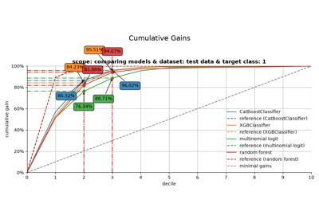

# summarize\_selection[#](#summarize-selection "Link to this heading")

scikitplot.decile.summarize\_selection(**plot\_input**, **\***, **ntile=10**)[[source]](https://github.com/scikit-plots/scikit-plots/blob/1037dde0/scikitplot/decile/_decile_modelplotpy.py#L4152)[#](#scikitplot.decile.summarize_selection "Link to this definition")
:   Return a standardized summary row per group at a selected ntile.

    Parameters:
    :   ****plot\_input****pandas.DataFrame
        :   Output of [`ModelPlotPy.plotting_scope`](scikitplot.decile.ModelPlotPy.html#scikitplot.decile.ModelPlotPy.plotting_scope "scikitplot.decile.ModelPlotPy.plotting_scope").

        ****ntile****int
        :   Ntile to summarize (must exist in plot\_input).

    Returns:
    :   pandas.DataFrame
        :   One row per group with standardized fields.

            Columns include:

            * model\_label, dataset\_label, target\_class
            * ntile
            * tot, pos, pct
            * cumtot, cumpos, cumpct
            * cumlift, cumgain

    Raises:
    :   \_PlotInputError
        :   If required columns are missing.

        ValueError
        :   If ntile is outside valid range.

    Parameters:
    :   * ****plot\_input**** ([**DataFrame**](https://pandas.pydata.org/docs/dev/reference/api/pandas.DataFrame.html#pandas.DataFrame "(in pandas v3.2)"))
        * ****ntile**** ([**int**](https://docs.python.org/3/builtins/functions.html#int "(in Python v3.15)"))

    Return type:
    :   [**DataFrame**](https://pandas.pydata.org/docs/dev/reference/api/pandas.DataFrame.html#pandas.DataFrame "(in pandas v3.2)")

    > **See also**
    > [`ModelPlotPy.plotting_scope`](scikitplot.decile.ModelPlotPy.html#scikitplot.decile.ModelPlotPy.plotting_scope "scikitplot.decile.ModelPlotPy.plotting_scope")

    Notes

    This helper is intended for DS/MLOps workflows where you want a stable,
    audit-friendly view of a chosen operating point (e.g., decile 3).

    Examples

    Try it in your browser!
    ```
    >>> # df = summarize_selection(plot_input, ntile=3)

    ```
    Go BackOpen In Tab

## Gallery examples[#](#gallery-examples "Link to this heading")



[Introduction to modelplotpy](../../auto_examples/decile/plot_modelplotpy_script.html)

Introduction to modelplotpy