:orphan:

# Gallery of sites using this theme[#](#gallery-of-sites-using-this-theme "Link to this heading")

This is a gallery of documentation sites built with `pydata-sphinx-theme`. If you’d like
to add your documentation to this list, add an entry (in alphabetical order) to the list
at the end of [this page](https://github.com/pydata/pydata-sphinx-theme/blob/main/docs/examples/gallery.md)
and open a Pull Request to add it.

## Featured projects[#](#featured-projects "Link to this heading")

These projects are our earliest adopters and/or present some interesting customization.
Check their repositories for more information.

{"version": 1, "interactive": false, "searchVariant": "pill-overflow", "facets": [], "sorts": ["title"], "records": {"sk-collection-item-0": {"title": "ArviZ", "fields": {"title": "ArviZ"}, "search": "ArviZ ArviZ Python docs"}, "sk-collection-item-1": {"title": "Bokeh", "fields": {"title": "Bokeh"}, "search": "Bokeh Bokeh docs"}, "sk-collection-item-2": {"title": "Brightway", "fields": {"title": "Brightway"}, "search": "Brightway Brightway docs"}, "sk-collection-item-3": {"title": "Jupyter", "fields": {"title": "Jupyter"}, "search": "Jupyter Jupyter docs"}, "sk-collection-item-4": {"title": "Jupyter Book", "fields": {"title": "Jupyter Book"}, "search": "Jupyter Book Jupyter Book docs"}, "sk-collection-item-5": {"title": "Matplotlib", "fields": {"title": "Matplotlib"}, "search": "Matplotlib Matplotlib docs"}, "sk-collection-item-6": {"title": "MNE-Python", "fields": {"title": "MNE-Python"}, "search": "MNE-Python MNE-Python docs"}, "sk-collection-item-7": {"title": "NetworkX", "fields": {"title": "NetworkX"}, "search": "NetworkX NetworkX docs"}, "sk-collection-item-8": {"title": "NumPy", "fields": {"title": "NumPy"}, "search": "NumPy NumPy docs"}, "sk-collection-item-9": {"title": "Pandas", "fields": {"title": "Pandas"}, "search": "Pandas Pandas docs"}, "sk-collection-item-10": {"title": "SciPy", "fields": {"title": "SciPy"}, "search": "SciPy SciPy docs"}, "sk-collection-item-11": {"title": "scikit-learn", "fields": {"title": "scikit-learn"}, "search": "scikit-learn scikit-learn docs"}, "sk-collection-item-12": {"title": "SEPAL", "fields": {"title": "SEPAL"}, "search": "SEPAL SEPAL docs"}}, "collectionId": ""}ArviZ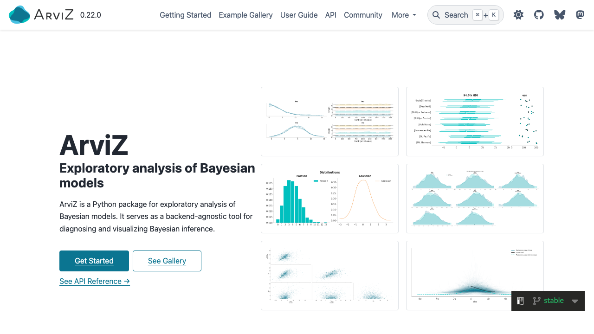
[ArviZ Python docs](https://python.arviz.org/)Bokeh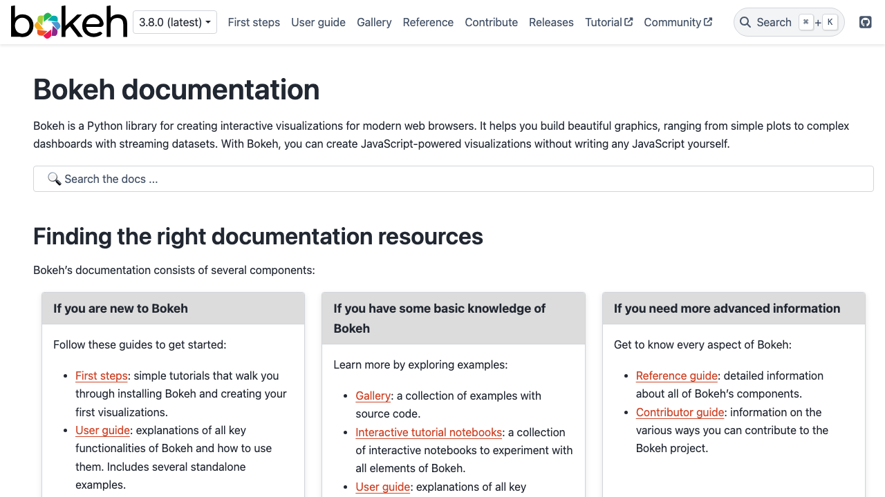
[Bokeh docs](https://docs.bokeh.org/en/latest/)Brightway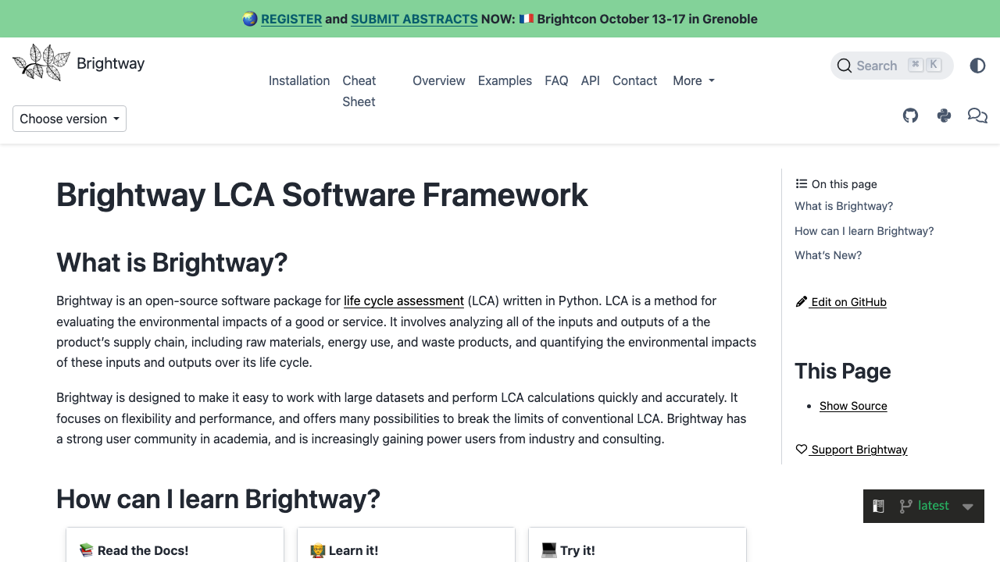
[Brightway docs](https://docs.brightway.dev/en/latest/)Jupyter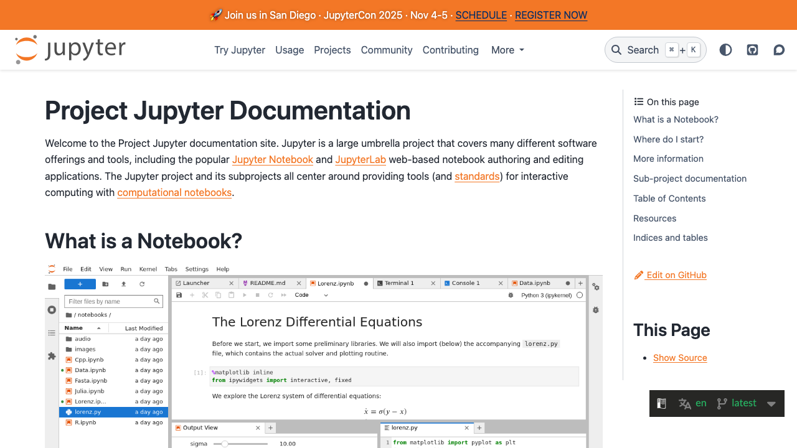
[Jupyter docs](https://docs.jupyter.org/en/latest/)Jupyter Book
[Jupyter Book docs](https://jupyterbook.org/v1/intro.html)Matplotlib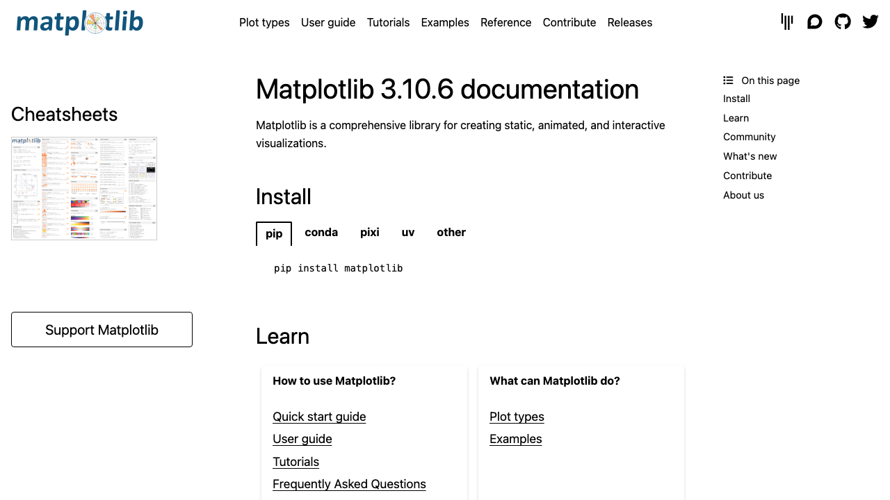
[Matplotlib docs](https://matplotlib.org/stable/)MNE-Python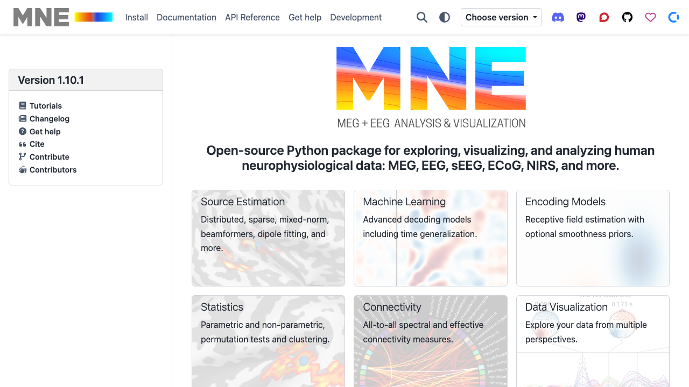
[MNE-Python docs](https://mne.tools/stable/index.html)NetworkX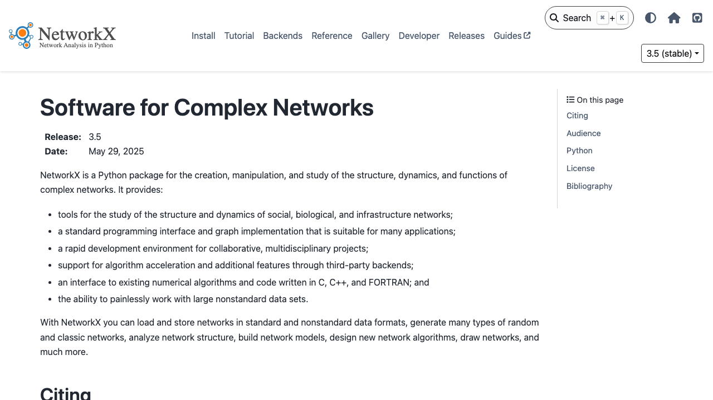
[NetworkX docs](https://networkx.org/documentation/stable/)NumPy
[NumPy docs](https://numpy.org/doc/stable/)Pandas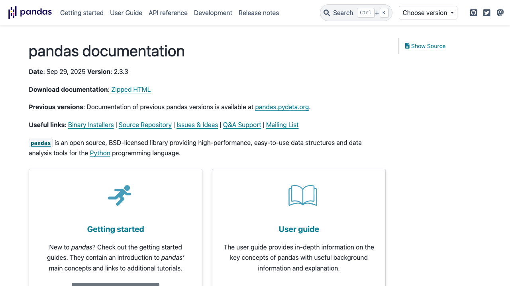
[Pandas docs](https://pandas.pydata.org/docs/)SciPy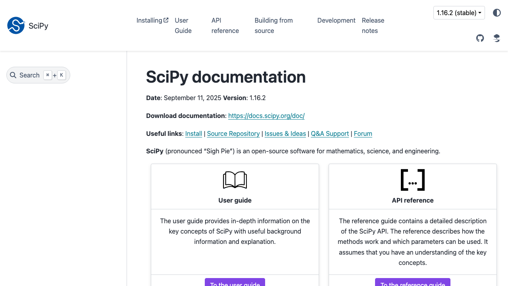
[SciPy docs](https://docs.scipy.org/doc/scipy/)scikit-learn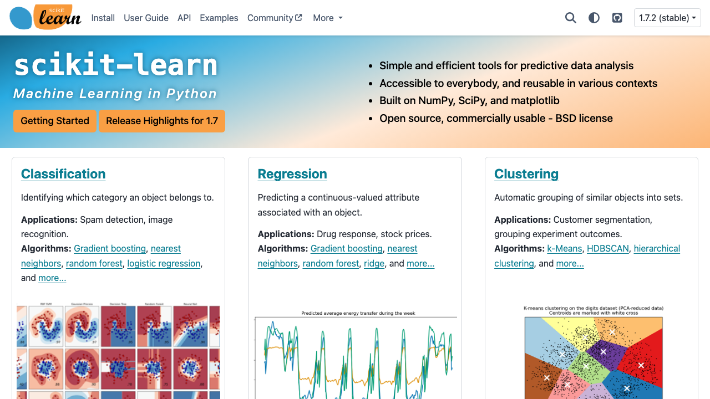
[scikit-learn docs](https://scikit-learn.org/stable/)SEPAL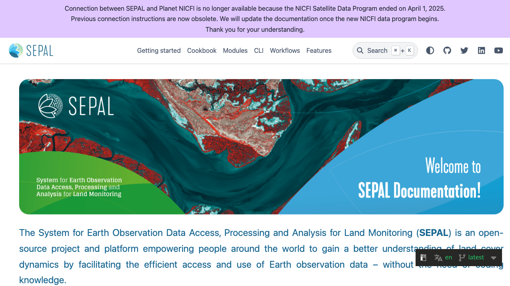
[SEPAL docs](https://docs.sepal.io/en/latest/index.html)

## Other projects using this theme[#](#other-projects-using-this-theme "Link to this heading")

Here are some other projects using `pydata-sphinx-theme` for their documentation.
Thanks for your support!

{"version": 1, "interactive": false, "searchVariant": "pill-overflow", "facets": [], "sorts": ["title"], "records": {"sk-collection-item-13": {"title": "Binder", "fields": {"title": "Binder"}, "search": "Binder Binder docs"}, "sk-collection-item-14": {"title": "BrainGlobe", "fields": {"title": "BrainGlobe"}, "search": "BrainGlobe BrainGlobe docs"}, "sk-collection-item-15": {"title": "cashocs", "fields": {"title": "cashocs"}, "search": "cashocs cashocs docs"}, "sk-collection-item-16": {"title": "CuPy", "fields": {"title": "CuPy"}, "search": "CuPy CuPy docs"}, "sk-collection-item-17": {"title": "DecentralChain", "fields": {"title": "DecentralChain"}, "search": "DecentralChain DecentralChain docs"}, "sk-collection-item-18": {"title": "Fairlearn", "fields": {"title": "Fairlearn"}, "search": "Fairlearn Fairlearn docs"}, "sk-collection-item-19": {"title": "Falcon web framework", "fields": {"title": "Falcon web framework"}, "search": "Falcon web framework The Falcon web framework"}, "sk-collection-item-20": {"title": "Feature-engine", "fields": {"title": "Feature-engine"}, "search": "Feature-engine Feature-engine docs"}, "sk-collection-item-21": {"title": "idtracker&period;ai", "fields": {"title": "idtracker&period;ai"}, "search": "idtracker&period;ai idtracker&period;ai docs"}, "sk-collection-item-22": {"title": "itom measurement and simulation software", "fields": {"title": "itom measurement and simulation software"}, "search": "itom measurement and simulation software itom documentation"}, "sk-collection-item-23": {"title": "movement", "fields": {"title": "movement"}, "search": "movement movement docs"}, "sk-collection-item-24": {"title": "Pastas", "fields": {"title": "Pastas"}, "search": "Pastas Pastas docs"}, "sk-collection-item-25": {"title": "PhaseFieldX", "fields": {"title": "PhaseFieldX"}, "search": "PhaseFieldX PhaseFieldX docs"}, "sk-collection-item-26": {"title": "PyVista", "fields": {"title": "PyVista"}, "search": "PyVista PyVista docs"}}, "collectionId": ""}Binder[Binder docs](https://mybinder.readthedocs.io/en/latest/index.html)BrainGlobe[BrainGlobe docs](https://brainglobe.info)cashocs[cashocs docs](https://cashocs.readthedocs.io/en/stable/)CuPy[CuPy docs](https://docs.cupy.dev/en/stable/index.html)DecentralChain[DecentralChain docs](https://docs.decentralchain.io/en/master/)Fairlearn[Fairlearn docs](https://fairlearn.org/main/about/)Falcon web framework[The Falcon web framework](https://falcon.readthedocs.io/)Feature-engine[Feature-engine docs](https://feature-engine.readthedocs.io/)idtracker.ai[idtracker&period;ai docs](https://idtracker.ai/)itom measurement and simulation software[itom documentation](https://itom-project.github.io/latest/docs/index.html)movement[movement docs](https://movement.neuroinformatics.dev)Pastas[Pastas docs](https://pastas.readthedocs.io/)PhaseFieldX[PhaseFieldX docs](https://phasefieldx.readthedocs.io/en/latest/index.html)PyVista[PyVista docs](https://docs.pyvista.org)