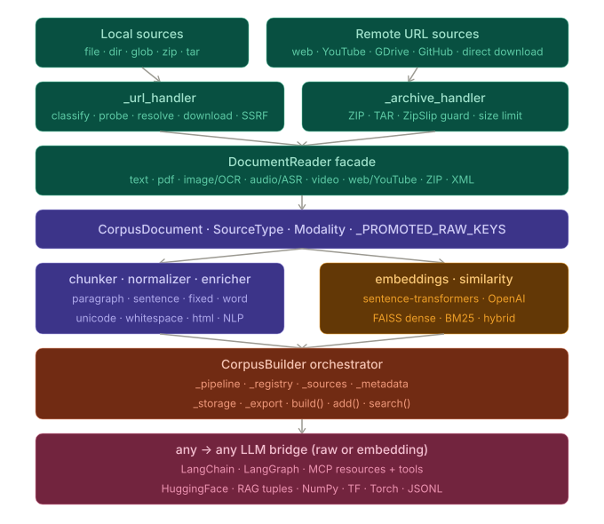

# Corpus User Guide[#](#corpus-user-guide "Link to this heading")

## Corpus (Remarks Citation) Generation[#](#corpus-remarks-citation-generation "Link to this heading")



## Quick start[#](#quick-start "Link to this heading")

Examples

```
# First we download the media preproccess libraries (text, image, audio or video).
# pip install nltk gensim langdetect faster-whisper openai-whisper pytesseract youtube-transcript-api
# sudo apt-get install tesseract-ocr
# pip install scikit-plots[corpus]
from scikitplot import corpus

print(corpus.__doc__)

```

## Optional backend outcomes[#](#optional-backend-outcomes "Link to this heading")

Media and parser readers keep format-specific fallback semantics while sharing a
small internal orchestration layer. In particular, AudioReader and VideoReader
try `faster-whisper` before `openai-whisper`. With the default
`strict=False`, optional ASR failures warn and may yield no ASR documents
instead of aborting the surrounding Corpus/gallery run.

Fail-soft does not mean unobservable. After a reader run,
`reader.backend_reports` contains JSON-compatible backend provenance and
structured errors. A successful empty transcription is reported as `empty`;
a fallback after a backend failure is `degraded`; total backend failure is
`failed`. Pass `strict=True` when backend exhaustion must raise.

This shared mechanism does not force every reader to use the same fallback
policy. For example, XML parser fallback is only for an unavailable optional
parser, while explicit OCR backend selection remains explicit.

Examples

* [Build a Multi-Source WHO Corpus](../../auto_examples/corpus/plot_corpus_who_per_file_script.html#sphx-glr-auto-examples-corpus-plot-corpus-who-per-file-script-py): Example notebook.

> **See also**
> * [modelcontextprotocol/python-sdk](https://github.com/modelcontextprotocol/python-sdk)
* [semantica-agi/semantica](https://github.com/semantica-agi/semantica)
* <https://docs.getsemantica.ai/guides/distance-intelligence/#common-pitfalls>
> **See also**
> Google’s language-detection:

* [google/cld3](https://github.com/google/cld3)
* <https://pypi.org/project/gcld3/>
* [Mimino666/langdetect](https://github.com/Mimino666/langdetect)
* [shuyo/language-detection](https://github.com/shuyo/language-detection)
* [Abhijit-2592/spacy-langdetect](https://github.com/Abhijit-2592/spacy-langdetect)
* <https://spacy.io/models/en>

facebookresearch:

* [facebookresearch/fastText](https://github.com/facebookresearch/fastText)
* <https://fasttext.cc/>
* [facebookresearch/faiss](https://github.com/facebookresearch/faiss)
* <https://research.facebook.com/research-areas/facebook-ai-research-fair/>